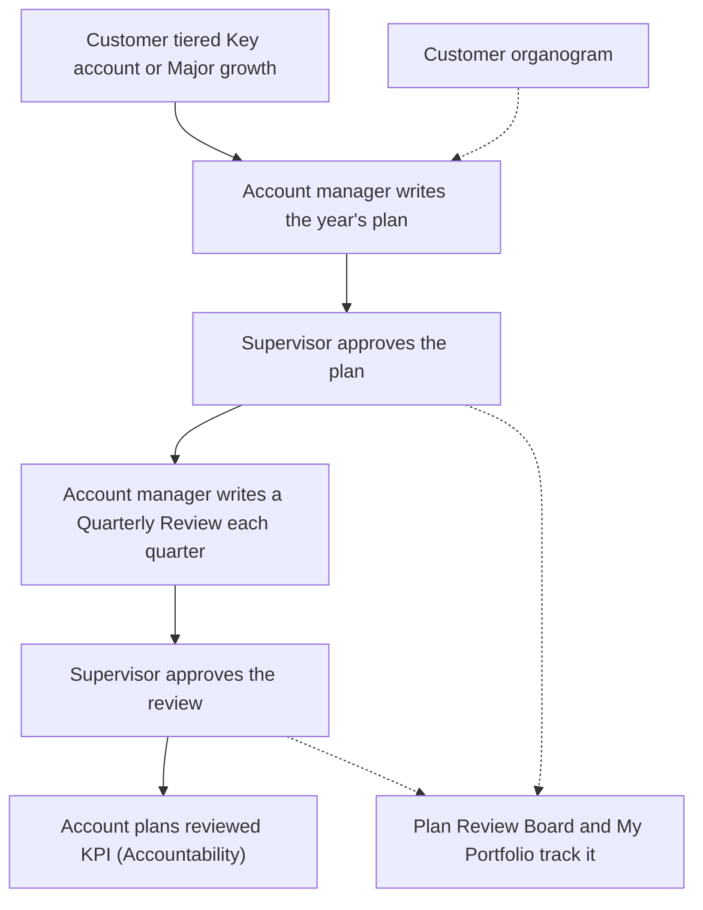

import Illustration from '../../../../components/Illustration.astro';

An **account plan** is an account manager's plan for one customer for one year: what Tritel wants to win there, how, with whom, and what could get in the way. Each customer (a company, not a person) has at most one plan per year. The plan is called after the customer and the year, for example *Customer A · 2026*. A second plan for the same year is refused: *This customer already has a plan for that year.*

Plans matter most for **target accounts** in the two top tiers, **Key account** and **Major growth**. These accounts need an approved plan for the year, and the reminders, the **Plan Review Board** and the account manager KPI all look at them. You can write a plan for any customer, but customers in **Maintain**, or with no tier, aren't chased or counted. Tiers are set on the customer; see [target accounts](/tenders/concepts/market-coverage/#target-accounts).

The plan belongs to the customer's **Account manager**. Their supervisor approves it: the person shown as **Approver**, who is the account manager's **Manager** in the employee record. Once a plan is approved, the account manager writes a short **Quarterly Review** each quarter, and the supervisor approves that too. Each review approved in time counts towards the account manager's **Account plans reviewed** KPI.

## The parts of a plan

<Illustration name="tenders/concept-account-plan-form" caption="An approved plan. The numbers match the list below." />

1. **Quarterly Review** opens the quarterly review you should be working on (shown once the plan is **Approved**). **Revise Plan** puts an approved plan back to **Draft** so it can be changed and approved again.
2. The status: **Draft**, **Submitted**, **Approved**, or **Returned** when the supervisor sends it back with a note (*Returned for changes: …*).
3. **Customer**, **Year** and **Tier**. The **Account manager** is filled in from the customer.
4. **Approver**: the account manager's supervisor.
5. **Due date** and **Timeliness**: the date the plan should be approved by (31 January of its year unless your administrator changed it), and whether it was approved on time. While the plan waits for approval, **Waiting (working days)** shows for how long. **Head of Commercial informed** appears once it has been escalated. See [Account plan due dates, grace days and reminders](/tenders/calculations/account-plan-due-dates/).
6. The five tabs:

| Tab | What goes in it |
|---|---|
| **Goal and awarded value** | **Awarded value goal (attributed)** for the year and the **Q1 goal** to **Q4 goal** (type the year's goal first and the four quarters are filled in with a quarter each). **Focus areas**: the solution pillars to grow. **Won before**: pillars of tenders already won. A table, **Awarded value by quarter (account manager attribution)**, shows **Gross**, **Attributed**, **Goal** and **Attributed, year before** for each quarter, in millions. |
| **Strategy and risks** | **Account strategy** and **Risks**, in your own words. |
| **Key people** | The customer's people who matter: a small organogram, then a list with **Organogram** (where the person sits on the chart), **Person**, **Job title**, **Influence**, **Relationship**, **Covered by**, **Last met** and **Note** (**Reports to** can be shown too). The list follows the chart from the top down, and everyone on it holds a role on the organogram. Choosing the customer on a new plan fills in every active contact of the customer. |
| **Objectives and actions** | **Action**, **Owner**, **Due** and a state: **Open**, **On track**, **Done** or **Dropped**. |
| **Quarterly reviews** | The plan's reviews, read-only: quarter, **Status**, what changed, approval, **Due date** and **Timeliness**. |

## The quarterly review

A **Quarterly Review** looks back at one quarter. It has a **Status** (**Green**, **Amber** or **Red**), **What changed this quarter** (required before you submit) and **Next steps**. It is due 14 days after the quarter ends, and still counts for the KPI if it is approved within 5 more days (**Counts until**). An approved review can't be changed.

In the first days of a quarter, **Quarterly Review** opens the review for the quarter that has just ended, so you can look back at it. Once that review can no longer count, it opens the current quarter. The steps are in [Account plan and quarterly review workflow](/tenders/workflows/account-plan/).

## The customer organogram

The **organogram** is a chart of the customer's people: who holds which role and who reports to whom. It belongs to the customer, not to one plan, so next year's plan uses the same chart. A role can be left without a person, to show a gap. The **Key people** tab shows a small version with gap warnings (for example *No contact at Head of ICT.*), and **Open Full Screen** opens the full chart, where you can add people and roles, change reporting lines, and add people to the plan's key people or take them off it. Everyone in a plan's key people holds a role on the chart. Taking someone off a plan leaves their role in place, because the chart is shared by every year's plan. Logging a customer activity with **Contacts met** sets each person's **Last met** date. See [Map the customer organogram](/tenders/how-to/account-plans/map-the-customer-organogram/).

## On the customer form

Company customers have three buttons at the top of the form, for people allowed to see the plan:

- **Account Plan**: this year's plan, for example *2026 · reviewed 14 Apr*, its status, or *No plan*. Clicking it opens the plan, or starts one for this year.
- **Organogram**: how complete the chart is, for example *5 of 7 roles*, or *Not started*.
- **Awarded, 4Q**: the value awarded in the last 4 quarters (this one included), as attributed to the account manager.

Who can see all this is explained in [Who sees an account plan](/tenders/concepts/account-plan-privacy/).

## How plans feed the account manager KPI

In Accountability, the measure **Account plans reviewed** counts the account manager's Key account and Major growth customers that have a review approved by its **Counts until** date. A second measure, **Awarded value growth vs same quarter last year**, uses the same attributed awarded values as the plan's table. The rules are in [Account manager KPIs](/accountability/calculations/account-manager-kpi/).

## The screens

All four are under **Tender Manager › Tender Customers**:

| Screen | What it is for |
|---|---|
| **Account Plans** | The list of plans you can see, filtered to **This year**. Filters **My plans** and **To approve**. |
| **Plan Reviews** | Quarterly reviews, opening on **To approve** (reviews waiting for you). Supervisors find the reviews waiting here, and approve each one from its plan's **Quarterly reviews** tab. |
| **Plan Review Board** | Every Key account and Major growth customer with its plan and its four quarters, coloured by status, with totals for approvals, waiting and overdue items. |
| **My Portfolio** | An account manager's customers, tiers, plan status, awarded value and pipeline; the **Team** tab gives managers one line per account manager. |

**Tender Manager › My Actions** also lists **Account plans to write**, **Account plans returned to you**, **Account plan reviews due** and, for supervisors, **Account plans and reviews to approve**.

:::note[Good to know]
- The four menus are shown to all staff. Someone who isn't an account manager, a manager of one, or the Head of Commercial sees empty screens.
- **Awarded, 4Q** and the plan's **Awarded value by quarter** table include every attributed award in the period. The KPI **Awarded value growth vs same quarter last year** counts won tenders only, so the figures can differ.
- The plan's **Account manager** is filled in once, when the plan is created. If the customer later gets a new account manager, ask the Head of Commercial to change the **Account manager** on this year's plan; until then, the new account manager can't open it.
:::

## Tasks that use this

- [Write an account plan](/tenders/how-to/account-plans/write-an-account-plan/)
- [Submit a quarterly review](/tenders/how-to/account-plans/submit-a-quarterly-review/)
- [Approve plans and reviews](/tenders/how-to/account-plans/approve-plans-and-reviews/)
- [Map the customer organogram](/tenders/how-to/account-plans/map-the-customer-organogram/)
- [Use the Plan Review Board](/tenders/how-to/account-plans/plan-review-board/)
- [Use My Portfolio](/tenders/how-to/account-plans/my-portfolio/)
