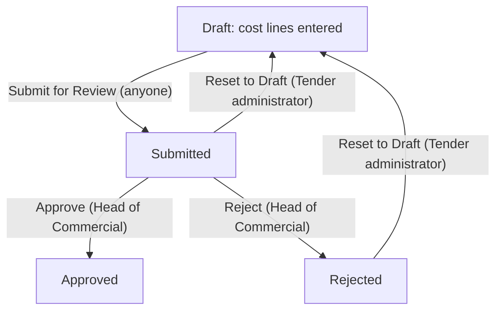

import Illustration from '../../../../components/Illustration.astro';

A **tender business case** sets out what a bid will cost Tritel and the margin it leaves, so the Head of Commercial can approve the price before the bid goes in. Each tender has at most one. Open it with the **Business Case** smart button on the tender; if there isn't one yet, the button creates a draft.

The revenue is the tender's **Expected Revenue**, in KES. You list the costs on the **Cost Breakdown** tab, one line per item: a **Category**, a **Description**, a quantity, a unit price and a currency. The case adds them up:

- **Total Cost**: the sum of the lines, converted to KES.
- **Gross Profit**: Expected Revenue minus Total Cost.
- **Gross Margin (%)**: Gross Profit divided by Expected Revenue, times 100, to one decimal.

KES 5,000,000 of revenue against KES 4,000,000 of cost gives a gross profit of KES 1,000,000 and a margin of **20.0%**. See [Business case margin](/tenders/calculations/business-case-margin/).

<Illustration name="tenders/concept-business-case" caption="A business case waiting for approval. The numbers match the list below." />

1. **Approve** and **Reject** are shown to the Head of Commercial and Tender administrators while the case is **Submitted**. **Reset to Draft** is shown to Tender administrators.
2. The **Status**: **Draft**, **Submitted**, **Approved** or **Rejected**.
3. The tiles: **Revenue**, **Total Cost**, **Gross Profit** and **Margin**, each estimated and, once the tender is won or prequalified, actual.
4. The tabs: **Cost Breakdown**, **Actual vs Estimated** (won or prequalified tenders only) and **Notes & Assumptions**.
5. The cost lines. A **Commissions & Facilitation** line belongs to the Head of Commercial or the Head of Channel (its **Commission Role**); only that head and Tender administrators see its description. Everyone else sees dots, though the amount still counts.

## Cost categories

| Category |
|---|
| **Hardware / Equipment** |
| **Software / Licenses** |
| **Labour (Internal)** |
| **Subcontractors** |
| **Commissions & Facilitation** |

Every line needs a description: *Description is required on all cost lines.*

## How it is approved

**Submit for Review** records who submitted it and when. The Head of Commercial sees it in **My Actions** under **Business cases to approve**, unless they created it themselves, or the tender has been lost, dropped or cancelled. The person who created it sees **Business cases waiting for approval** while it waits, and **Business cases to finish** while it is a draft or rejected. No emails are sent; the full path is the [business case workflow](/tenders/workflows/business-case/).

## Actual against estimated

Once the tender is **Won** or **Prequalified**, the **Actual vs Estimated** tab compares the case with what happened: **Actual Revenue** from the tender's confirmed sales orders, **Actual Cost** from its confirmed purchase orders, the **Actual Gross Profit**, **Actual Margin %** and the **GP Variance (Actual − Estimated)**. Orders count when they are linked to the tender.

:::note[Good to know]
- **Approve** and **Reject** are hidden from other roles, but nothing else stops someone approving. Treat approval as the Head of Commercial's step.
- **Reject** needs a reason: *Please enter a rejection reason before rejecting.* The **Rejection Reason** box only appears once a case is rejected, so the Head of Commercial can't fill it in first on the back-office form. Until this is changed, write the reason in the chatter and ask a Tender administrator to help record it.
- A rejected case can only go back to **Draft** through a Tender administrator.
- The approved budget the delivery team works to after a win is a separate thing, the project's Delivery Budget: see [Delivery Budgets and revisions](/projects/concepts/baselines/). Once a delivery project is opened, the tender's **Projects** button (once called **Delivery projects**) shows its project code, for example **P26-049**.
:::

## Tasks that use this

- [Prepare and approve a business case](/tenders/how-to/bids/business-case/)
- [Business case margin](/tenders/calculations/business-case-margin/)
- [Business case workflow](/tenders/workflows/business-case/)
