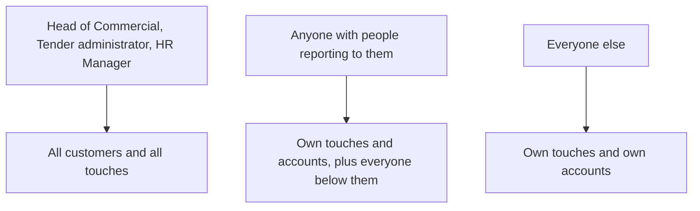

import Illustration from '../../../../components/Illustration.astro';

A **customer activity**, or **touch**, is one contact with a customer: a meeting, a call, a site visit, a workshop, an email that mattered. Logging every touch shows who is talking to which customers, which accounts have gone quiet, and how much support each bid got. Touches also feed the account managers' coverage and, for won tenders, the achievement split.

A touch records:

| Label | Meaning |
|---|---|
| **Customer** | Who was touched. Required. |
| **Date** (or **Planned for**) | When it happened, or when it is planned. |
| **Type** | The kind of touch, such as **Customer Meeting** or **Workshop**. Each type has a default **Channel**: **Call**, **Meeting**, **Visit**, **Email**, **Workshop / Demo**, **Proof of Concept**, **Document / Submission**, **Follow-up (channel not stated)** or **Other**. |
| **Touch made by** (or **Who will make it**) | The person who made the contact. It can be anyone: an account manager, a presales engineer, a head. |
| **Account Manager** | The account's owner. |
| **Tender** or **Lead/Pipeline** | The deal it supports, if any. Pick one or the other; picking one clears the other. |
| **What happened** (or **Notes**) | What the customer said, the outcome and the next step. |

A touch is either **Planned** or **Done**. Logging a touch saves it as done straight away. Planning one saves it as planned, and you complete it later with the outcome.

<Illustration name="tenders/concept-customer-activities" caption="The Customer Activities screen. The numbers match the list below." />

1. **Log touch** records a touch that happened; **Plan touch** records one to come; **List** opens the classic list, pivot, graph and calendar for the same selection.
2. The tabs: **Customers** (a heatmap of touches per customer per month), **People** (one person's profile: how many touches, on which customers, in which phase, acting as what) and **Planned** (planned touches, with **Complete**, **Reschedule** and **Open**, and how many days late).
3. **Showing** picks whose touches you see: **Me**, **My team**, **Everyone** (for those who can see all) or one person. **Made by them only** leaves out touches others made on their accounts.
4. The totals: **Touches**, **Customers** and customers **Quiet > 90 days**.
5. Each row's last-touch colour: **≤ 30 days**, **31–90**, or **> 90 or never**.

The screen is at **Tender Manager › Tender Customers › Customer Activities**. The tender and opportunity forms also show a **Customer touches** strip, and the customer form a **Touchpoints** button that opens the customer's timeline.

## Who sees what

A manager's team is everyone below them in the employee reporting line, at any depth. Trying to open someone else's profile stops with *You can only view profiles of yourself and the people who report to you.*

## What the system works out for each touch

- **When a touch is done:** the date can't be in the future (*Activity date cannot be greater than today!*); the feedback is posted on the linked tender's or opportunity's chatter as *Feedback from customer touch dated …*; and the customer's **Last Seen** date moves forward. A nightly job sorts customers into **Last Seen** bands (1 to 30 days, 31 to 60, 61 to 90, 91 to 120, over 120, never seen).
- **Touch Phase**, by the date of the touch: **Account-level** (no deal linked), **Pipelining** (an opportunity, or before the tender was recorded), **Bid Support** (up to the submission deadline), **Post-submission** (after the deadline, or after the award on a tender that wasn't won) and **Delivery & Collection** (after the award on a won tender).
- **Participant Role**: **Account Manager**, **Presales** or **Bid Liaison** when the person holds that role on the linked deal; otherwise worked out from their job title (for example "Head of…" gives **Leadership**) or their role in the app; else **Other**.
- **Entered Late**: logged more than 7 days after the touch happened.
- **Overdue Plan**: a planned touch whose date has passed. The person making it sees **Overdue planned customer touches** in **My Actions**.
- **Valid** and **Activity Phase**: whether the touch counts towards a won tender's achievement. These go by the date the touch was **entered**, not the date it happened. See [How achievements are split and counted](/tenders/commercial-targets/achievements/).

:::note[Good to know]
- **Touch Phase** (by the touch date) and **Activity Phase** (by the entry date) are different things with similar names. Log touches promptly so the two agree.
- Changing a customer's account manager also moves its planned touches, its **Draft** and **Bidding** tenders and its open opportunities to the new account manager.
:::

## Tasks that use this

- [Log a customer activity](/tenders/how-to/customers/log-a-customer-activity/)
- [Plan customer touches](/tenders/how-to/customers/plan-customer-touches/)
- [Read the Customer Activities screen](/tenders/how-to/customers/read-the-customer-activities-screen/)
- [Customer activity and target account workflow](/tenders/workflows/customer-activity/)
