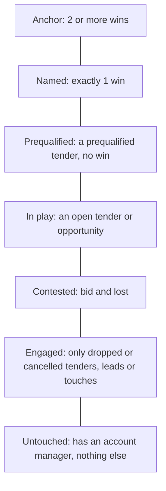

import Illustration from '../../../../components/Illustration.astro';

**Market coverage** answers three questions about Tritel's customers: how far has Tritel got with each one, who owns each account, and which accounts matter most. The answers come from everything already recorded (tenders, opportunities and customer touches), so nobody keeps a separate list.

## The coverage ladder

Every customer sits on one rung of a ladder, the highest one that applies. The system works it out from all their tenders, all their opportunities (archived ones included) and their done touches.

| Rung | When |
|---|---|
| **Anchor** | 2 or more wins: won tenders plus opportunities in a won CRM stage. |
| **Named** | Exactly 1 win. |
| **Prequalified** | A prequalified tender and no win. |
| **In play** | An open tender (**Draft**, **Bidding** or **Evaluation**) or an open opportunity (in the first three CRM stages). |
| **Contested** | A lost tender, or an opportunity that is neither won nor open. |
| **Engaged** | Only dropped or cancelled tenders, raw leads or done touches. |
| **Untouched** | Has an account manager, but nothing else yet. |

A customer with one won tender and one lost tender is **Named**. A customer with a lost tender and an open one in **Bidding** is **In play**. See [The market coverage ladder](/tenders/calculations/coverage-ladder/).

## The Market Coverage screen

**Tender Manager › Tender Customers › Market Coverage** has five tabs: **Overview**, **Accounts**, **Sectors**, **Share of account** and **Account managers**. You can filter by period, account manager and sector; clicking a sector filters every tab. The main figures:

| Figure | Meaning |
|---|---|
| **Customers reached** | Customers on any rung above **Untouched**. |
| **Named share** | **Anchor** and **Named** customers as a share of those reached. |
| **New named this year** | Customers whose first win was this year. |
| **Win rate** | Wins out of decided bids (won plus lost, tenders and opportunities). |
| **Reached, no account manager** | Customers with activity but no owner. |
| **Target accounts named**, **Targets untouched** | How the target accounts are doing. |

What counts as "the market" is a setting (**Market Coverage measures against**): **Engaged customers + assigned accounts** (the default) or **Target accounts**. The screen shows what you are allowed to see: the Head of Commercial, Tender administrators and HR see everyone; others see their own accounts and their team's.

## Account ownership

Every customer should have one **Account Manager**. **Tender Manager › Tender Customers › Account Ownership** lists the customers that need one: those with a tender, opportunity or done touch but no account manager.

<Illustration name="tenders/concept-account-ownership" caption="The Account Ownership list. The numbers match the list below." />

1. **Accept Suggestion**, **Assign To…** and **Mark as Company**: for the Head of Commercial and Tender administrators.
2. **Claim for Me**: for account managers, to take an unowned customer. *Customer A already has an account manager.* if someone owns it already.
3. **Suggested Owner** and **Why**: the one active account manager on its deals (*Account manager on 2 of its deals*); if several, the most recent; if its deals' account managers have all left, none (*Previous account manager archived*); otherwise the account manager who made most of its touches.

Owners are also set without anyone asking: saving a tender or opportunity with an account manager, for a customer that has none, makes that person the owner. And when a customer's account manager changes, its **Draft** and **Bidding** tenders, planned touches and open opportunities move to the new owner.

## Target accounts

A **target account** is a customer Tritel has chosen to pursue, with a **Target Tier**: **Strategic**, **Growth** or **Maintain**. Anyone can **Propose as Target**; the Head of Commercial or a Tender administrator then **Approve**s it (tier **Growth** unless set) or **Decline**s it, or sets a tier directly with **Target: Strategic**, **Target: Growth** or **Target: Maintain**. They do this on the customer form or in **Tender Manager › Tender Customers › Classify Accounts**, which also offers **Apply Suggested Sector** to fill in sectors and segments in bulk. The steps are in the [customer activity and target account workflow](/tenders/workflows/customer-activity/).

Once a customer is proposed or made a target, its form also shows **Target Note**: a free-text line for why it was chosen or what the plan is. **Classify Accounts** has the same column, hidden by default.

## How it counts in Accountability

Coverage feeds measures such as **Named share – deals led**, **Named share – my accounts**, **New named accounts** and **Target accounts named**.

:::note[Good to know]
- The ladder is worked out fresh each time; nobody sets it by hand. To move a customer up, record the tender, opportunity or touch.
- Only the Head of Commercial and Tender administrators can set target accounts: *Only the Head of Commercial or a Tender Administrator can set target accounts. Use "Propose as Target" instead.*
:::

## Tasks that use this

- [Use the Market Coverage screen](/tenders/how-to/customers/market-coverage/)
- [Claim, assign and classify accounts](/tenders/how-to/customers/account-ownership/)
- [The market coverage ladder](/tenders/calculations/coverage-ladder/)
