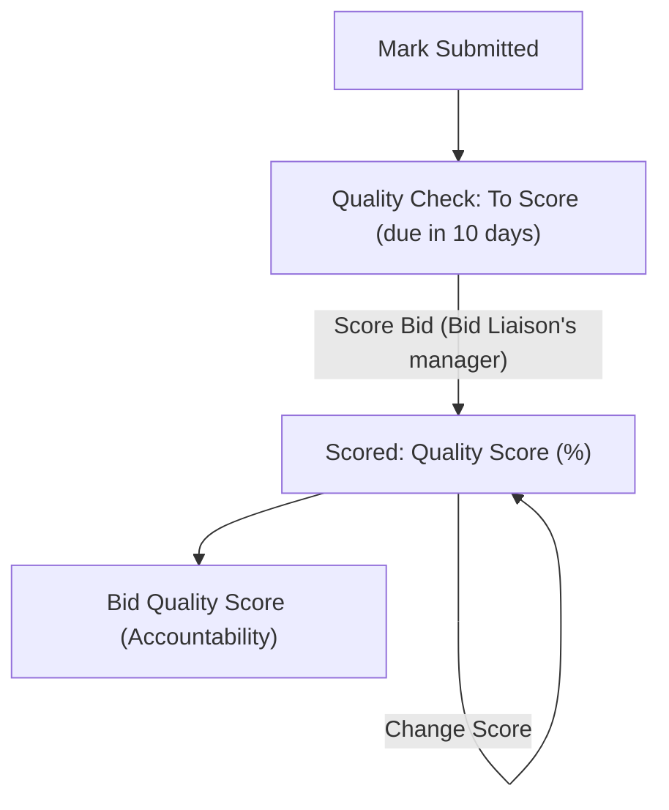

import Illustration from '../../../../components/Illustration.astro';

Three things together measure how well Tritel prepares its bids:

- **Must-win tenders.** The Head of Commercial flags the tenders that matter most. Everyone on the team is told, the deadline is watched more closely, and a confirmed error on a must-win tender counts three times.
- **The bid quality check.** After every submission, the Bid Liaison's manager scores the bid against a fixed list of guidelines. The result is the **Quality Score (%)**.
- **Disqualifications.** When a tender is lost or dropped because of an avoidable error, the person recording it says who caused it, and a manager confirms the cause.

These feed the Accountability measures **Bid Quality Score (Bid Liaison)** and **Bid Compliance (Technical Presales)**. None of these details can be typed in; they change only through the buttons. A direct edit stops with *Must-win, quality check and disqualification details can only be changed with the buttons on the tender.*

<Illustration name="tenders/concept-bid-quality-tab" caption="The Bid Quality tab of a must-win tender after submission. The numbers match the list below." />

1. **Must-Win** group: **Why Must-Win**, **Flagged By** and **Flagged On**. The tender also shows a red **Must-Win** badge.
2. **Submission** group: the **Submission Deadline**, the **Actual Submission** time, **Submitted Late** (ticked when the actual time is after the deadline) and **Submission Recorded**.
3. **Quality Check**: **Not Due**, **To Score** or **Scored**, with **Quality Check Due** while waiting.
4. **Score Bid** (or **Change Score** once scored), shown only to the person who scores this bid.
5. **Disqualification**: **To Confirm** or **Confirmed**, with **Caused By**, **Evidence** and **Confirm By**, and the **Confirm Cause** button for the person who confirms.

The tab appears once a tender is must-win, submitted, or has a disqualification.

## Must-win

Only the Head of Commercial and Tender administrators see **Flag Must-Win** and **Remove Must-Win**. Both ask for a reason. While the tender is **Draft** or **Bidding**, the team (Account Manager, Bid Liaison, Technical Presales and the Bid Liaison's manager) gets an email, *Must-win tender* or *No longer must-win*. Flagging after submission sends no email. A must-win flagged before submission also adds 2 effort points to the Bid Liaison's workload.

Before the deadline, the team gets *Must-win tender closes in 7 day(s)* (and again at 3 days and 1 day), asking them to check signatures, formatting and documents. In **My Actions** they see **Must-win tenders closing soon** for the last 7 days.

## The quality check

The first time a tender moves to **Evaluation**, its **Quality Check** becomes **To Score**, due 10 days later. The person who scores it is:

1. the Bid Liaison's manager (from the employee record); or, if there isn't one,
2. the Head of Commercial; or, failing that,
3. a Tender administrator.

The Bid Liaison never scores their own bid. In the **Bid Quality Check** window the scorer can correct the **Actual Submission**, marks each guideline **Met**, **Not met** or **Not applicable**, adds a note, and clicks **Save Score**. The score is the guidelines met divided by the guidelines that apply, times 100, to one decimal: 6 met out of 7 that apply is **85.7%**. The Bid Liaison gets an email with the score. See [Bid quality score](/tenders/calculations/bid-quality-score/).

The guidelines (at **Tender Manager › Configuration › Bid Quality Guidelines**, kept by the Head of Commercial):

| Guideline |
|---|
| All required forms are completed and signed |
| Every page needing a stamp or initials has them |
| Format, binding and number of copies match the tender instructions |
| Mandatory licences, certificates and registrations are included and valid |
| Bid security is included in the correct form, amount and validity |
| The technical response covers every mandatory requirement |
| The financial schedule is complete and consistent with the technical response |
| Submitted before the deadline at the correct location |

Each scored line keeps its own wording, so later changes to the list don't change past scores.

## Disqualifications

Some **Lost Reasons** and **Drop Reasons** are ticked **Disqualification**: *Disqualified: missing signature*, *Disqualified: incorrect formatting*, *Disqualified: incomplete or expired document* and *Disqualified: late submission*. Choosing one in the **Lost** or **Drop** window asks two more things: **Caused By** (**Bid Liaison**, **Technical Presales**, **Account Manager**, **OEM or supplier**, **Client** or **Other**) and **Evidence**. The disqualification becomes **To Confirm**, due in 7 days.

The person who confirms it is never the person at fault:

- if the cause is **Technical Presales**: the presales engineer's manager;
- otherwise: the Bid Liaison's manager;
- in either case, falling back to the Head of Commercial, then a Tender administrator.

With **Confirm Cause** they confirm it or change the cause. If they change it to someone another manager answers for, it moves to that manager and stays **To Confirm**. Once **Confirmed**, the person named gets an email: *A disqualification on this tender has been confirmed as caused by you. It counts in your Bid Quality Score.* Reopening the tender to any status other than **Lost** or **Dropped** clears the disqualification.

## How it counts in Accountability

**Bid Quality Score (Bid Liaison)** averages the Bid Liaison's submitted bids: each counts at its **Quality Score (%)**, or 0% for a confirmed disqualification caused by the Bid Liaison (counted in the quarter it was confirmed). Must-win tenders count three times; bids not yet scored are left out. **Bid Compliance (Technical Presales)** works the same way, with every bid at 100% unless a disqualification caused by Technical Presales was confirmed.

:::note[Good to know]
- Must-win can be flagged or removed at any status for now, including after submission. Emails only go out while the tender is **Draft** or **Bidding**.
- The reason *Disqualified: late submission* isn't linked to the **Submitted Late** tick. Choose it yourself when it applies.
- Overdue quality checks and disqualifications are emailed to the scorer or confirmer the day after they fall due, then once a week. They also appear in **My Actions** under **Bid quality checks to score** and **Disqualifications to confirm**.
:::

## Tasks that use this

- [Flag a must-win tender](/tenders/how-to/bids/flag-a-must-win/)
- [Score a bid's quality](/tenders/how-to/bids/score-bid-quality/)
- [Confirm the cause of a disqualification](/tenders/how-to/bids/confirm-a-disqualification/)
- [Bid quality score](/tenders/calculations/bid-quality-score/)
- [Quality check and disqualification workflow](/tenders/workflows/quality-and-disqualification/)
