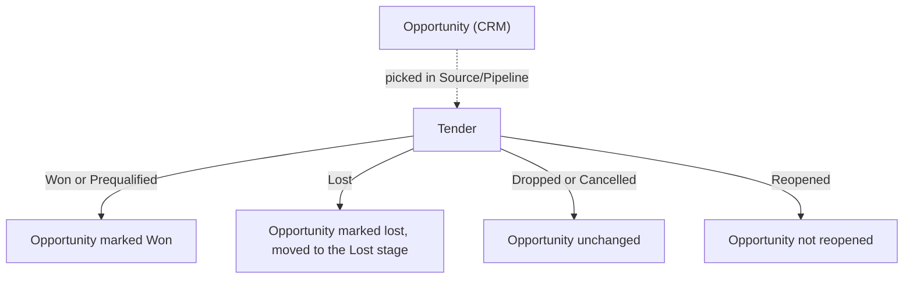

An **opportunity** lives in the **CRM** app. It is a possible deal with a customer that the account manager is working on, often long before any tender is published. A **tender** lives in the **Tender Manager** app and is the formal request the customer publishes. Many tenders start life as an opportunity, but the two are separate records.

You connect them on the tender, in the **Source/Pipeline** field. You can only pick an opportunity for the same customer. Once linked, the tender shows a **Pipeline** smart button that opens the opportunity, and the opportunity shows a **Tenders** smart button that lists its tenders.

**Nothing is created automatically.** Winning or creating an opportunity does not create a tender. When the tender is published, an account manager creates the tender on the board and picks the opportunity in **Source/Pipeline**. The other way a tender is created for you is **Log RFQ** on a prequalification, which opens a new tender filled in with the customer, account manager and categories. See [Prequalifications](/tenders/concepts/prequalifications/).

## What the link does

| When the tender… | The opportunity |
|---|---|
| is marked **Won** or **Prequalified** | is marked won. |
| is marked **Lost** | is marked lost and moved to the **Lost** stage. |
| is **Dropped** or **Cancelled** | doesn't change. Close it yourself in CRM if the deal is over. |
| is reopened by a Tender administrator | isn't reopened. The tender's chatter says *The pipeline opportunity was not reopened. Reopen it in CRM if needed.* |

Losing the opportunity in CRM doesn't touch its tenders.

## What the tender tracker adds to an opportunity

- **Account Manager** and **Technical Presales Engineer** fields. The account manager (and the salesperson) are filled from the customer's account manager when you pick the customer.
- **Assign Account Manager** and **Assign Tech-Presales** buttons for the Head of Channel and Tender administrators. They work like the ones on a tender: the nominee gets a to-do and an email goes to the team.
- When an opportunity is created, every Head of Channel gets a **Required Nomination of Technnical Pre-sales** to-do.
- **Tenders** and **Customer activities** smart buttons, a **Customer touches** strip under the buttons, a **My Pipeline** filter and a **Period** worked out from the expected closing date.
- If the customer has no account manager yet, saving an opportunity or a tender with an account manager makes that person the customer's account manager.

## The presales rule on CRM stages

An opportunity in one of the first three stages of the CRM pipeline can't move to any other stage, except **Lost**, until a Technical Presales engineer is assigned. The message is *Please ensure that technical pre-sales engineer has been assigned for this opportunity!* Moving an opportunity to **Lost** also clears its presales nomination to-dos.

:::note[Good to know]
- The rule above counts the first three stages of the pipeline, whatever they are called at the time. A move between two of those early stages is blocked too.
- Losing a tender sets the opportunity lost, but dropping or cancelling a tender does not. Keep the two in step by hand.
:::

## Tasks that use this

- [Create a tender from an opportunity](/tenders/how-to/bids/create-a-tender/)
- [Nominate the Account Manager, Bid Liaison and Presales](/tenders/how-to/bids/nominate-the-team/)
- [Vendor opportunities on a CRM opportunity](/tenders/channel/vendor-opportunities/)
- [Run the Tender and Pipeline Follow Up reports](/tenders/how-to/bids/follow-up-reports/)
