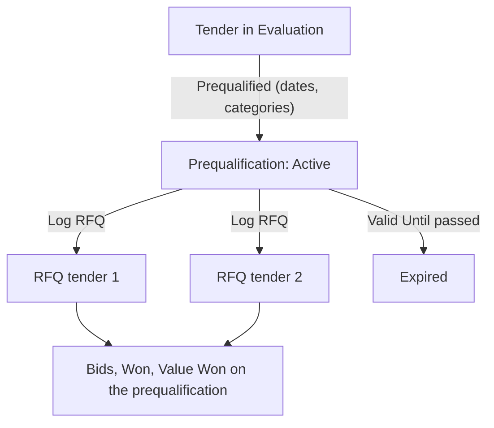

import Illustration from '../../../../components/Illustration.astro';

Some tenders don't end in a contract. Instead the customer **prequalifies** Tritel: it adds Tritel to a shortlist or framework, and later sends requests for quotation (RFQs) to the firms on it. A **prequalification** is the record of that shortlisting. It tracks how long it is valid, the RFQs it brings in, how many became bids and wins, and when to follow up.

A prequalification is created for you when a tender in **Evaluation** is marked **Prequalified**. The window that opens asks for **Valid From**, **Valid Until** and **Categories** (filled from the tender's tags). The tender closes as **Prequalified**, and the new prequalification starts as **Active**, owned by the tender's account manager, with a **Next Follow-up** 30 days away. If you leave out a date, it is marked **Dates Unknown** and a yellow banner asks you to add them; reminders start once both dates are filled in.

Each RFQ the customer sends under it is logged as a new tender with **Log RFQ**. The new tender is filled in with the customer, account manager and categories, carries a **From prequalification** badge, and goes through the normal tender statuses.

<Illustration name="tenders/concept-prequalification-form" caption="A prequalification. The numbers match the list below." />

1. **Log RFQ** opens a new tender for the next RFQ. It shows while the prequalification is **Active** or **Renewed**. The source tender has a **Log RFQ** button too.
2. The **Status**: **Applied**, **Active**, **Expired**, **Renewed** or **Closed**. You change it by clicking the status bar.
3. The **RFQs** smart button lists every tender logged against it.
4. **Valid From** and **Valid Until**: the window the shortlisting covers.
5. **Next Follow-up**: when to chase the customer next.
6. The **RFQs** tab lists the RFQ tenders with their deadline, status and **Value (KES)**. **Notes** and **Documents** hold anything else.

## The results

| Label | Meaning |
|---|---|
| **RFQs** | Tenders logged against this prequalification. |
| **Bids** | Those that were submitted: in **Evaluation**, **Won**, **Prequalified** or **Lost**. |
| **Won** | Those marked **Won**. |
| **Value Won** | The total value of the won ones, in KES. |
| **Last RFQ** | When the most recent RFQ was logged. |

## Reminders

Every day the system checks each **Active** prequalification:

- **Expiry:** the day after **Valid Until**, it moves to **Expired** and the chatter says *Expired on 31/12/2026.*
- **Renewal notice:** 60 days and 30 days before **Valid Until**, the account manager gets *This prequalification expires on 31/12/2026. Plan the renewal.*
- **No RFQs:** when no RFQ has come in for 60 days (counted from the last RFQ, or else from **Valid From**), the account manager gets *No RFQ has come in under this prequalification for 60 days. Follow up with the client.* It repeats every 30 days after that.

The account manager also sees each one in **My Actions** under **Prequalifications to follow up**: when its dates are missing, when it expires within 60 days, or when it has had no RFQ for 60 days.

The list is at **Tender Manager › Tenders › Prequalifications**, shown by status, with filters **Active**, **Dates Unknown** and **My Accounts**.

:::note[Good to know]
- Anyone can change a prequalification's status by clicking the status bar. Only **Active** has automatic follow-up; **Applied**, **Renewed** and **Closed** are labels you set yourself.
- Prequalifications made before this way of working have older stages (**Draft**, **Submitted**, **Qualified**, **Failed**). They aren't shown on the new screens.
:::

## Tasks that use this

- [Follow up a prequalification and log an RFQ](/tenders/how-to/bids/prequalifications-and-rfqs/)
- [Record the result: Won, Lost, Prequalified, Drop or Cancel](/tenders/how-to/bids/record-the-result/)
- [Prequalification workflow](/tenders/workflows/prequalification/)
