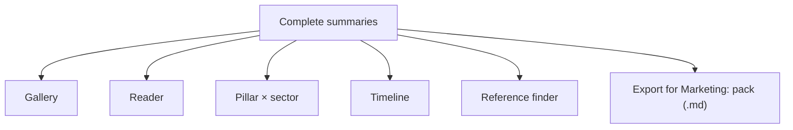

import Illustration from '../../../../components/Illustration.astro';

A **project summary** is a short, structured case study of a won tender: who the client is, the problem, what Tritel delivered, Tritel's role, the timeline and the outcome. Approved summaries go into the **Project Summaries** library, where anyone preparing a bid can find a relevant reference, and marketing can export them.

A summary goes through four hands:

1. **A manager requests it.** The Head of Channel, the Head of Commercial or a Tender administrator picks a writer and a due date. The tender must be **Won**. The writer defaults to the tender's Technical Presales engineer, and the due date to 7 days away.
2. **The writer writes it** under each heading, picks the classification, and clicks **Submit for review**.
3. **A reviewer approves it or sends it back.** The reviewer is any of those managers except the writer. The review is due 5 days after submission.
4. **On approval, it joins the library**, with a note on whether the customer may be named in public.

<Illustration name="tenders/concept-summary-workspace" caption="A summary being written. The numbers match the list below." />

1. **Submit for review** is shown only to the writer, while the summary is **Writing** or **Changes requested**. Managers see **Reassign** (to change the writer or due date), and once it is in review, **Approve** and **Send back**.
2. **Summary Status**: **Not requested**, **Writing**, **In review**, **Changes requested** or **Complete**.
3. **Headings**: how many required headings have content, such as 6 of 8.
4. **Classification**: **Primary Pillar**, **Secondary Pillars**, **Tritel's Role** (**Prime contractor**, **Subcontractor** or **Partner**) and **Motion** (**Project** or **Channel**).
5. The **Headings** checklist and **What to cover** guidance. A yellow **Reviewer's note** banner shows what to change on a summary that was sent back, and a red banner says *This is overdue.*

## The headings

Each summary starts with these headings in the text: **Client and sector** (filled in for you from the customer where possible), **The client's problem**, **What we delivered**, **Pillars**, **Tritel's role**, **Timeline**, **Outcome** and **Reference status**. **Pillars** counts as filled when a primary pillar is chosen, and **Tritel's role** when both the role and the motion are chosen. The others need some text under them.

Submitting stops until everything is there, for example: *Choose the primary pillar, Tritel's role, the motion. Add content under: Outcome.* The heads keep the list at **Tender Manager › Configuration › Summary Headings** and **Pillars** (seeded with **Productivity** and **Connectivity**). A heading can be switched off but not deleted.

## Where summaries are tracked

- **Tender Manager › Tenders › Summary Tracker**: managers see every won tender and its summary status, with **Request summaries** for several at once; everyone else sees the summaries they write. Filters include **Overdue** and **No pre-sales engineer**.
- The **Project Summary** tab on a won tender, with **Open summary workspace**.
- **My Actions**: **Summaries to write**, **Summaries sent back to you**, **Summaries to review**, **Won tenders with no summary requested**, and **Summaries waiting on others** (with **Remind** for managers).
- The portal: **/my/summaries**. See [The commercial portal](/tenders/concepts/the-portal/).

## The library

**Tender Manager › Tenders › Project Summaries** opens the library. It shows only **Complete** summaries, in five views: **Gallery**, **Reader**, **Pillar × sector**, **Timeline** and **Reference finder** (describe what a bid asks for, and it ranks the best matches by pillar, sector, OEM and how recent they are). Each case carries a naming badge: **Can be named**, **Anonymise externally** or **Not yet asked**.

The library is open to people with the **Project Summary Library** role, the three managers and Tender administrators (all summaries), and to anyone with a tender role.

**Export for Marketing** builds a pack of complete summaries filtered by pillar, sector, OEM, award years, role and motion, with a preview, and downloads it with **Download pack (.md)**. Summaries whose customer hasn't been asked about naming are held back unless you include them, and the **Reference status** heading is never exported. Each download is kept under **Marketing Exports**.

:::note[Good to know]
- In the back office, people with a tender role see every complete summary in the library; on the portal they see those for tenders in their scope.
- If a won tender is reopened, its summary to-dos pause and the text is kept. When it is **Won** again, they resume and whoever the summary is waiting on gets an email.
- **Reopen** on a complete summary takes it out of the library until it is approved again.
:::

## Tasks that use this

- [Request a project summary](/tenders/how-to/customers/request-a-project-summary/)
- [Write and submit a project summary](/tenders/how-to/customers/write-a-project-summary/)
- [Review, send back or approve a summary](/tenders/how-to/customers/review-a-project-summary/)
- [Find references in the summary library](/tenders/how-to/customers/use-the-summary-library/)
- [Export a marketing pack](/tenders/how-to/customers/export-for-marketing/)
- [Project summary workflow](/tenders/workflows/project-summary/)
