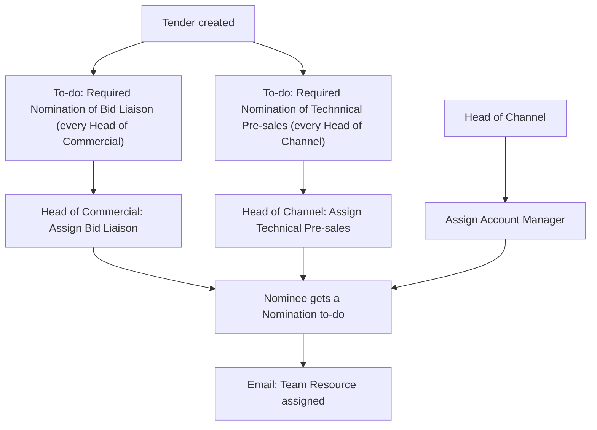

import Illustration from '../../../../components/Illustration.astro';

Every tender has a team of three, shown at the top of the form:

- the **Account Manager**, who owns the customer and the relationship. It is filled from the customer when you pick it, and can be changed with **Assign**.
- the **Bid Liaison**, who runs the bid itself: the readiness checklist, the submission and the receipt.
- the **Technical Pre-sales Engineer** (Technical Presales), who prepares the technical response and the manufacturer documents, and usually writes the project summary if the tender is won.

The three fields can't be typed into. Each has an **Assign** link that only certain roles see, so nominating is a deliberate step that leaves a trail.

<Illustration name="tenders/concept-tender-team" caption="The tender team on a draft tender. The numbers match the list below." />

1. **Confirm Bid** moves the tender to **Bidding**. Today it needs a Bid Liaison and a Technical Presales engineer first (see the note below).
2. **Account Manager** and its **Assign** link: the Head of Channel or a Tender administrator, while the tender is **Draft**, **Bidding** or **Evaluation**.
3. **Bid Liaison** and its **Assign** link: the Head of Commercial or a Tender administrator, while **Draft** or **Bidding**. The window shows each Bid Liaison's current load. See [The bid desk and fair workload](/tenders/concepts/bid-desk-workload/).
4. **Technical Pre-sales Engineer** and its **Assign** link: the Head of Channel or a Tender administrator, while **Draft** or **Bidding**.
5. **Source/Pipeline**: the opportunity the tender came from. See [Opportunities and tenders](/tenders/concepts/opportunities-and-tenders/).

## Who nominates whom

| Role on the tender | Nominated by | Window | Button in the window |
|---|---|---|---|
| **Account Manager** | Head of Channel, Tender administrator | **Assign Account Manager** | **Assign Account Manager** |
| **Bid Liaison** | Head of Commercial, Tender administrator | **Assign Bid Liaison** | **Assign Bid Liaison** |
| **Technical Pre-sales Engineer** | Head of Channel, Tender administrator | **Assign Technical Pre-sales** | **Assign Technical Pre-sales** |

On a CRM opportunity, the Head of Channel (or a Tender administrator) uses **Assign Account Manager** and **Assign Tech-Presales** in the same way.

## What a nomination does

- **When a tender is created**, every Head of Commercial gets a **Required Nomination of Bid Liaison** to-do, and every Head of Channel a **Required Nomination of Technnical Pre-sales** to-do, on the tender. A new opportunity gives the Head of Channel the presales to-do too.
- **When someone is assigned**, the "required" to-do is removed, the nominee gets a **Nomination for Bid Liaison**, **Nomination for Technnical Pre-sales** or **Nomination for Account Manager** to-do, the chatter records who assigned whom, and an email, *Team Resource assigned for Customer A*, goes to the three team members, copied to the Tender administrators and both heads.
- **When the tender leaves the bidding stages** (submitted, won, prequalified, lost, dropped or cancelled), the open nomination to-dos are removed.
- **My Actions** lists the gaps: **Bid liaisons to nominate** (Head of Commercial), **Pre-sales engineers to nominate** and **Account managers to nominate** (Head of Channel). An item turns overdue once the submission deadline has passed.

## Role cards

**Tender Manager › Tender Customers** has three lists of people: **Account Managers**, **Bid Liaisons** and **Technical Presales**. A person appears in a list if they held that role on a tender or opportunity created in the last 24 months, or own a customer (account managers), or have that role in the Tender Manager app. Each card counts their open and recent tenders and opportunities, wins, customers, touches in the last 90 days and overdue planned touches. Click a count to open the records behind it.

Account manager cards also show **Coverage**, for example *60% named (3/5)*: of the customers this person bid on as account manager in the last 24 months, the share where they won a tender or opportunity. Clicking it opens Market Coverage. On every card, **Touches** shows the touches the person made in the last 90 days and how many planned touches are overdue. To find people who have gone quiet or are busy, use the **No Touches in 90 Days** and **Has Open Bids** filters.

## Roles in the app

| Role | What it adds |
|---|---|
| **Account Manager** | Listed as an account manager; can claim unowned customers; sees own tenders and opportunities on the portal. |
| **Bid Liaison** | When named on a tender: works the checklist, marks it submitted and records the receipt. |
| **Technical Pre-sales** | Prepares their rows of the checklist; is the default summary writer. |
| **Head of Commercial** | Nominates Bid Liaisons, flags must-win tenders, approves business cases, manages account ownership and target accounts. |
| **Head of Channel** | Nominates Account Managers and Technical Presales; requests and reviews project summaries. |
| **Administrator** (Tender administrator) | Everything above, plus reopening, moving back on the board and deleting tenders. |
| **Project Summary Library** | Read access to the library of complete project summaries. |

The Bid Liaison's own manager (from the employee record) also has a part: they can work the checklist and mark the bid submitted, and they score its quality afterwards.

:::note[Good to know]
- Today a tender can't change status at all (not even to **Dropped** or **Cancelled**) until both a **Bid Liaison** and a **Technical Pre-sales Engineer** are assigned, unless a Tender administrator does it. The messages are *Missing bid liaison. Please assign one before proceeding!* and *Missing technical presales engineer. Please assign one before proceeding*. Ask the heads to nominate early.
- No "required nomination" to-do is created for the Account Manager, because it usually comes from the customer. **Account managers to nominate** in My Actions still lists open tenders without one.
- The to-do names are spelled *Technnical* on screen.
:::

## Tasks that use this

- [Nominate the Account Manager, Bid Liaison and Presales](/tenders/how-to/bids/nominate-the-team/)
- [Work through Tender My Actions](/tenders/how-to/bids/tender-my-actions/)
- [Tender status workflow](/tenders/workflows/tender-status/)
