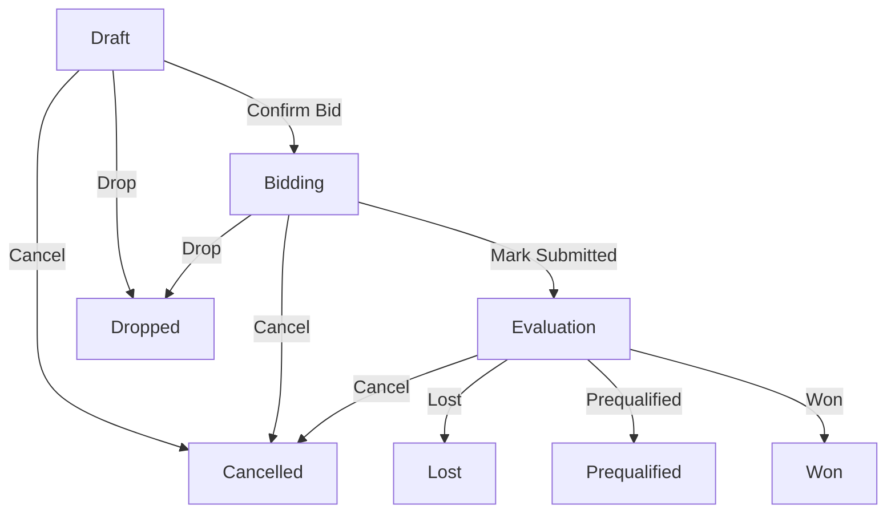

import Illustration from '../../../../components/Illustration.astro';

A **tender** is one record for one public tender, RFQ or similar request that Tritel considers bidding for. It holds the customer, the reference (**Ref**), a short description of the scope, the value (**Expected Revenue** in the **Tender Currency**), the team, the key dates and the documents. When the currency isn't the company currency, the form shows the value converted to KES beside it (**≈ KES …**), at the rate on the award date, or else the submission deadline, or else today.

Every tender has a **Status**. There are eight: **Draft**, **Bidding**, **Evaluation**, **Won**, **Prequalified**, **Lost**, **Cancelled** and **Dropped**. The status changes only through the buttons on the tender (or by dragging the card on the board, which runs the same buttons). Editing it any other way stops with *Use the buttons on the tender to change its status.*

The **board** (**Tender Manager › Tenders › All Tenders**) has one column per status, and the column always follows the status. The status bar at the top of a tender shows **Draft**, **Bidding** and **Evaluation**, plus the result once there is one.

| Status | Meaning |
|---|---|
| **Draft** | Recorded, not yet decided. The team is being nominated. |
| **Bidding** | Tritel has decided to bid. The readiness checklist is open. |
| **Evaluation** | The bid has gone in and the customer is evaluating it. |
| **Won** | Awarded to Tritel. The **Award Date** is set. |
| **Prequalified** | Tritel was shortlisted. A prequalification tracks the RFQs that follow. |
| **Lost** | Awarded to someone else, or rejected. A **Lost Reason** is recorded. |
| **Dropped** | Tritel decided not to bid, before submitting. A **Drop Reason** is recorded. |
| **Cancelled** | The customer withdrew or re-tendered, or the record was a duplicate. A **Cancel Reason** is recorded. |

The full path, with who moves each step, is the [tender status workflow](/tenders/workflows/tender-status/).

## The board

<Illustration name="tenders/concept-tender-board" caption="The tender board. The numbers match the list below." />

1. The **Period** bar and the search. The board opens on the active target period; pick another period or all periods in the bar. Filters include **My Tenders**, **Bidding**, **Under Evaluation**, **Won**, **Must-Win**, **Quality Check To Score**, **Not Confirmed Ready** and **Submission Not Recorded**.
2. One column per status. **Won**, **Prequalified**, **Lost**, **Cancelled** and **Dropped** are folded by default; click a folded column to open it.
3. A card shows the reference, customer, scope and **Tender Sum** (or **Contract Value** once won), and a red **Must-Win** badge when flagged.
4. A coloured pill on each card, and a bar at the top of each column, show urgency. A **Draft** or **Bidding** tender is red within 7 days of the submission deadline and amber within 21 days (or when it has no deadline). A won tender is amber while its achievement is still to be attributed.

Dragging a card one step forward works only for **Draft** to **Bidding**. A drag to any other column opens the same window as the button (for example **Mark as Won** or the lost reason). Dragging a card backwards is a reopen, and only a Tender administrator can do it.

## Key fields

| Label | Where | Meaning |
|---|---|---|
| **Ref** | Top of the form | The tender or document reference, such as TND-2026-001. Required. |
| **Customer** | Top of the form | Required. Picking it fills the **Account Manager** from the customer. |
| **Source/Pipeline** | Top of the form | The CRM opportunity the tender came from (same customer only). |
| **Submission Deadline** | **Tender Info** tab | When the bid must be in. Edit it here; the copies on other tabs are read-only. |
| **Tender Opening Date**, **Validity Period (Days)** | **Tender Info** tab | Opening and bid validity. |
| **Award Date**, **Period** | **Tender Info** tab | Shown once the tender is **Won** or **Prequalified**. The period is the target period the award date falls in. |
| **Documents** | **Documents** tab | The tender documents, one row per document. |

The smart buttons at the top open the **Pipeline** opportunity, the **Activities** logged against the tender, its **Sales**, **Purchases**, **Invoices**, **Bills**, **Business Case** and **Prequalification**.

:::note[Good to know]
- Every status change made by someone who isn't a Tender administrator (**Confirm Bid**, **Mark Submitted**, **Won**, **Prequalified**, **Lost**, **Drop** and **Cancel**) needs both a **Bid Liaison** and a **Technical Pre-sales Engineer** on the tender first. Otherwise it stops with *Missing bid liaison. Please assign one before proceeding!* or *Missing technical presales engineer. Please assign one before proceeding*.
- Every internal user can create and edit every tender in the back office. Only a Tender administrator can delete one: *Only an administrator can delete tender records.*
- The **Submission Deadline** shows on the **Bid Readiness** and **Bid Quality** tabs too, read-only. Change it on **Tender Info**.
- A **Bid Bond Required** setting adds a bid bond to the checklist, but it isn't on the back-office form; it shows only on the portal tender page.
:::

## Tasks that use this

- [Create a tender from an opportunity](/tenders/how-to/bids/create-a-tender/)
- [Confirm the bid](/tenders/how-to/bids/confirm-the-bid/)
- [Mark a tender submitted](/tenders/how-to/bids/mark-submitted/)
- [Record the result: Won, Lost, Prequalified, Drop or Cancel](/tenders/how-to/bids/record-the-result/)
- [Reopen a tender](/tenders/how-to/bids/reopen-a-tender/)
- [Tender status workflow](/tenders/workflows/tender-status/)
