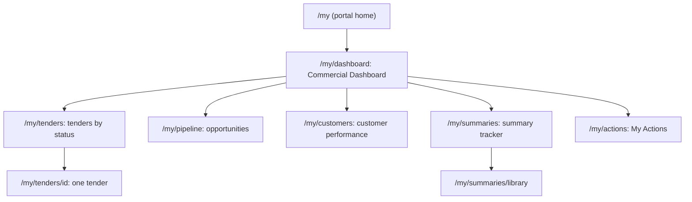

The **commercial portal** is a set of web pages for the tender team, built for a quick look on a laptop or phone. It shows the same tenders, opportunities, customers, summaries and to-dos as the back office, but each person sees only their own part. Every page opens from the bar at the top. Anyone with a tender role and an employee record lands on **/my/dashboard** when they open the portal.

## The pages

| Page | What it shows |
|---|---|
| **/my/dashboard** | Counts, values and win rate for the chosen period. The title depends on your role: **Commercial Dashboard** (Tender administrators), **Head of Commercial Dashboard**, **Head of Channel Dashboard**, or **My Dashboard**. The heads see **Individual Performance** and **Team Performance**. |
| **/my/tenders** | Your tenders, grouped by status, with a period filter and filters by Account Manager, Bid Liaison and Presales. Open one for its details, customer activities and project summary. |
| **/my/pipeline** | Your CRM opportunities by stage, with a period filter and linked tenders. |
| **/my/customers** | How each customer is doing in a period, compared with another period. |
| **/my/summaries** | The summary tracker as tiles by status. Writers write and submit here; managers request, approve, send back and reopen. **/my/summaries/library** is the library. |
| **/my/actions** | My Actions: the same list as **Tender Manager › My Actions**, with the Projects section for delivery staff. |
| **/my/targets**, **/my/achievements** | Commercial targets and achievements. These are being replaced by Accountability revenue targets; see [Commercial Targets](/tenders/commercial-targets/). |

Tender administrators also have **/my/dashboard2** (a performance dashboard) and **/my/access-log** (who opened which portal page). Every portal visit is logged.

## Who sees which tenders

| Role | Tenders on **/my/tenders** |
|---|---|
| Account Manager, Bid Liaison, Technical Presales | Tenders where you are the Account Manager, Bid Liaison or Technical Presales. |
| Head of Channel | Your own, plus every tender with someone in the Technical Presales role on it. |
| Head of Commercial | Your own, plus every tender with someone in the Account Manager or Bid Liaison role on it. |
| Tender administrator | All tenders. |

A summary writer can also open the tender they write for, and the three summary managers can open any won tender. Opening a tender outside your scope shows *You do not have permission to view this tender.*

## Who sees which opportunities

| Role | Opportunities on **/my/pipeline** |
|---|---|
| Tender administrator, Head of Commercial, Head of Channel | All opportunities. |
| Account Manager | Those where you are the account manager or the salesperson. |
| Technical Presales | Those where you are the presales engineer. |
| Bid Liaison | Those linked to tenders where you are the Bid Liaison. |

On **/my/customers**, account managers are locked to their own accounts; others can pick an account manager.

:::note[Good to know]
- The portal pages need your user to be linked to an employee. Without one they stop with *You must be linked to an employee to access the tender portal.* Ask HR or your system administrator.
- The portal's scopes are stricter than the back office, where every internal user can open every tender.
:::

## Tasks that use this

- [Use the Commercial Dashboard and portal pages](/tenders/how-to/customers/portal-dashboard/)
- [Work through Tender My Actions](/tenders/how-to/bids/tender-my-actions/)
- [Write and submit a project summary](/tenders/how-to/customers/write-a-project-summary/)
