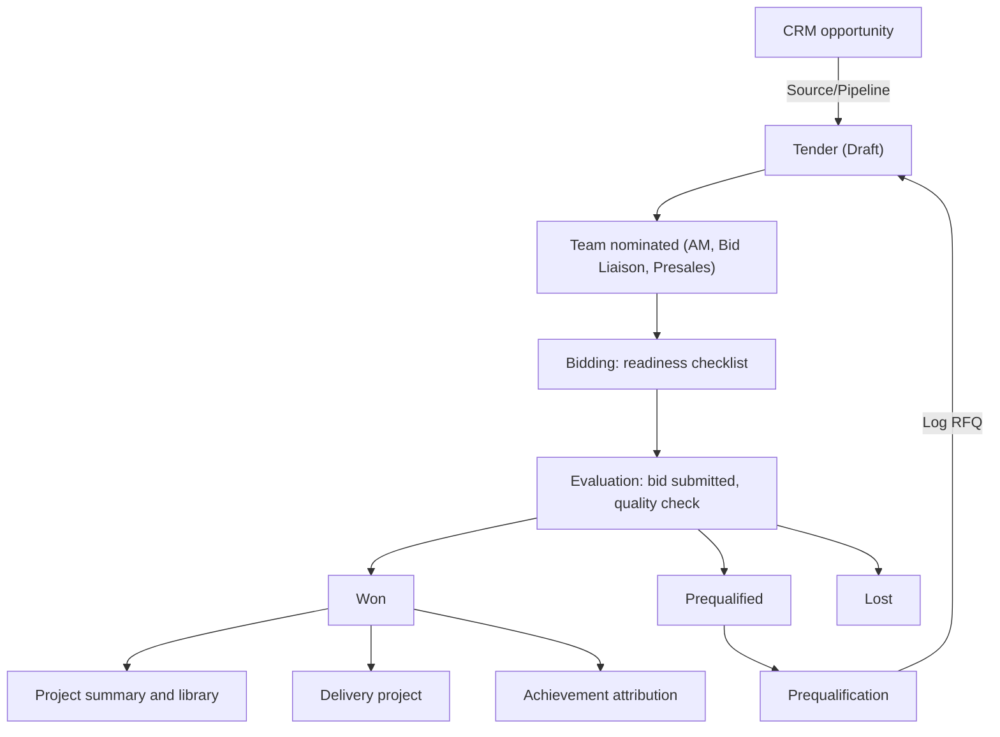
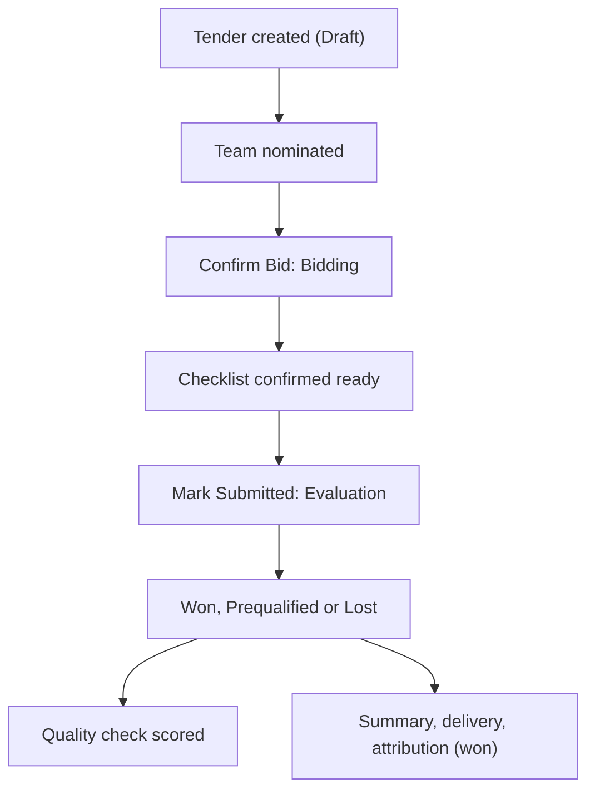

The **Tender Manager** app is where Tritel records every tender, RFQ and prequalification it considers, from the first sighting to the result. Each tender has a team (an Account Manager, a Bid Liaison and a Technical Presales engineer) and a **Status** that moves from **Draft** through **Bidding** and **Evaluation** to a result. Around that core sit the bid desk (who takes each bid, and a checklist of the documents it needs), bid quality, prequalifications, business cases, project summaries for won work, and the record of every customer touch.

The **Channel** app sits beside it. It holds the OEMs Tritel resells, the distributors it buys through, OEM bookings, compliance documents and staff certifications. It has its own pages: see [The Channel app](/tenders/channel/).

## How the parts fit together

- **Tender and status:** one record per tender or RFQ. The status drives the column on the board. See [Tenders, statuses and the board](/tenders/concepts/tenders-and-statuses/).
- **The tender team:** the Head of Channel nominates the Account Manager and the Technical Presales engineer; the Head of Commercial nominates the Bid Liaison. See [Account Manager, Bid Liaison and Technical Presales](/tenders/concepts/roles-on-a-tender/).
- **Opportunities:** a tender can be linked to the CRM opportunity it came from. Nothing is created automatically. See [Opportunities and tenders](/tenders/concepts/opportunities-and-tenders/).
- **Bid desk:** the Bid Liaison works a checklist of the documents the bid needs, and the Head of Commercial sees each Bid Liaison's load before assigning. See [The bid readiness checklist](/tenders/concepts/bid-readiness/) and [The bid desk and fair workload](/tenders/concepts/bid-desk-workload/).
- **Bid quality:** must-win tenders, a manager's quality check after each submission, and confirmed disqualifications. See [Must-win tenders, bid quality and disqualifications](/tenders/concepts/must-win-and-bid-quality/).
- **Prequalifications:** a shortlisting that should bring RFQs. See [Prequalifications](/tenders/concepts/prequalifications/).
- **Business cases:** the cost and margin of a bid, approved by the Head of Commercial. See [Tender business cases](/tenders/concepts/business-cases/).
- **Project summaries:** a written case study of each won tender, reviewed and kept in a library. See [Project summaries and the library](/tenders/concepts/project-summaries/).
- **Customers:** every meeting, call and visit, where each customer sits on the coverage ladder, and who owns each account. See [Customer activities and touchpoints](/tenders/concepts/customer-activities/) and [Market coverage, account ownership and target accounts](/tenders/concepts/market-coverage/).
- **After the win:** the delivery team opens a delivery project from a won tender (see [Project Delivery](/projects/)), and the heads attribute the win to the people who worked on it (see [Commercial Targets](/tenders/commercial-targets/)).

## Where things are

| Menu | What you find there |
|---|---|
| **Tender Manager › Tenders** | **All Tenders** (the board), **Prequalifications**, **Summary Tracker**, **Project Summaries**, **Export for Marketing**, **Marketing Exports** |
| **Tender Manager › My Actions** | Everything in the tender tracker waiting on you, and what you are waiting on |
| **Tender Manager › Tender Customers** | **Customer Activities**, **Account Managers**, **Bid Liaisons**, **Technical Presales**, **Market Coverage**, **Account Ownership**, **Classify Accounts**, **Customers** |
| **Tender Manager › Commercial Targets** | Targets and achievements (being replaced by Accountability revenue targets) |
| **Tender Manager › Reporting** | **Tender Follow Up Report** |
| **Tender Manager › Configuration** | Reasons, tags, guidelines, standard bid documents, the bid desk team, pillars, summary headings, customer tags, activity types and last seen stages. See [Tender Manager configuration](/tenders/configuration/). |

The same people also use the portal: **/my/dashboard** is the landing page for anyone with a tender role. See [The commercial portal](/tenders/concepts/the-portal/).

## Who uses it

| Who | What they do |
|---|---|
| **Account Managers** | Own customers and their tenders and opportunities, create tenders, log customer touches, prepare business cases, and record results. |
| **Bid Liaisons** | Run the bid: work the readiness checklist, confirm the bid ready, mark it submitted and record the receipt. |
| **Technical Presales** | Prepare the technical documents on the checklist, support opportunities, and write project summaries for won tenders. |
| **Head of Commercial** | Nominates Bid Liaisons, flags must-win tenders, scores bid quality (as a fallback), approves business cases, and looks after account ownership and target accounts. |
| **Head of Channel** | Nominates Account Managers and Technical Presales on tenders and opportunities, and requests and reviews project summaries. |
| **Tender administrators** | Can do everything above, and are the only ones who can reopen a tender, move it back on the board or delete it. |
| **Channel users** | Work in the Channel app: OEMs, bookings, compliance and certifications. |
| **Everyone else** | Can read the Project Summaries library if given access, and meet tenders on sales orders, purchase orders, invoices and delivery projects. |

## The life of a tender

1. **Someone creates the tender** on the board, picks the customer and, if there is one, the **Source/Pipeline** opportunity. The heads get to-dos to nominate the team.
2. **The team is nominated** with the **Assign** links on the tender.
3. **Confirm Bid** moves it to **Bidding**. The readiness checklist is built from the standard bid documents.
4. **The Bid Liaison confirms the bid ready**, ideally at least 72 hours before the **Submission Deadline**.
5. **Mark Submitted** moves it to **Evaluation** and records when the bid actually went in. The Bid Liaison's manager has 10 days to score its quality.
6. **The result is recorded**: **Won** (with the award date), **Prequalified** (which opens a prequalification), or **Lost** (with a reason). A tender can also be **Dropped** before submission or **Cancelled**.
7. **After a win**, a project summary is requested, the delivery team opens a delivery project, and the heads attribute the achievement.

## Where to start

| You are | Start here |
|---|---|
| An Account Manager, Bid Liaison or the Head of Commercial | [Commercial](/roles/commercial/) |
| Technical Presales, the Head of Channel or a Channel user | [Channel](/roles/channel/) |
| New to Odoo | [Finding your way](/getting-started/finding-your-way/) |

Every status is in [statuses](/reference/states/), and every term is in the [glossary](/reference/glossary/). The full step-by-step path is in the [tender status workflow](/tenders/workflows/tender-status/).

:::note[Good to know]
- In the back office every internal user can open and edit every tender. The role scopes (your own tenders, your team's) apply on the portal and on the Customer Activities and Market Coverage screens only.
- The result buttons (**Won**, **Prequalified**, **Lost**, **Drop**, **Cancel**) are not limited to a role: anyone who can open the tender sees them. Agree in your team who records results.
:::
