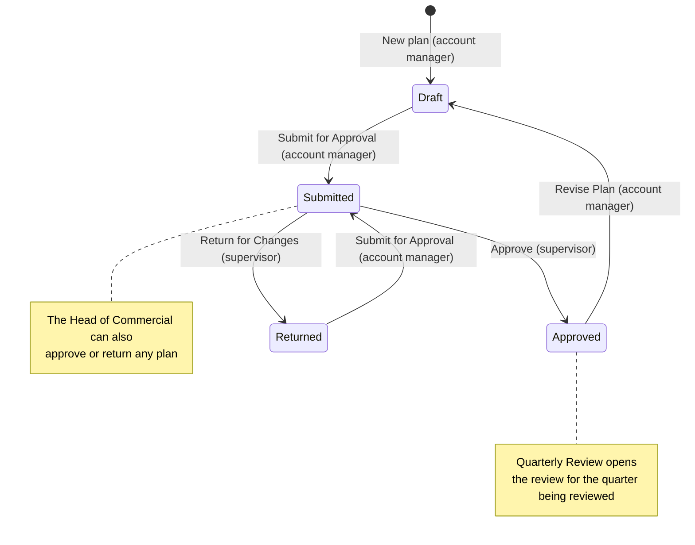
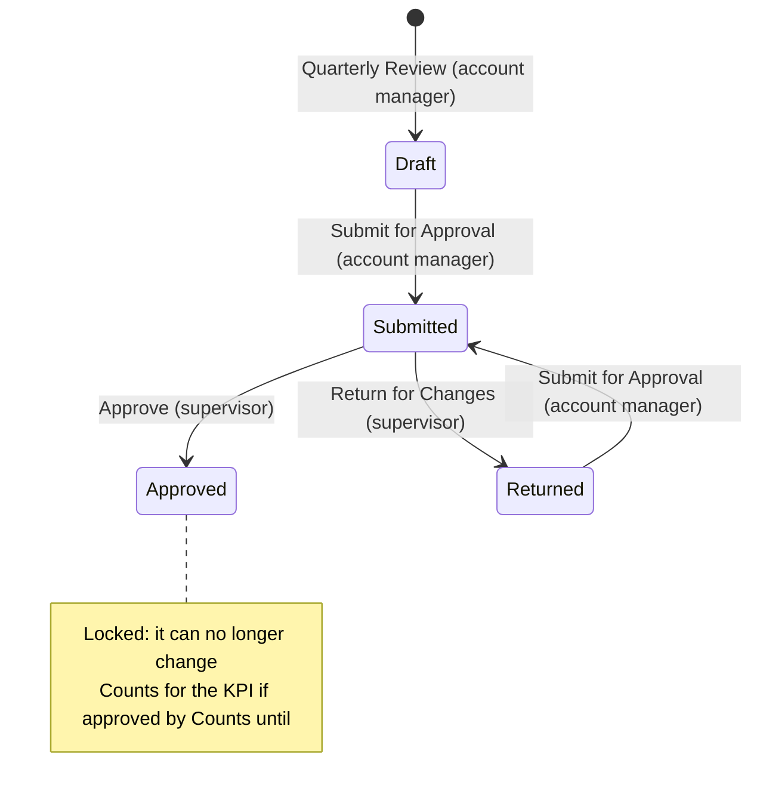
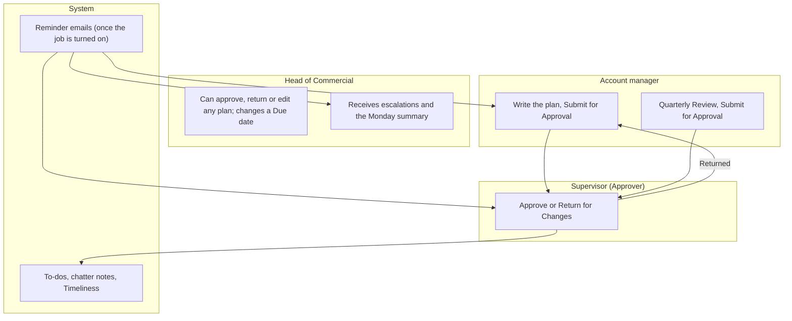

An account plan and each of its quarterly reviews go through the same four statuses: the account manager writes and submits, and their supervisor (the plan's **Approver**) approves it or returns it with a note. The Head of Commercial can do both jobs on any plan. What a plan is, and its parts, are in [Account plans](/tenders/concepts/account-plans/).

## The plan

| Status | What it means | Moves to | Who moves it |
|---|---|---|---|
| **Draft** | Being written. A new plan, or an approved plan reopened with **Revise Plan**. | **Submitted** with **Submit for Approval** | The account manager or the Head of Commercial |
| **Submitted** | Waiting for the **Approver**. **Waiting (working days)** counts the days. | **Approved** with **Approve**; **Returned** with **Return for Changes** | The **Approver** or the Head of Commercial |
| **Returned** | Sent back. The plan shows *Returned for changes:* and the note. | **Submitted** with **Submit for Approval** | The account manager or the Head of Commercial |
| **Approved** | The year's plan is agreed. Reviews can start. | **Draft** with **Revise Plan** | The account manager or the Head of Commercial |

## The quarterly review

| Status | What it means | Moves to | Who moves it |
|---|---|---|---|
| **Draft** | Started with **Quarterly Review** on an approved plan. Fill in **Status** (**Green**, **Amber** or **Red**), **What changed this quarter** and **Next steps**. | **Submitted** with **Submit for Approval** | The account manager or the Head of Commercial |
| **Submitted** | Waiting for the **Approver**. | **Approved** with **Approve**; **Returned** with **Return for Changes** | The **Approver** or the Head of Commercial |
| **Returned** | Sent back with a note, shown as *Returned for changes:* on the review. | **Submitted** with **Submit for Approval** | The account manager or the Head of Commercial |
| **Approved** | Done and locked: *An approved review can no longer change.* | — | — |

Each review also has a **Due date**, a **Counts until** date and a **Timeliness**: **Not due yet**, **Approved on time**, **Approved late**, **Overdue** or **Missed**. See [Account plan due dates, grace days and reminders](/tenders/calculations/account-plan-due-dates/).

## Who does what

## What the system does automatically

- **Submitting a plan** gives the **Approver** a to-do, *Approve account plan: Customer A · 2026*, and records when it was submitted.
- **Submitting a review** gives the **Approver** a to-do on the plan, *Approve account plan review: Customer A · Q1 2026*.
- **Approving** closes that to-do and records the approval date, which sets the **Timeliness**. Approving a review also posts a note on the plan, for example *Review **Q1 2026** approved (Green): …*, and shows the review as approved on the plan's **Account Plan** button on the customer (*2026 · reviewed 14 Apr*).
- **Return for Changes** asks for **What needs to change** (required). It closes the supervisor's to-do and gives the account manager a to-do, *Account plan returned: Customer A · 2026* (or *… · Q1 2026* for a review), with the note.
- **Status changes** of the plan are written in its chatter.
- **My Actions** lists what each person has to do: **Account plans to write**, **Account plans returned to you** and **Account plan reviews due** for account managers, and **Account plans and reviews to approve** for supervisors.
- **Reminder emails.** The scheduled job **Account Plans: reminders and escalation** is switched off when the system is installed. Once your administrator turns it on, it runs each weekday morning and:
  - emails account managers *Account plans due*, from 14 days before a plan or review is due and then every 3 working days, until they submit;
  - emails supervisors *2 account plan item(s) waiting for your approval* once something has waited 2 working days, and again every 2 working days;
  - emails the Head of Commercial *Account plans escalated*, once per plan or review, when it is 5 working days overdue or has waited 5 working days for approval, and fills in **Head of Commercial informed** on the plan;
  - on Mondays, emails the Head of Commercial *Account plans this week*, one line per account manager, for example *Employee A: 1 overdue · 0 waiting approval · 3 of 5 reviewed for Q1 2026*.

  The days are settings; see [Account Plans settings](/tenders/configuration/#account-plans-settings) and the worked timeline in [Account plan due dates, grace days and reminders](/tenders/calculations/account-plan-due-dates/#reminders-and-escalation).

:::note[Good to know]
- **Approving reviews.** **Tender Manager › Tender Customers › Plan Reviews** (opening on **To approve**) lists the reviews waiting. To approve or return one, open its plan and click the review on the **Quarterly reviews** tab: it opens in a window with **Approve** and **Return for Changes**. Opened straight from Plan Reviews, a review fills the page and shows no buttons. The supervisor's My Actions item opens the plan. Plans are approved on the plan itself, or found in **Account Plans** with the **To approve** filter.
- **To approve** shows only items waiting for *you* as **Approver**. A Head of Commercial who isn't the approver finds other people's items with the **Submitted** filter (on **Plan Reviews**) or by clearing the filter.
- **Revise Plan** after the due date: when the plan is approved again, its approval date is the new date, so its **Timeliness** can change to **Approved late**.
- If the account manager's **Manager** has no user, submitting stops with *Employee A has no supervisor in the org chart to approve the plan.* (for a review: *The account manager has no supervisor in the org chart to approve the review.*). Ask HR to fix the org chart.
- A review needs **What changed this quarter**: *Write what changed this quarter before submitting.*
:::

## Related tasks

- [Write an account plan](/tenders/how-to/account-plans/write-an-account-plan/)
- [Submit a quarterly review](/tenders/how-to/account-plans/submit-a-quarterly-review/)
- [Approve plans and reviews](/tenders/how-to/account-plans/approve-plans-and-reviews/)
