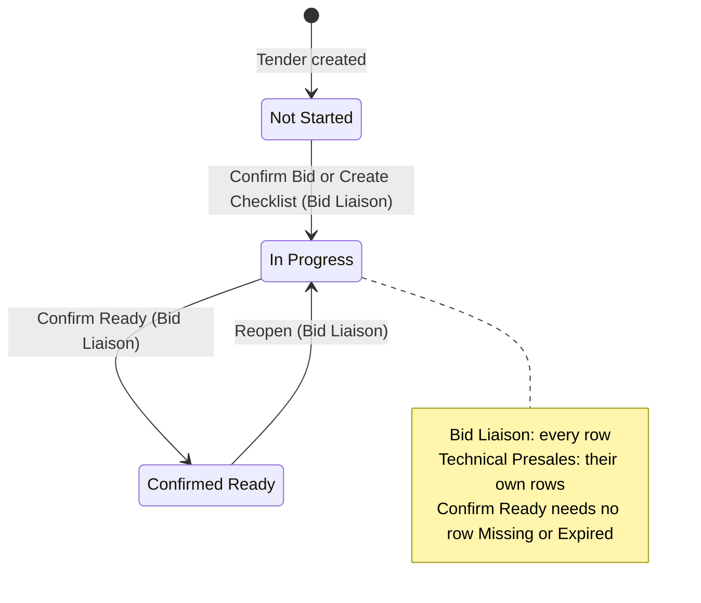
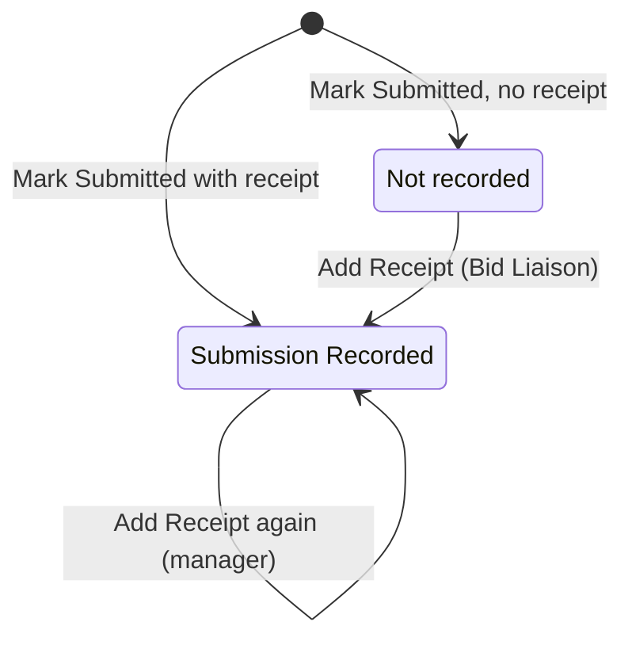

Each tender has a **Readiness** status for its checklist of bid documents. It starts **Not Started**, opens when the tender moves to **Bidding**, and is **Confirmed Ready** when every document is in. The Bid Liaison, their manager or a Tender administrator can reopen it to make changes. Separately, once the bid is in, the submission is **recorded** with its receipt.

| Status | What it means | Moves to | Who moves it |
|---|---|---|---|
| **Not Started** | No checklist yet. The tender is in **Draft**, or was in **Bidding** before checklists existed. | **In Progress** when the tender moves to **Bidding**, or with **Create Checklist** | Whoever clicks **Confirm Bid**; the Bid Liaison, their manager or a Tender administrator (**Create Checklist**) |
| **In Progress** | The checklist is open. Documents are being attached. | **Confirmed Ready** with **Confirm Ready** | The Bid Liaison, their manager or a Tender administrator |
| **Confirmed Ready** | Every row is **Ready** or **Not Needed**. The rows are locked. **Confirmed Ready On** and **Confirmed By** are filled in. | **In Progress** with **Reopen** | The Bid Liaison, their manager or a Tender administrator |

## Row statuses

Each document on the checklist has its own status, worked out from what is attached:

| Row status | What it means | Moves to | Who moves it |
|---|---|---|---|
| **Missing** | No file, or the document expires and **Valid Until** is empty. | **Ready** by attaching the file (and the date); **Not Needed** by ticking it | The person preparing it (Bid Liaison or Technical Presales), the Bid Liaison or their manager |
| **Expired** | **Valid Until** is before the deadline day. | **Ready** by attaching a current document and date | Same |
| **Ready** | Attached, and in date on the deadline day. | **Expired** if the deadline moves past **Valid Until** | The system |
| **Not Needed** | Ticked as not needed for this tender. Left out of **Progress**. | **Missing** or **Ready** by unticking it | Same |

## Recording the submission

| Status | What it means | Moves to | Who moves it |
|---|---|---|---|
| Not recorded | The tender is in **Evaluation** but no receipt has been attached. **Submission Recorded** is unticked. | **Submission Recorded** with **Add Receipt** on the **Bid Quality** tab | The Bid Liaison, their manager or a Tender administrator |
| **Submission Recorded** | The receipt or proof of delivery is attached, with **Recorded By** and the time. | Re-recorded with **Add Receipt** | The Bid Liaison's manager or a Tender administrator (the Bid Liaison can't re-record their own) |

The **Record Submission** window asks for **Actually Submitted** (not in the future) and the **Submission Receipt** (required: *Please attach the submission receipt.*), with an optional note.

## What the system does automatically

- **Moving to Bidding** builds the checklist: one row per active standard bid document, with the **Bid bond** row only when the tender needs a bid bond. **Readiness** becomes **In Progress**.
- **Confirm Ready** adds a **Bid bond** row if the tender now needs one, then checks every row. If any is missing or expired it stops with *This bid isn't ready yet:* and the list, for example *Tax compliance certificate: expired*. On success it writes *Bid confirmed ready by Employee A.* in the chatter.
- **Reopen** writes *Bid readiness reopened by Employee A.* in the chatter.
- **Reminder emails:** each morning, for **Draft** and **Bidding** tenders not confirmed ready, the Bid Liaison and Technical Presales get *Bid not yet confirmed ready* when the deadline is 5 days away and again at 3 days.
- **My Actions:** **Bids to confirm ready** from 6 days before the deadline (overdue with less than 72 hours left), for the Bid Liaison and Technical Presales; **Submissions to record** for the Bid Liaison while a submitted tender has no receipt.

:::note[Good to know]
- A confirmed checklist can't be changed: *This checklist is confirmed. Reopen it to make changes.*
- Technical Presales can only change their own rows, and can't add or remove rows: *Only the Bid Liaison or their manager can add items.*
- **Mark Submitted** doesn't require the checklist to be confirmed ready.
:::

## Related tasks

- [Work the bid readiness checklist](/tenders/how-to/bids/work-the-readiness-checklist/)
- [Mark a tender submitted](/tenders/how-to/bids/mark-submitted/)
- [Readiness progress](/tenders/calculations/readiness-progress/)
- [The bid readiness checklist](/tenders/concepts/bid-readiness/)
