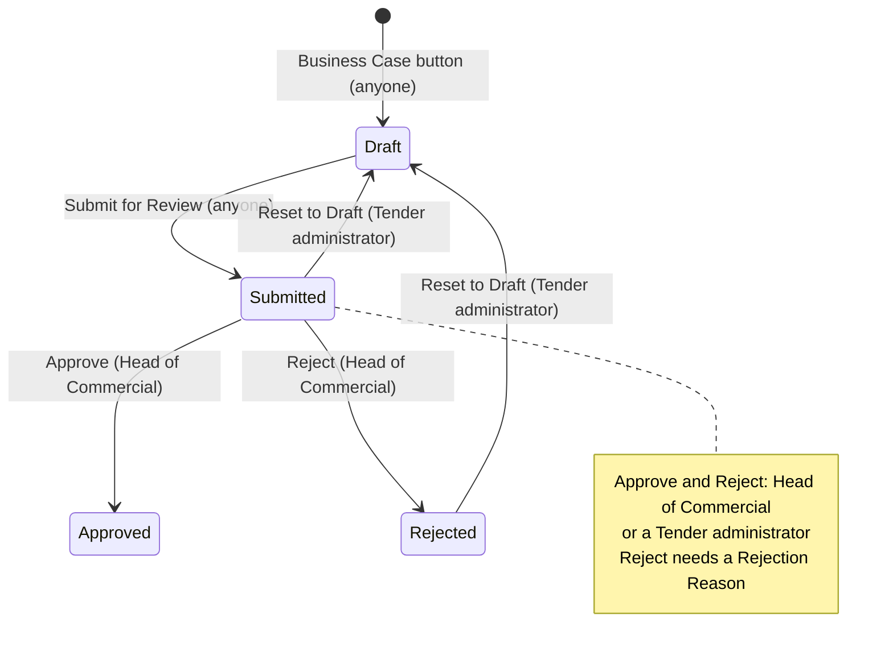
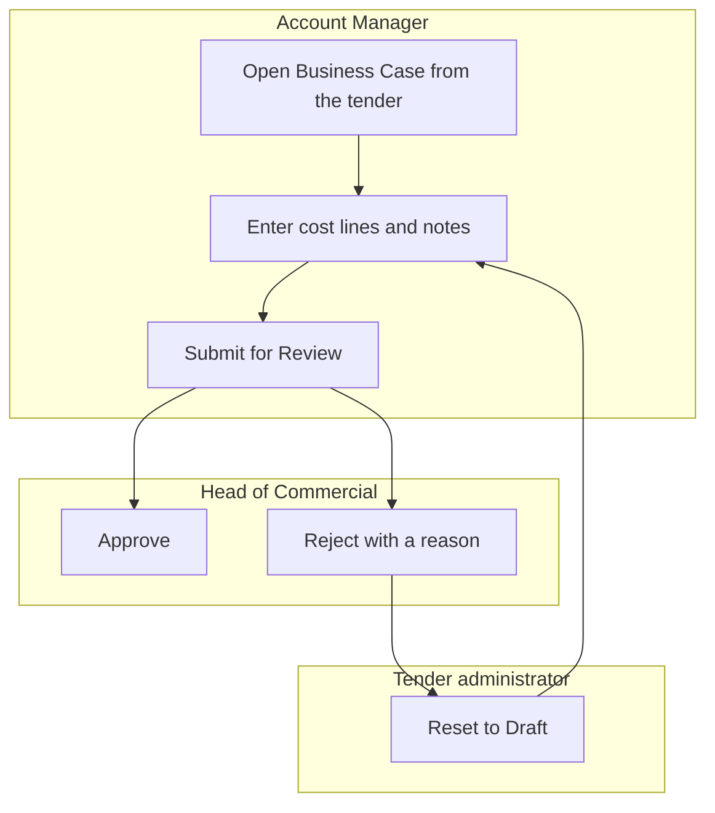

A **tender business case** is drafted from the tender's **Business Case** smart button, submitted for review, and approved or rejected by the Head of Commercial. A Tender administrator can send a submitted or rejected case back to **Draft**. There are no emails; the steps show in **My Actions**.

| Status | What it means | Moves to | Who moves it |
|---|---|---|---|
| **Draft** | Cost lines and notes are being entered. | **Submitted** with **Submit for Review** | Any internal user (usually the Account Manager) |
| **Submitted** | Waiting for approval. **Submitted By** and **Submitted Date** are filled in. | **Approved** with **Approve**; **Rejected** with **Reject**; **Draft** with **Reset to Draft** | Head of Commercial or Tender administrator; Tender administrator (reset) |
| **Approved** | Approved. **Reviewed By** and **Review Date** are filled in. | — | — |
| **Rejected** | Rejected, with a **Rejection Reason**. **Reviewed By** and **Review Date** are filled in. | **Draft** with **Reset to Draft** | Tender administrator |

## Who does what

## What the system does automatically

- **Business Case button:** opens the tender's case, creating a draft if it has none. A tender can have only one: *A business case already exists for this tender.*
- **Totals:** **Total Cost**, **Gross Profit** and **Gross Margin (%)** update as lines change. The revenue always follows the tender's **Expected Revenue** in KES.
- **Submit for Review:** records **Submitted By** (your employee) and **Submitted Date**.
- **Approve / Reject:** records **Reviewed By** and **Review Date**. Approving clears any old rejection reason.
- **After the award:** on a **Won** or **Prequalified** tender, the actual revenue and cost come from the tender's confirmed sales and purchase orders.
- **My Actions:** the Head of Commercial and Tender administrators see **Business cases to approve** (not ones they created, and not for lost, dropped or cancelled tenders). The person who created the case sees **Business cases to finish** while it is a draft or rejected, and **Business cases waiting for approval** while it is submitted.

:::note[Good to know]
- **Reject** stops with *Please enter a rejection reason before rejecting.* if the **Rejection Reason** is empty, and that box is only shown once a case is rejected. Until the form is changed, the Head of Commercial can't reject from the back office alone; record the reason in the chatter and ask a Tender administrator.
- **Approve** and **Reject** are hidden from other roles, but there is no further check behind them.
- An approved case has no way back to **Draft** on the form.
:::

## Related tasks

- [Prepare and approve a business case](/tenders/how-to/bids/business-case/)
- [Business case margin](/tenders/calculations/business-case-margin/)
- [Tender business cases](/tenders/concepts/business-cases/)
