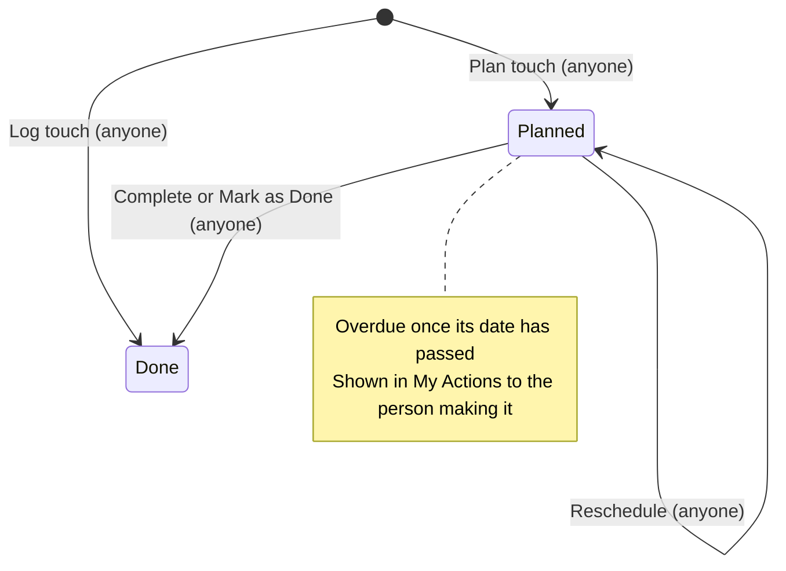
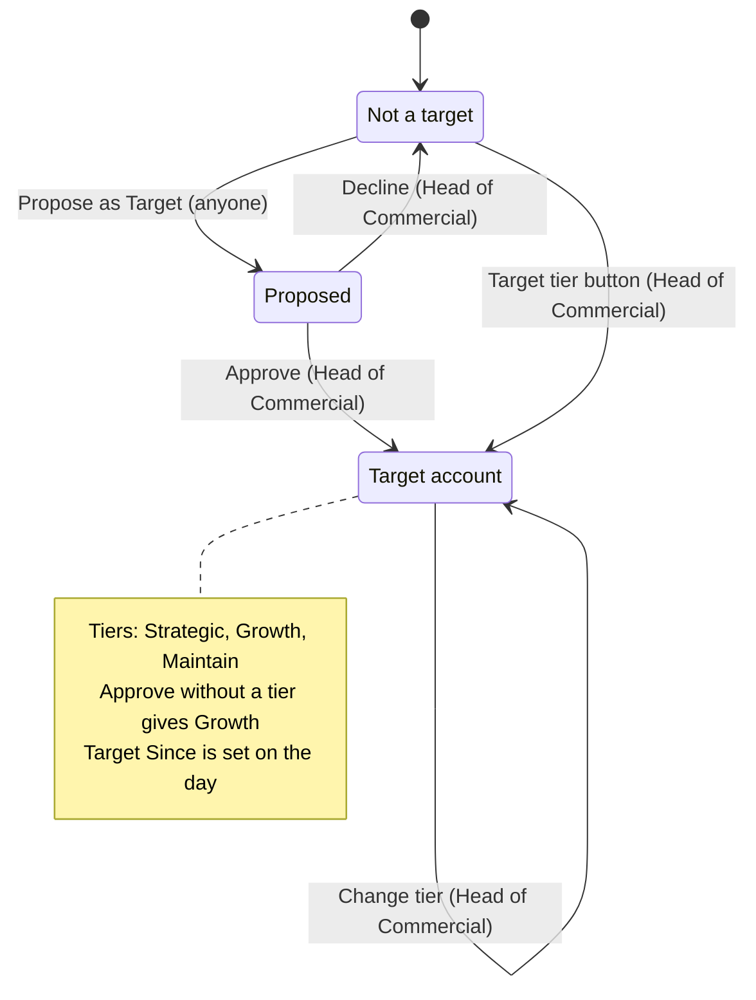
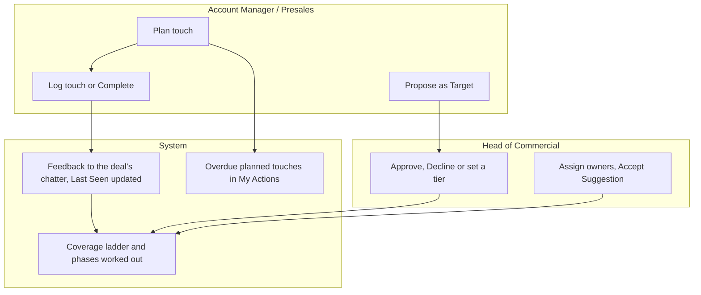

Two small workflows keep the customer picture current. A **customer touch** is either planned or done. A **target account** is proposed by anyone and approved, tiered or declined by the Head of Commercial.

## Customer touches

| Status | What it means | Moves to | Who moves it |
|---|---|---|---|
| **Planned** | A touch to come, with **Planned for**, **Who will make it** and notes. Overdue once the date has passed. | **Done** with **Complete** (on the **Planned** tab) or **Mark as Done**; a new date with **Reschedule** | The person making it, or anyone whose scope covers it |
| **Done** | It happened. The outcome is recorded in **What happened**. Counts in the heatmap, coverage and achievements. | — | — |

On the Customer Activities screen you can only reschedule or complete touches in your scope: *This planned touch is not one you can reschedule.* / *This touch is not one you can complete.*

## Target accounts

| Status | What it means | Moves to | Who moves it |
|---|---|---|---|
| Not a target | An ordinary customer. | **Proposed** with **Propose as Target**; **Target account** with **Target: Strategic**, **Target: Growth** or **Target: Maintain** | Any internal user (propose); Head of Commercial or Tender administrator (tier) |
| **Proposed** (**Proposed Target**) | Someone has proposed it. **Proposed By** and **Proposed On** are filled in. | **Target account** with **Approve** (or **Approve Proposed**); back to not a target with **Decline** (or **Decline Proposed**) | Head of Commercial or Tender administrator |
| **Target account** | A chosen account, with a **Target Tier** and **Target Since**. | Another tier with the tier buttons | Head of Commercial or Tender administrator |

The buttons are on the customer form and in **Tender Manager › Tender Customers › Classify Accounts**, where several customers can be handled at once.

## Who does what

## What the system does automatically

- **Log touch:** saves the touch and marks it done in one step, and shows *Touch logged*. **Plan touch** shows *Touch planned*.
- **When a touch is done:** the date must be filled in and not in the future (*Date is Mandatory!*, *Activity date cannot be greater than today!*). The outcome is posted on the linked tender's or opportunity's chatter, and the customer's **Last Seen** date moves forward if this is the latest touch.
- **Every touch:** **Touch Phase**, **Participant Role**, **Channel**, **Entered Late** and, for achievements, **Valid** and **Activity Phase** are worked out. See [Customer activities and touchpoints](/tenders/concepts/customer-activities/).
- **Nightly:** customers are re-sorted into **Last Seen** bands.
- **My Actions:** **Overdue planned customer touches** (a count, with **Open Customer Activities**) for the person making them.
- **Target account changes** are written in the customer's chatter, for example *Proposed as a target account by Employee A.* or *Target account approved by Employee D.*
- **Changing a customer's account manager** moves its planned touches, its **Draft** and **Bidding** tenders and its open opportunities to the new account manager.

:::note[Good to know]
- A planned touch with no follow-up stays **Planned** for ever; there is no automatic cancel. Complete it with what happened, or reschedule it.
- Proposing a target doesn't notify anyone. The Head of Commercial finds proposals in **Classify Accounts** (the **Proposed** column).
:::

## Related tasks

- [Log a customer activity](/tenders/how-to/customers/log-a-customer-activity/)
- [Plan customer touches](/tenders/how-to/customers/plan-customer-touches/)
- [Read the Customer Activities screen](/tenders/how-to/customers/read-the-customer-activities-screen/)
- [Claim, assign and classify accounts](/tenders/how-to/customers/account-ownership/)
