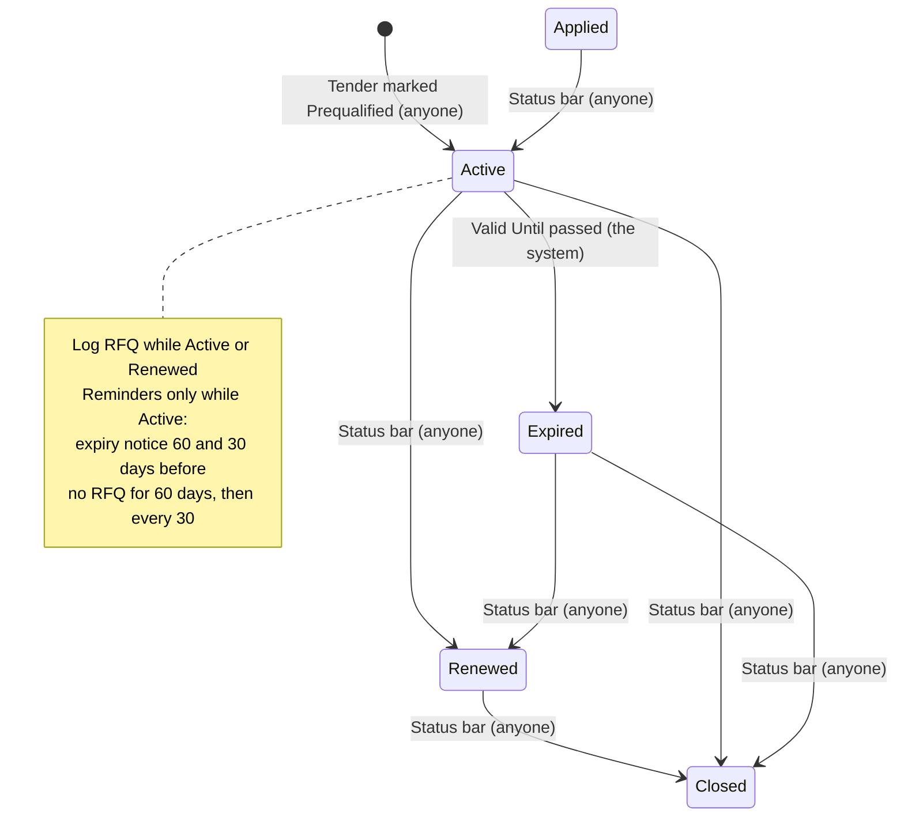
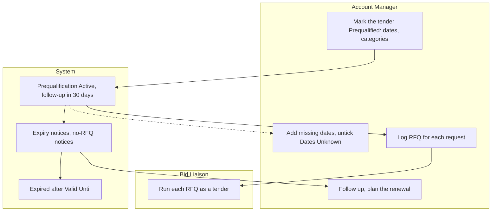

A **prequalification** is created when a tender is marked **Prequalified**, and starts **Active**. While active, RFQs are logged against it and the system watches its expiry and how long it has been since the last RFQ. Its other statuses are set by hand on the status bar.

| Status | What it means | Moves to | Who moves it |
|---|---|---|---|
| **Applied** | Tritel has applied and is waiting to hear. Set by hand; nothing is automatic. | Any status, by clicking the status bar | Any internal user |
| **Active** | Tritel is prequalified and inside the validity window. RFQs can be logged; reminders run. | **Expired** the day after **Valid Until**; any status by clicking the status bar | The system; any internal user |
| **Expired** | **Valid Until** has passed. | Any status, by clicking the status bar | Any internal user |
| **Renewed** | The prequalification was renewed. RFQs can still be logged. Reminders don't run. | Any status, by clicking the status bar | Any internal user |
| **Closed** | No longer followed up. | Any status, by clicking the status bar | Any internal user |

The status bar shows **Applied**, **Active**, **Expired** and **Closed**; **Renewed** shows when it is the current status. The diagram shows the usual moves, but any status can be clicked from any other.

## Who does what

## What the system does automatically

- **Tender marked Prequalified:** creates the prequalification with the customer, reference, account manager (also the **Owner**), the dates and categories from the window, status **Active**, and **Next Follow-up** 30 days away. If a date is missing, **Dates Unknown** is ticked. The tender's chatter says *Prequalification created: valid … to ….*
- **Log RFQ:** opens a new tender with the customer, account manager and categories filled in and linked in **From Prequalification**. The tender shows a **From prequalification** badge. The prequalification's **RFQs**, **Bids**, **Won**, **Value Won** and **Last RFQ** update as its RFQ tenders move.
- **Each day, for Active prequalifications:**
  - after **Valid Until**: status **Expired**, and *Expired on …* in the chatter;
  - exactly 60 and 30 days before **Valid Until** (dates known): the account manager is told *This prequalification expires on …. Plan the renewal.*;
  - 60 days without an RFQ (counting from the last RFQ, or else **Valid From**, or else the day it was created), then every 30 days: *No RFQ has come in under this prequalification for 60 days. Follow up with the client.*
- **My Actions:** the account manager sees **Prequalifications to follow up** for each active one with dates unknown, expiring within 60 days, or with no RFQ for 60 days.

:::note[Good to know]
- Anyone can click the status bar, and only **Active** has automatic follow-up. Agree in your team what **Applied**, **Renewed** and **Closed** mean and who sets them.
- Notices go to the account manager on the prequalification. If it has none, they are only noted in its chatter.
:::

## Related tasks

- [Follow up a prequalification and log an RFQ](/tenders/how-to/bids/prequalifications-and-rfqs/)
- [Record the result: Won, Lost, Prequalified, Drop or Cancel](/tenders/how-to/bids/record-the-result/)
- [Prequalifications](/tenders/concepts/prequalifications/)
