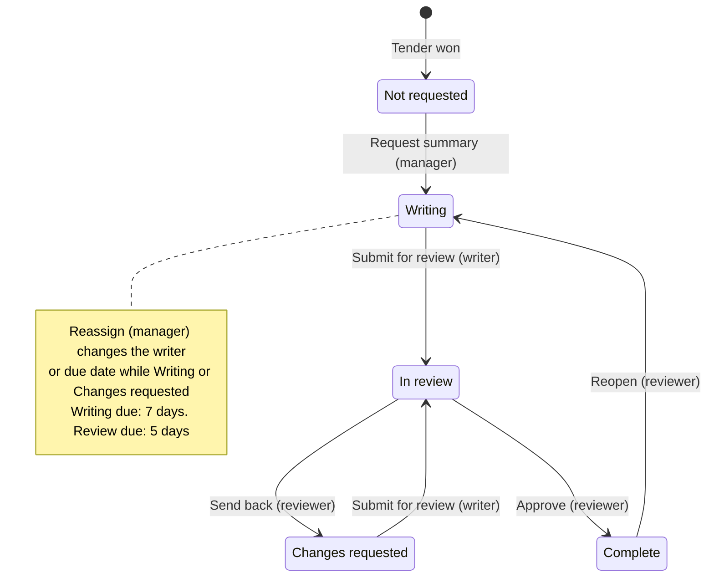
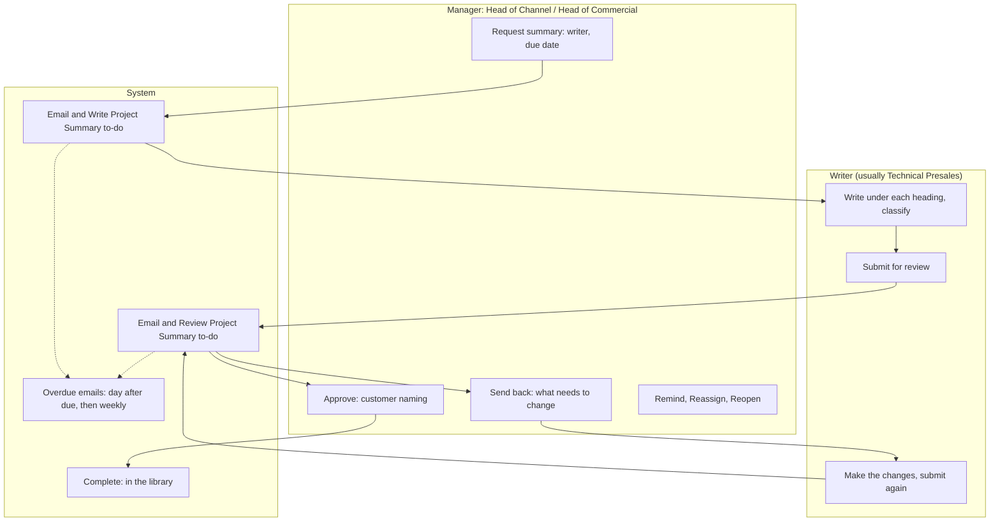

A project summary belongs to a won tender. A manager (the Head of Channel, the Head of Commercial or a Tender administrator) requests it from a writer; the writer submits it; another manager approves it or sends it back. Approved summaries are **Complete** and appear in the library. The status shows as **Summary Status** on the summary workspace and the tender's **Project Summary** tab.

| Status | What it means | Moves to | Who moves it |
|---|---|---|---|
| **Not requested** | The tender is won, but no one has been asked to write. | **Writing** with **Request summary** (one tender) or **Request summaries** (several, from the Summary Tracker) | Head of Channel, Head of Commercial or Tender administrator |
| **Writing** | The writer is writing under the headings. **Summary Due** is set (7 days by default). | **In review** with **Submit for review**; stays **Writing** with a new writer or date via **Reassign** | The writer only (submit); a manager (reassign) |
| **In review** | Submitted. **Review Due** is 5 days after submission. Locked for the writer. | **Complete** with **Approve**; **Changes requested** with **Send back** | Any of the three managers except the writer |
| **Changes requested** | Sent back with a **Reviewer's note**. A new due date, 7 days away. | **In review** with **Submit for review**; **Reassign** | The writer; a manager |
| **Complete** | Approved, with **Customer Naming** set. In the library. | **Writing** with **Reopen** (confirm *Reopen this summary? It leaves the library until it is approved again.*) | Any of the three managers except the writer |

## What each step asks for

| Button | You enter |
|---|---|
| **Request summary** / **Reassign** | **Writer** (defaults to the tender's Technical Presales engineer) and **Due** (defaults to 7 days away). |
| **Submit for review** | Nothing, but the **Primary Pillar**, **Tritel's Role** and **Motion** must be chosen and every required heading must have content. |
| **Send back** | **What needs to change** (required). |
| **Approve** | **Customer naming**: **Can be named**, **Anonymise** or **Not yet asked** (required). |

## Who does what

## What the system does automatically

- **Request summary:** the summary text is set up with every heading, **Client and sector** is filled from the customer where possible, the writer gets a **Write Project Summary** to-do due on the due date and an email *Project summary to write* listing the headings. A bulk request sends each writer one email for all their tenders. Every step is kept in the **History**.
- **Reassign:** the new writer gets the email and the to-do; the previous writer is told *This project summary is now with Employee B. You no longer need to write it.* Changing only the date sends *Project summary due date changed*.
- **Submit for review:** the reviewer gets a **Review Project Summary** to-do and an email *Project summary to review*. The reviewer is the person who requested it, or another manager if the requester is also the writer. Any manager other than the writer can act on it.
- **Send back:** the writer gets a new to-do with the reviewer's note and an email *Project summary sent back*.
- **Approve:** the writer and the requester get *Project summary complete*. The summary appears in the library with its naming badge.
- **Reopen:** the writer gets *Project summary reopened* and a new due date; the summary leaves the library.
- **Overdue:** each day, a summary whose due date (or review date) has passed is emailed to the writer and requester (or reviewer and requester) the day after, then every 7 days: *Overdue: project summary*.
- **Remind:** in **My Actions**, managers can nudge whoever the summary is waiting on.
- **Tender leaves Won:** the to-dos are removed and the text kept. When it is **Won** again, the to-dos come back and whoever it waits on gets *Project summary back in progress*.
- Nobody is emailed about their own action.

:::note[Good to know]
- Only the assigned writer can edit the text, and only while **Writing** or **Changes requested**: *Only the assigned writer can edit a project summary, while it's being written.*
- A manager who wrote the summary can't approve it: *You wrote this summary, so someone else needs to review it.*
- The **Reference status** heading is required to submit but is never included in the marketing pack.
:::

## Related tasks

- [Request a project summary](/tenders/how-to/customers/request-a-project-summary/)
- [Write and submit a project summary](/tenders/how-to/customers/write-a-project-summary/)
- [Review, send back or approve a summary](/tenders/how-to/customers/review-a-project-summary/)
- [Find references in the summary library](/tenders/how-to/customers/use-the-summary-library/)
- [Export a marketing pack](/tenders/how-to/customers/export-for-marketing/)
