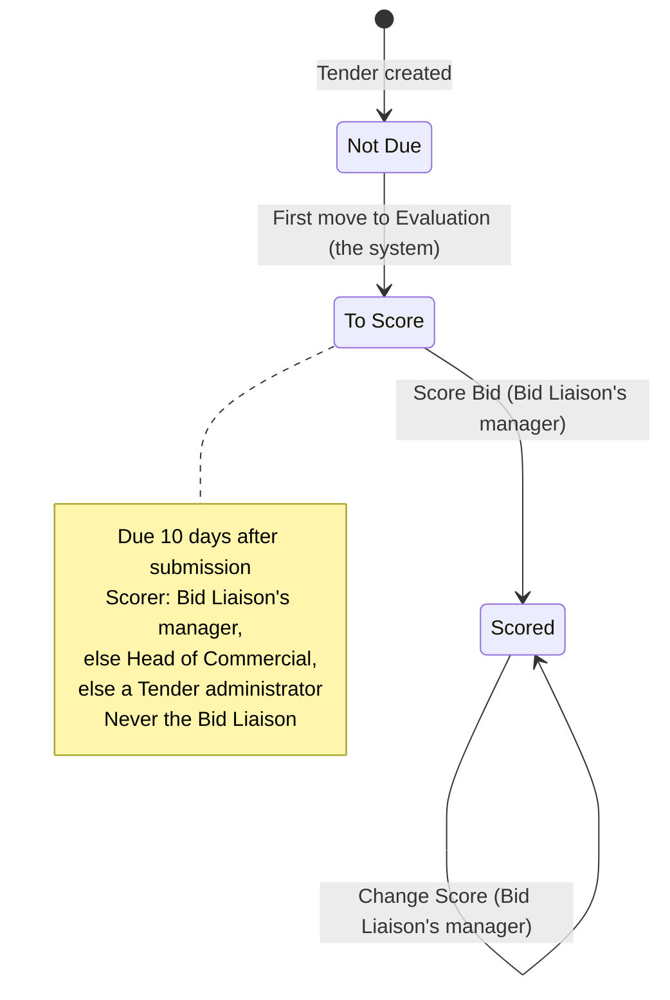
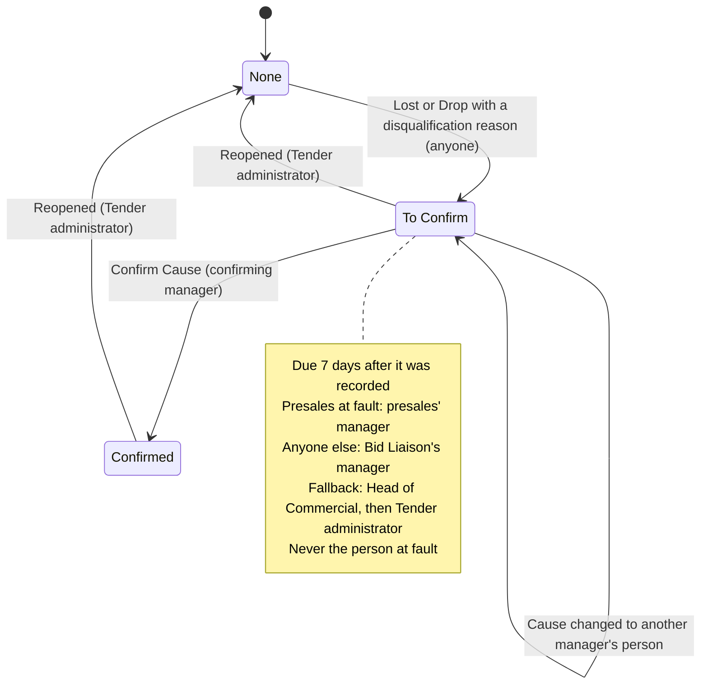
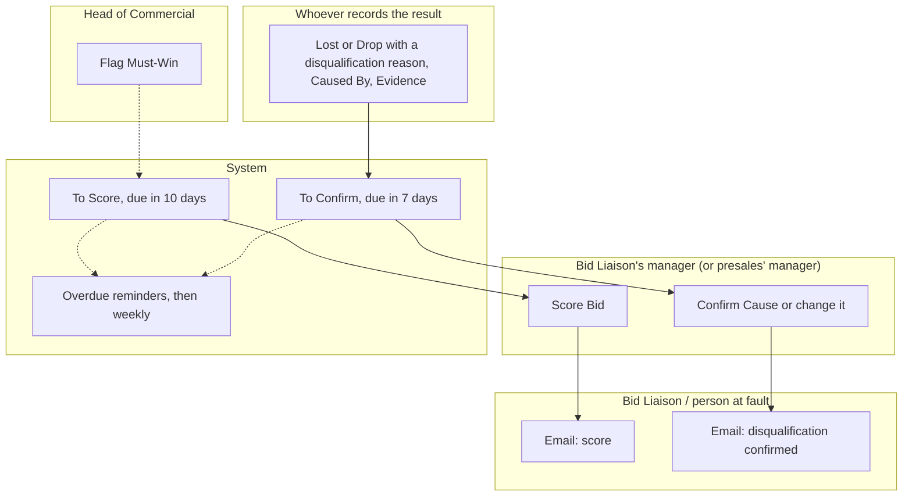

Every submitted bid gets a **Quality Check**, scored by the Bid Liaison's manager against the bid guidelines. Separately, a tender lost or dropped for an avoidable error gets a **Disqualification**, whose cause a manager confirms. Both are on the tender's **Bid Quality** tab, and both change only through their buttons.

## The quality check

| Status | What it means | Moves to | Who moves it |
|---|---|---|---|
| **Not Due** | The bid hasn't been submitted. | **To Score** the first time the tender moves to **Evaluation** | The system |
| **To Score** | Submitted; waiting for the scorer. **Quality Check Due** is 10 days after submission. | **Scored** with **Score Bid** and **Save Score** | The Bid Liaison's manager (else the Head of Commercial, else a Tender administrator) |
| **Scored** | The **Quality Score (%)**, **Scored By**, **Scored On**, the note and each guideline's result are shown. | Re-scored with **Change Score** | The same scorer |

A cancelled tender's quality check stays where it is and drops out of the reminders.

## The disqualification

| Status | What it means | Moves to | Who moves it |
|---|---|---|---|
| **None** | No disqualification. | **To Confirm** when the tender is marked **Lost** or **Dropped** with a reason ticked **Disqualification** | Whoever records the result (they must give **Caused By** and **Evidence**) |
| **To Confirm** | Recorded, with a cause and evidence. **Confirm By** is 7 days later. | **Confirmed** with **Confirm Cause**; stays **To Confirm** and moves to another manager if the cause is changed to someone they answer for; **None** if the tender is reopened | The confirming manager; a Tender administrator (Reopen) |
| **Confirmed** | The cause is confirmed, with **Confirmed By** and **Confirmed On**. A cause naming the Bid Liaison counts at 0% in their Bid Quality Score for the quarter it was confirmed. | **None** if the tender is reopened | A Tender administrator (Reopen) |

## Must-win

Must-win isn't a status but a flag, set and removed by the Head of Commercial or a Tender administrator with **Flag Must-Win** and **Remove Must-Win**, each with a reason. A confirmed error on a must-win tender counts three times in the Bid Quality Score.

## Who does what

## What the system does automatically

- **First move to Evaluation:** **Actual Submission** is set to now (the Mark Submitted window then saves the time you entered), **Quality Check** becomes **To Score** and **Quality Check Due** is 10 days away.
- **Save Score:** checks that the **Actual Submission** isn't in the future and that at least one guideline applies (*At least one guideline must apply to this bid.*), works out the score, writes it in the chatter (including the old and new score on a change), and emails the Bid Liaison: *Your bid has been scored 85.7% against the bid guidelines.*
- **Disqualification recorded:** the chatter notes who recorded it and the cause, and the confirming manager gets *Disqualification to confirm*.
- **Cause changed to another manager's person:** that manager gets *Disqualification to confirm*, and it stays **To Confirm**.
- **Confirmed:** the person named in the cause (if it names someone on the team) gets *Disqualification confirmed*.
- **Reopened:** any later status other than **Lost** or **Dropped** clears the disqualification and writes *Disqualification cleared: the tender was reopened.*
- **Daily reminders:** an overdue quality check emails the scorer *Overdue: bid quality check*, and an overdue disqualification emails the confirmer *Overdue: disqualification to confirm*, the day after it falls due and then every 7 days.
- **Must-win:** emails the team when flagged or removed (only while **Draft** or **Bidding**), and warns them 7, 3 and 1 days before the deadline.
- **My Actions:** **Bid quality checks to score**, **Disqualifications to confirm** and **Must-win tenders closing soon**.

:::note[Good to know]
- Someone who isn't the scorer or confirmer sees the tab but not the buttons. Trying anyway stops with *Only the Bid Liaison's manager can score this bid.* or *You are not the person who confirms this disqualification.*
- The scorer and confirmer follow the **Manager** on each person's employee record. Keep it up to date.
:::

## Related tasks

- [Flag a must-win tender](/tenders/how-to/bids/flag-a-must-win/)
- [Score a bid's quality](/tenders/how-to/bids/score-bid-quality/)
- [Confirm the cause of a disqualification](/tenders/how-to/bids/confirm-a-disqualification/)
- [Bid quality score](/tenders/calculations/bid-quality-score/)
- [Late submission and submission dates](/tenders/calculations/late-submission/)
