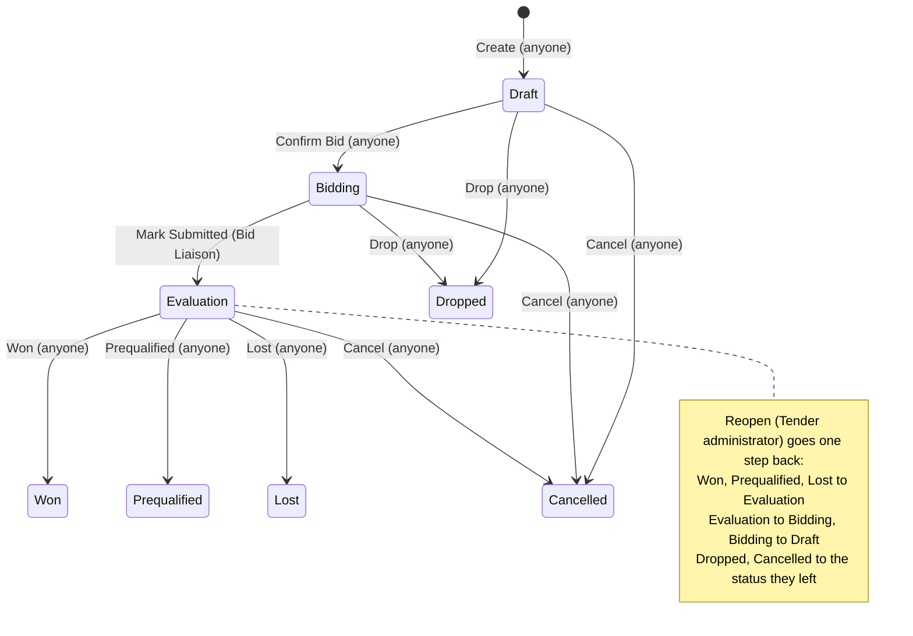
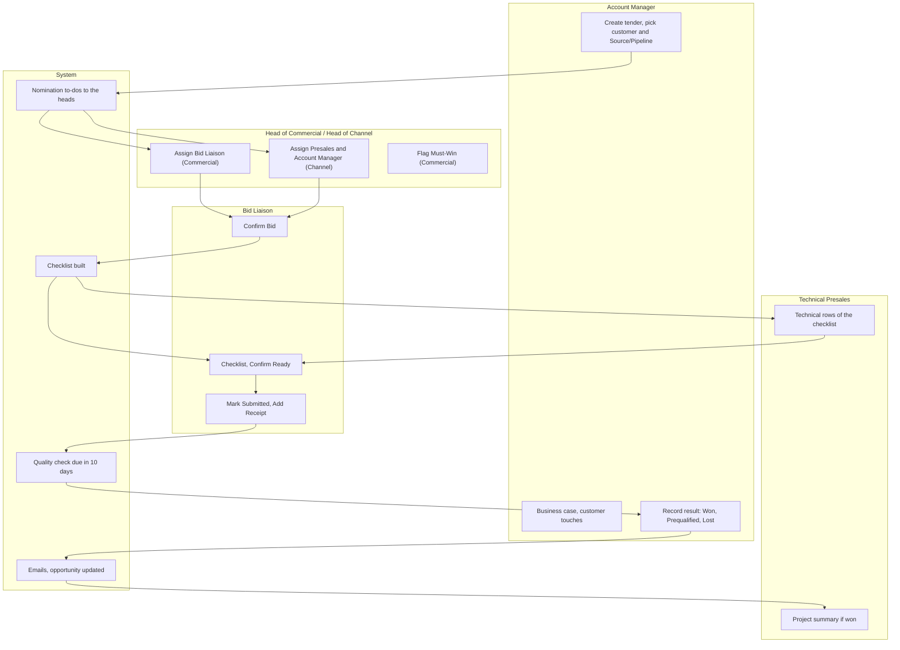

A tender's **Status** is the only thing that decides where it sits on the board. It moves forward through **Draft**, **Bidding** and **Evaluation** to one of five end statuses. Each move is made with a button on the tender (or by dragging the card, which opens the same window). Only a Tender administrator can move a tender back, one step at a time, with **Reopen**.

| Status | What it means | Moves to | Who moves it |
|---|---|---|---|
| **Draft** | Recorded. The team is being nominated and the bid decision made. | **Bidding** with **Confirm Bid**; **Dropped** with **Drop**; **Cancelled** with **Cancel** | Any internal user (see the note on the team rule) |
| **Bidding** | Tritel is bidding. The readiness checklist is open. | **Evaluation** with **Mark Submitted**; **Dropped**; **Cancelled**; back to **Draft** with **Reopen** | Bid Liaison, their manager or a Tender administrator (Mark Submitted); any internal user (Drop, Cancel); Tender administrator (Reopen) |
| **Evaluation** | Submitted. The customer is evaluating; the quality check is due. | **Won**, **Prequalified**, **Lost** or **Cancelled**; back to **Bidding** with **Reopen** | Any internal user; Tender administrator (Reopen) |
| **Won** | Awarded to Tritel, with an **Award Date**. | Back to **Evaluation** with **Reopen** | Tender administrator |
| **Prequalified** | Shortlisted. A prequalification now tracks the RFQs. | Back to **Evaluation** with **Reopen** | Tender administrator |
| **Lost** | Not awarded, with a **Lost Reason**. | Back to **Evaluation** with **Reopen** | Tender administrator |
| **Dropped** | Tritel chose not to bid, with a **Drop Reason**. | Back to the status it was dropped from, with **Reopen** | Tender administrator |
| **Cancelled** | Withdrawn, re-tendered or a duplicate, with a **Cancel Reason**. | Back to the status it was cancelled from, with **Reopen** | Tender administrator |

## What each move asks for

| Button | Window | You enter |
|---|---|---|
| **Confirm Bid** | none | Nothing. |
| **Mark Submitted** | **Mark Submitted** | **Actually Submitted** (required, not in the future), **Submission Receipt** (optional now, or later with **Add Receipt**), **Note**. |
| **Won** | **Mark as Won** | **Award Date** (required), **Note**. |
| **Prequalified** | **Mark as Prequalified** | **Valid From**, **Valid Until**, **Categories**, **Note**. |
| **Lost** | **Lost Reason** | **Tender lost reason**, **Closing Note** (both required); for a disqualification also **Caused By** and **Evidence**. Then **Submit**. |
| **Drop** | **Drop Reason** | **Tender drop reason**, **Closing Note**; for a disqualification also **Caused By** and **Evidence**. Then **Submit**. |
| **Cancel** | **Cancel Tender** | **Why Cancelled** (required: *Withdrawn by the client*, *Re-tendered*, *Duplicate entry* or *Other*), **Note**. |
| **Reopen** | **Reopen Tender** | **Reason** (required). |

## Who does what

The swimlane shows the usual split of work. The **Confirm Bid** and result buttons are not limited to these roles; agree in your team who presses them.

## What the system does automatically

- **On create:** every Head of Commercial gets a **Required Nomination of Bid Liaison** to-do and every Head of Channel a **Required Nomination of Technnical Pre-sales** to-do. If the customer has no account manager, the tender's account manager becomes the owner.
- **Confirm Bid (to Bidding):** stamps **Bid Decision Made** (first time only), builds the readiness checklist from the standard bid documents and sets **Readiness** to **In Progress**.
- **Mark Submitted (to Evaluation):** records the **Actual Submission** time, sets **Quality Check** to **To Score** due in 10 days (the first time), records the receipt if attached, and removes the open nomination to-dos.
- **Won:** sets the linked opportunity won, removes nomination to-dos, and emails the won alert to the Tender administrators and both heads, copied to the Account Manager, Bid Liaison and Technical Presales. The **Project Summary** and **Target Achievements** tabs appear, the summary to-dos resume if the tender was won before, and a delivery project can be opened from it.
- **Prequalified:** as for **Won**, plus a new prequalification, **Active**, with a follow-up in 30 days (or **Dates Unknown** if dates were left out).
- **Lost:** sets the opportunity lost and moves it to the **Lost** stage, removes nomination to-dos, and emails *Tender lost alert!* to the same people. A disqualification reason records a disqualification **To Confirm**.
- **Dropped:** stamps **Bid Decision Made** if empty, removes nomination to-dos, and emails *Tender drop alert!*. The opportunity isn't changed.
- **Cancelled:** removes nomination to-dos. No email, and the opportunity isn't changed.
- **Reopen:** the reason is written in the chatter. Reopening a lost or dropped tender clears any disqualification. The opportunity isn't reopened: *The pipeline opportunity was not reopened. Reopen it in CRM if needed.*
- **Daily reminders:** the Bid Liaison and Technical Presales are emailed 5 and 3 days before the deadline if the bid isn't confirmed ready; must-win teams 7, 3 and 1 days before.

:::note[Good to know]
- Today any status change by someone who isn't a Tender administrator needs both a **Bid Liaison** and a **Technical Pre-sales Engineer** on the tender, whatever the move: **Confirm Bid**, **Mark Submitted**, **Won**, **Prequalified**, **Lost**, **Drop** or **Cancel**. Otherwise you see *Missing bid liaison. Please assign one before proceeding!* or *Missing technical presales engineer. Please assign one before proceeding*. An older set of rules also still applies to non-administrators underneath: for example a **Prequalified**, **Cancelled** or **Dropped** tender can't change (*You can not change a tender in "Prequalified", "Cancelled" or "Dropped" stage!!*). With the buttons above you won't normally meet these, because only a Tender administrator can reopen.
- **Won**, **Prequalified**, **Lost**, **Drop** and **Cancel** are open to every internal user. Only **Mark Submitted** (Bid Liaison, their manager, Tender administrators) and **Reopen** (Tender administrators) are restricted.
- A drag on the board that skips a step, or goes backwards for a non-administrator, stops with *A tender in Draft can't move to Won.* or *Only Tender Tracker Administrators can move a tender back.*
- The won alert email's subject reads *Congratutulations 🎉🎉* on screen.
:::

## Related tasks

- [Create a tender from an opportunity](/tenders/how-to/bids/create-a-tender/)
- [Nominate the Account Manager, Bid Liaison and Presales](/tenders/how-to/bids/nominate-the-team/)
- [Confirm the bid](/tenders/how-to/bids/confirm-the-bid/)
- [Mark a tender submitted](/tenders/how-to/bids/mark-submitted/)
- [Record the result: Won, Lost, Prequalified, Drop or Cancel](/tenders/how-to/bids/record-the-result/)
- [Reopen a tender](/tenders/how-to/bids/reopen-a-tender/)
