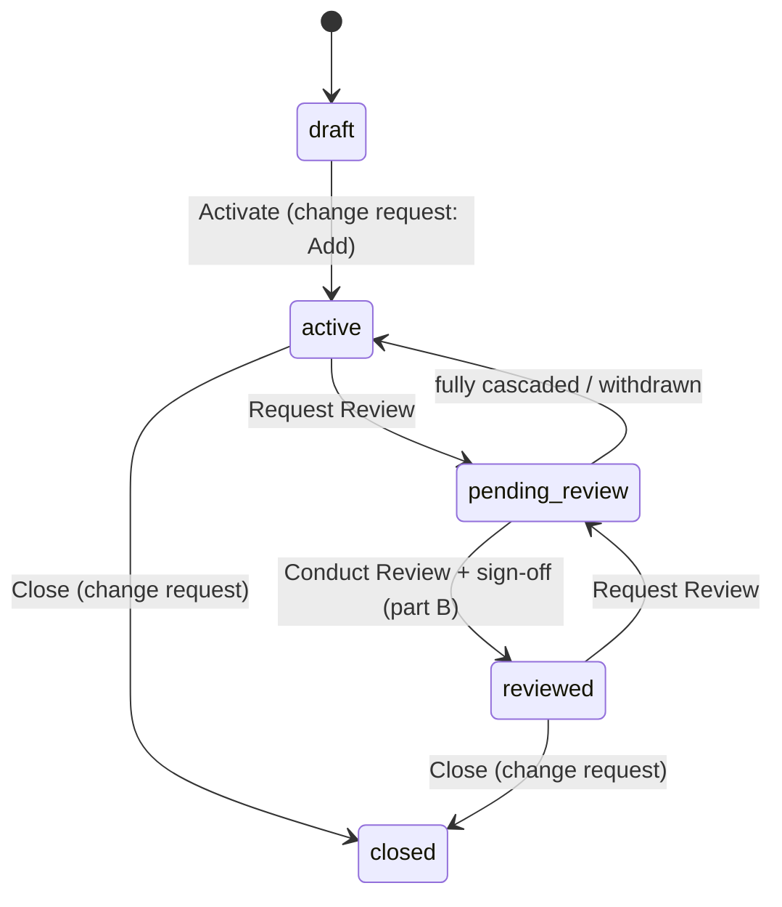

# Accountability Framework — discovery (tritel_accountability_framework 16.0.1.96.1)

Merged from two halves: **Part A** = objectives, targets, metrics, scoring, weights, milestones, library/proposals, change requests; **Part B** = reviews, sessions, review packs, ratings, briefs, snapshots, overview, portal, module-wide security and menus. Read from branch training-portal (16.0 @ eec18b4). Section numbers match the other discovery files.

## 1. Purpose

### Part A — targets, metrics and scoring

Tritel sets yearly **periods**. Inside a period, leadership defines **objectives** (a tree), and every employee holds **targets** under those objectives. A target is a number to reach (quantitative), a service level to stay within (threshold / SLA) or a set of dated stages to deliver (milestone). Managers **cascade** targets down the reporting line: a quantitative target can be split into **shares** that reports adopt, or reports can get **supporting** targets. Each target has a **weight**; how much it counts in the person's score (**share of score**) depends on its weight and on how long it was live in the period. Where a figure can be read from Odoo (CRM pipeline, tender desk, project delivery, OEM bookings, review behaviour), an admin attaches a **metric** to the target. The system then shows a **provisional current value** and, after each review window closes, creates a draft review with the fetched figure. Scores roll up: the target score feeds the person's **own score**. For a manager, own score and **team score** combine into an **overall (composite) score**. Changes to a live scorecard (add, withdraw, close, change the target value) go through **change requests**, which need approval after the target-setting deadline. The employee then acknowledges the new priorities.

---

### Part B — reviews, reporting, security and menus

**Module as a whole.** The Accountability Framework is Tritel's continuous performance-management system. Each staff member has **targets** (grouped under **objectives**) for an **accountability period** (normally a financial year). Targets cascade down the org chart, results are recorded through **reviews**, and each person gets a score for their own targets. Managers also get a team component. Both turn into a five-level **rating**. Everything follows the HR org chart (Employee › Manager field). Nobody assigns access by hand except administrators.

**This half.** This half covers how results get *recorded, agreed and reported*:
- Managers run **Review Sessions** for their direct reports each month or quarter. Each employee gets one **Review Pack**, which they acknowledge, question (**Concern**) or escalate.
- Single reviews can also be created one at a time or automatically by a daily metric job.
- Results are rated on the **five-level scale**, with "on pace" rating for running totals.
- Staff receive optional **Progress Briefs** by email at each month or quarter end.
- **Performance Snapshots** freeze a person's position at a date for later comparison. The **Performance Overview** can be viewed "as at" any past month end.
- A **reporting-line history** keeps reviews visible to and scored for the manager at the time, even after the employee moves teams.
- Staff see all of this on the website portal under **My Performance**.

---

## 2. Models

### Part A — targets, metrics and scoring

#### 2.1 `accountability.period`: "Period" (`models/accountability_period.py`)
| Field | UI label | Meaning |
|---|---|---|
| name | "Period Name" | e.g. FY 2026 |
| date_start / date_end | "Start Date" / "End Date" | Period bounds; used for every time-weighting calculation |
| state | "Status": Draft / Active / Closed | Only one Active period per company (:31-40) |
| target_setting_deadline | "Target-Setting Deadline" | Targets created after it are flagged late-set. After it, scorecard changes need approval (scorecard_request:211) |
| company_id | "Company" | |
Computed/RPC: `_level_average` (:121): weighted mean of top-level non-draft objectives' `level_score` by **objective weight**. Shown on the Objectives (period browser) screen.
Extensions: `_previous_period`, `action_copy_objectives_from_previous` (target_proposal.py:48-95). Closing a period cancels its open change requests (withdrawn.py:127).

#### 2.2 `accountability.objective`: "Objective" (`models/accountability_objective.py`, + `_order.py`, `_proposal.py`, `_exempt.py`)
| Field | UI label | Meaning |
|---|---|---|
| name | "Objective" | |
| period_id | "Period" | required |
| parent_id / child_ids | "Parent Objective" / "Sub-objectives" | Tree; `level` ("Level", list "L") = depth (0 = top) |
| owner_id | "Owner" | Employee; `department_id` ("Department") is computed from the owner and can be edited |
| weight | "Default Weight for New Targets" (list: "Default Target Weight") | Starting weight for new targets only. **Never used in target scores.** It is used to weight objectives against each other in the period average (period.py:121) |
| state | "Status": Draft / Active / Closed | |
| threshold_score_pct | "Achievement Threshold (%)", default 70 | |
| sequence | "Sequence" | Order within the period |
| previous_objective_id | "Carried From" | Link to last year's objective |
| cascade_source_target_id | "Created by Cascade From" | Read-only; not written by any code I found (see Gaps) |

Computed:
- `target_count`, `cascade_sent_count`, `cascade_total_recipients`, `cascade_adopted_count`, `cascade_pending_count`, `review_count` (:133): simple counts over the objective's own targets.
- `counted_target_count` "Targets Counted", `measured_target_count` "Targets with a Result", `score_status` "Measurement" (Measured / Not yet measured / No targets set), `avg_score` "Org Average (%)" (:161).
  - *Counted* = targets of this objective and every sub-objective that are not draft, not development-only and not fully cascaded, and are either scoreable or live today (:189).
  - *Measured* = counted ∩ scoreable (:199). A result of 0% counts; a target not yet reviewed does not.
  - `avg_score` = weighted mean of measured targets' scores, weighted by each target's **period weight** (WGT:94). In a **closed period** the stored value is frozen (:178-186).
  - Example: two measured targets, score 80 at period weight 2.0 and score 50 at period weight 1.0, give (160+50)/3 = **70.0%**.
- `level_score` "Your Level (%)" (:221): the same formula, but limited to measured targets owned by the viewer and their reporting line. Admins see the org figure. `level_is_org` is true when the viewer's scope covers every owner.
- `achievement_state` "Achievement" (:239): Not Set (objective not closed, or threshold 0) / Not Measured (no measured targets) / **Achieved** (avg ≥ threshold) / **Partial Achievement** (avg ≥ 75% of threshold) / **Not Achieved**. Example: threshold 70%, avg 60%. 60 ≥ 52.5 (75% of 70), so the result is *Partial*. Frozen once the period is closed.

#### 2.3 `accountability.target`: "Target" (TGT + WGT + `_milestones`, `_order`, `_exempt`, `_withdrawn`, `_scorecard_request`, `_library`, `_proposal`)
**Core fields**
| Field | UI label | Meaning |
|---|---|---|
| name | "Target" | |
| objective_id | "Objective" | Required for employee-created targets |
| employee_id | "Employee" | Read-only to non-supervisors |
| supervisor_id | "Supervisor" | = employee's manager (`parent_id`), computed |
| period_id | "Period" | Related from the objective |
| cadence | "Review Cadence": Daily / Weekly / Monthly / Quarterly / Semi-Annual / Annual | Sets the review window (calendar month, quarter, half or year; ISO week; day). See `cadence.py:9` |
| target_type | "Target Type": Quantitative / Threshold / SLA / Milestone / Task | |
| target_value | "Target Value" | Quantitative goal |
| target_uom | "Unit" | e.g. KES, calls, % |
| direction | "Direction": Higher is Better / Lower is Better | |
| threshold_direction | "SLA Direction": At or above floor (quality SLA) / At or below ceiling (cost / time SLA) / Within range (band compliance) | |
| threshold_floor | "Compliance Floor" | Below it the score is 0. **For "At or below ceiling" this field holds the upper limit** (see Gaps) |
| threshold_target | form: "Ideal Target (Full Credit)" | Full credit at or beyond it |
| threshold_ceiling | "Upper Bound" | For Within range only |
| scoring_mode | "Scoring Mode": Weighted milestones (partial credit) / Binary, done or not done / Supervisor assessment (0–100) | Milestone targets |
| supervisor_score | "Supervisor Score (0–100)" | Used in Supervised mode |
| delivery_start / delivery_end | "Start" / "End" | Milestone target dates; required and inside the period before activation (milestones.py:122) |
| actual_value | "Actual Value" (form: "Latest Actual") | Written by review sign-off (part B) |
| actual_value_entered | "Actual Entered" | Distinguishes an entered 0 from a blank one |
| score | "Score (%)" | Stored, computed (below) |
| state | "Status": Draft / Active / Pending Review / Reviewed / Closed | |
| next_review_date | "Next Review Date" | Set from the review (review.py:333) |
| is_late_set | "Late Set" | create_date > period's target-setting deadline (TGT:935) |
| weight | "Weight" (default 1) | Relative importance |
| sequence | "Sequence" | Position in the employee's scorecard (shared across objectives) |
| development_only | "Development (not scored)" | Auto-set when created while the employee is exempt (exempt.py:156) |
| previous_target_id | "Carried From" | Last year's target |
| library_entry_id | "Library entry" | |

**Metric fields**
| Field | UI label | Meaning |
|---|---|---|
| metric_id | "Metric" (placeholder "Entered manually") | Hidden for milestone targets |
| metric_param | "Measured For" | Record the metric needs, e.g. the OEM (`crm.oem`). Required when the metric declares one |
| metric_reference_target_id | "Reference Target" | For ratio metrics: the denominator target (e.g. the revenue target) |
| metric_window_basis | "Measure Over": Cadence window (each review measures its own month or quarter) / Period to date (each review measures from the period start) | Defaults to *Period to date* for quantitative targets and *Cadence window* for others (TGT:445) |
| metric_automation | "Automatic Reviews": Off (fetch manually when reviewing) / Create a draft review for the reviewer to confirm / Create and submit the review automatically | Defaults to Draft when a metric is set (TGT:450). Only admins may choose Submit (TGT:462) |
| metric_current_value / _score / _at | "Current Value" / "Would Score (%)" / "As Of" | **Provisional, display only** |
| metric_current_error, metric_current_no_data | "Current Value Error", "Nothing Due Now" | |
| signed_review_count | "Signed-off Reviews" | Signed-off reviews, excluding N/A |

**Cascade fields**
| Field | UI label | Meaning |
|---|---|---|
| cascade_parent_id | "Cascaded From" | Source target |
| cascade_state | "Cascade Status": Not Cascaded / Pull Requested / Pending Adoption / Adopted / Declined | |
| cascade_link | "Link to Source": Share of source / Supporting target | A share consumes the source value; a supporting target does not |
| cascade_note | "Manager Note" | Push note, pull justification, or decline reason |
| is_apportionable | "Apportion when cascading" (default on) | Quantitative only |
| allocated_value | "Allocated" | Sum of share children in pushed, adopted or pull-requested state |
| remaining_value | "Remaining" | target_value − allocated (negative means over-allocated) |
| allocation_pct | "Allocated (%)" | allocated ÷ target_value × 100 |
| is_over_allocated | "Over-allocated" | allocated > target_value |
| adopted_value | "Cascaded (Adopted)" | Sum of **adopted** share children |
| measured_value | "Measured On" | max(target_value − adopted_value, 0). **This is the basis the owner is scored on** |
| is_fully_cascaded | "Fully Cascaded" | adopted > 0 and measured_value ≤ 0 |
| team_actual_value / team_progress_pct | form: "Team Result (not scored)" / "Team Progress (%)" | Own actual (only while a portion is retained) plus adopted children's team actual, recursively. Display only |
| cascade_label / retained_display | "Cascade Summary" / "Yours to Deliver" | Text such as "Keep 6,000,000 of 10,000,000 · 4,000,000 cascaded to …" |
| cascade_depth | "Cascade Depth" | 0 = root |
| cascade_child_count / adopted / pending / pull counts | "Cascade Recipients", "Adopted", "Pending", "Pull Requests" | |
| cascade_sent | "Cascade Sent" | Set when a push or pull is created |
Example (TGT:859): target 10,000,000 KES with shares adopted for 4,000,000 and pending for 3,000,000. Allocated = 7,000,000 (70%), remaining = 3,000,000, adopted = 4,000,000, measured_value = **6,000,000**.

**Weight and share fields** (WGT:36-77)
| Field | UI label | Formula |
|---|---|---|
| period_weight | "Counts As" | Σ(weight × days in force) ÷ days in period, counting from `live_from` (or the period start) until it was withdrawn, fully cascaded or closed, whichever comes first (WGT:176). Today's weight is assumed to continue to the period end |
| share_pct | "Share of Score (%)" | period_weight ÷ Σ period_weight of the employee's non-draft, non-dropped targets in the period × 100 (WGT:238) |
| current_share_pct | "Share From Today (%)" | weight ÷ Σ weight of targets live today × 100 |
| share_rank | "Rank" | "#2 of 5" |
| share_label | "Counts" | e.g. "25% of the score from today (weight 2 of 8)", "Draft: counts once activated", "No longer counts from 30 Sep 2026" |
| share_hint | (shown under the bar) | "A 10-point gain on this target adds about share ÷ 10 points to the … score". For managers it adds "about share/10 × own% overall" |
| composition_html | "Score Composition" | Coloured bar, one segment per target, coloured by objective; hatched = not scored yet |
| live_from | "Live From" | Stamped when a target goes live after the period started (WGT:692) |
| closed_on / withdrawn_on / fully_cascaded_on | "Closed On" / "Withdrawn From" / "Fully Cascaded On" | End dates for counting |
| withdraw_reason | "Why Withdrawn" | |
Worked example (period 1 Jan–31 Dec, 365 days):
- Target A has weight 1 until 30 Jun and 3 from 1 Jul. Period weight = (1×181 + 3×184) ÷ 365 = **2.01** ("weight 1 until 30 Jun, 3 from 1 Jul").
- Target B has weight 2, live from 1 Oct. Period weight = 2×92 ÷ 365 = **0.50**.
- Target C has weight 1 all year. Period weight = **1.00**.
- Share of score: A = 2.01 ÷ 3.51 = **57.3%**, B = 14.2%, C = 28.5%. Share from today (all three live, weights 3, 2, 1): A = 50%, B = 33.3%, C = 16.7%.
- Dropped: a target that ended with no result, or ended on the day it went live, has share 0 and is not part of the score (WGT:253, `_ended_before_counting` :170).
- New targets start at the average weight of the employee's live targets under the same objective, or at the objective's default if there are none (WGT:101).

**Score computation** (TGT:971, helpers TGT:38-75)
- **Quantitative** (TGT:1065). If fully cascaded the score is 0 and the target is left out of the own score (it counts only for the days before `fully_cascaded_on`). Otherwise the basis is `measured_value`:
  - Higher is better: min(actual ÷ basis × 100, 100). Example: basis 6,000,000, actual 4,500,000 gives **75%**.
  - Lower is better: min(basis ÷ actual × 100, 100). An **entered 0** scores 100. A blank actual scores 0. Example: target 5 incidents, actual 8 gives 62.5%.
  - Scores are capped at 100 (no over-achievement credit).
- **Threshold / SLA** (TGT:1072): **average of the scores of signed-off, non-N/A reviews** (missed reviews are not counted). Each review is band-scored (TGT:55):
  - At or above floor: actual < floor gives 0. actual ≥ ideal gives 100. In between: (actual − floor) ÷ (ideal − floor) × 100. Example: floor 80, ideal 95, actual 90 gives **66.7%**.
  - At or below ceiling: actual > *floor field* gives 0. actual ≤ ideal gives 100. In between: (floor − actual) ÷ (floor − ideal) × 100. Example: limit 48 h, ideal 24 h, actual 36 h gives **50%**.
  - Within range: inside [floor, upper bound] gives 100, outside gives 0.
  - Example target score: reviews of 100, 66.7 and 0 give **55.6%**.
  - The SLA actual cannot be typed on the target. It comes from reviews (TGT:1099).
- **Milestone** (TGT:1085):
  - Weighted: sum of the weights of **confirmed** stages (`done`). Example: stages 30/30/40 with the first two confirmed gives **60%**.
  - Binary: 100 only if every stage is done, otherwise 0.
  - Supervised: supervisor_score clamped to 0–100.
- **`_scoreable`** (TGT:375): a target counts towards scores only if all of these hold. It is not development-only. It is not fully cascaded without a date. It did not end before counting. And it is Reviewed, or it is Active/Closed with an actual entered, or Closed with a signed non-N/A review, or it is a weighted/binary milestone target with at least one confirmed stage. Draft and Pending Review targets with no actual entered do not count.
- **Provisional value** (TGT:592-660): the metric is evaluated over the *current* window and the score is projected with the same formulas. The result is **never part of a score** ("Not part of the score until a review records it."). It is refreshed by the nightly job, by the "Refresh" button, and when the metric fields change. Non-admins can refresh at most every 5 minutes (TGT:646).
- **Entry guidance** (TGT:813-857): on a target with adopted shares, the "own result only" hint and a warning appear when the actual entered looks like it includes the reports' results.

#### 2.4 `accountability.milestone`: "Target Milestone / Stage" (`models/accountability_milestone.py`, `_milestone_order.py`)
| Field | UI label | Meaning |
|---|---|---|
| name | "Stage" | |
| weight | "Weight (%)" | Stage weights must total 100 on weighted targets before activation (milestones.py:144). Never above 100 (milestone.py:173) |
| sequence / list_position | "Order" / "No." | List order |
| date_start / date_due | "Start" / "Due" | Due date required on live stage-based targets |
| status | "Status": Open / Awaiting Confirmation / Confirmed | |
| done / done_date | "Complete" / "Completed On" | Only confirmed stages score |
| marked_by_id, marked_on, confirmed_by_id, confirmed_on | "Marked Done By/On", "Confirmed By/On" | |
| return_note | "Sent Back Because" | |
| timing / timing_label | "Timing": Upcoming / Due Soon / Overdue / On Time / Late | Labels like "Due in 3 day(s)", "Overdue by 2 day(s)", "Completed 4 day(s) late". Due Soon = within 7 days (:119) |
| order_flag | "Sequence check" | Warning "Starts before X (#n)" when a stage starts before one listed above it (display only) |
| employee_id | "Owner" | |
| timeline_begin/finish, stage_row | "Timeline Start/End", "Stage Row" | Gantt support (Nairobi time zone handling) |

#### 2.5 `accountability.metric`: "Accountability Metric" (`models/accountability_metric.py`)
| Field | UI label | Meaning |
|---|---|---|
| name, code, description, uom ("Unit"), active | | `code` is unique |
| kind | Aggregate (count / sum / average of records) / Ratio (numerator ÷ denominator) / Coded (developer-defined) | |
| hook | "Coded Logic" | One of the registered hooks (§8) |
| hook_description | "How the coded logic works" | |
| param_model/label | "Parameter Model" / "Parameter" | e.g. OEM |
| settle_days | "Wait Before Automatic Review (days)" | 0 means use the hook default, else the company setting |
| log_grace_days | "Logging Grace (days)" | For activity-coverage hooks (default 7) |
| model_id, filter_domain ("Filter"), aggregation (Count of records / Sum of a field / Average of a field), field_id ("Field"), person_field_id ("Person Field"), scope (The target employee only / The employee and everyone below them in the reporting line), time_basis (Snapshot: what is open on the review date / Within the review window, by a date field), date_field_id ("Date Field") | | Aggregate definition |
| numerator_id ("Numerator"), denominator_kind (Another metric / The reference target's value for the window), denominator_id ("Denominator") | | Ratio definition |
| narrative ("Narrative"), formula_preview ("Formula"), column_ids ("Worksheet Columns"), flag_ids ("Flags") | | Worksheet presentation |

Evaluation:
- **Aggregate** (:621): search records of the model with the filter, plus person ∈ employee (or the whole line for Team scope), plus a date between window start and end when window-based. Then count, sum or average.
- **Ratio** (:823): numerator ÷ denominator. With a reference target, the denominator = reference value × (window days ÷ period days). Example: an annual revenue target of 120,000,000 with a Q1 window of 90 of 365 days gives 29,589,041. Pipeline 90,000,000 gives **3.04 × revenue target**. A denominator of 0 is an error.
- **Coded** (:589): a hook returns a value, a worksheet, or "no data" (which leads to Not applicable).
- **Settle days** (:543): snapshot metrics run immediately. Window metrics wait for the hook default (at least the logging grace) or the company "Metric Settle Period".
- Child models: `accountability.metric.column` ("Worksheet Columns": Field, "Of Linked Record", label, "Total") and `accountability.metric.flag` (label, rule: Records matching a filter / Built-in check, "Value Field"; built-in check "Attribution % doesn't match the stage points").
- `metric_worksheet.py`: JSON worksheet (max 200 rows; flagged rows beyond the cap are still listed) shown in the "How it's calculated" dialog.

#### 2.6 `accountability.score`: "Accountability Score" (`models/accountability_score.py`, `_team_scores.py`)
One record per employee and period (SQL unique).
| Field | UI label | Formula |
|---|---|---|
| scoring_mode | "Scoring Mode": Top Level / Middle / Leaf / Individual Contributor / Standalone (Flagged) / Exempt | (:74) *Exempt*: exempt for every day of the period so far. *Standalone*: no manager and no participating reports. *Leaf*: no participating reports, or fewer than "Min. Headcount for Team Weighting" (default 2) when they have a manager. *Top Level*: has reports and no manager (always team-weighted). *Middle*: has a manager and at least min-headcount reports |
| own_score | "Own Score (%)" | Weighted mean of the employee's **scoreable** targets' scores by period weight (:222). Example: 80 at 2.0 and 50 at 1.0 give 70.0 |
| team_score | "Team Score (%)" | (:138) Each team member's weight is the share of the period they reported to this manager (days ÷ elapsed days, exempt days removed). Score used: the member's composite if they had only this manager in the period, otherwise a "tenure score" from reviews stamped with this manager (:203). Members with no data are **left out**. Example: A was in the team all period with 80, B half the period with 60. Team = (1×80 + 0.5×60) ÷ 1.5 = **73.3** |
| team_breakdown | "How the team score is reached" | Text, one line per member |
| composite_score | "Composite Score (%)" | Top Level and Middle: own × Own% + team × Team% (settings default 40/60). Example: own 70, team 73.3 gives 28 + 44 = **72.0**. Leaf and Standalone: composite = own. Exempt: 0 |
| has_data | "Has Score Data" | At least one scoreable target |
| score_delta / previous_composite / has_previous | "vs Previous Period", "Previous Period Composite", "Has Previous Score" | Compared with the latest **closed** period of the same company |
| last_updated, standalone_notified | | |
Rating fields (`rating`, `rating_score`) come from part B (`accountability_rating.py`). Team Scores, Scorecard Request previews and the cascade trace use them.

#### 2.7 `accountability.config`: "Accountability Framework Configuration" (Settings; one per company)
"Own Performance Weight (%)" 40, "Team Average Weight (%)" 60, "Min. Headcount for Team Weighting" 2, "Review Acknowledgment Window (days)" 5 (also used as the priority-change deadline), "Cascade Action Deadline (days)" 3, "Cascade Reminder Interval (days)" 3 (0 = off), "Metric Settle Period (days)" 3, "Metric Review Confirmation Deadline (days)" 5, "Notify on Standalone Employees", "Review Escalation Contacts". Also "On-Track Threshold (%)" 80 and "Needs Attention Threshold (%)" 65, which are **not used anywhere** (Gaps). The rating scale and progress brief settings belong to part B. Button "Resync Access Rights".

#### 2.8 Exemptions: `hr.employee` extension (`models/accountability_exempt.py`)
"Exempt from Accountability", "Exempt From" (empty = since joining), "Exempt Until" (empty = open-ended), "Exemption Reason" (required), "Exempt Today". Exempt days are removed from team shares, headcounts, cascade recipients (push wizard offers only participants) and coverage metrics. Targets created while exempt become "Development (not scored)". Only HR managers and accountability admins can change exemptions or the development flag.

#### 2.9 `accountability.target.weight.change`: "Score Composition Change" (read-only history)
event_type "Change": Weight changed / Target added / Target withdrawn / Target closed / Fully cascaded / Target changed (value). Fields: "Target", "Employee", "Objective", "Period", "Effective From", "Old Weight", "New Weight", "Share of Score Before/After (%)", "Share From Today Before/After (%)", "Reason", "Changed By", "Changed On", "Own Score Before/After (%)", "Overall Score Before/After (%)", "Overall Change (pts)", "Up the Reporting Line" (HR/admin only), "Priority Change", "Acknowledgment". Written by the system only; cannot be edited or deleted.

#### 2.10 `accountability.priority.change`: "Priority Change"
One open record per employee and period groups every composition change. state "Status": To acknowledge / Acknowledged / Accepted automatically. "Acknowledge By" = today + acknowledgment window, reset on every new change. "What Changed" and "Your Score Now" are HTML tables.

#### 2.11 `accountability.scorecard.request`: "Scorecard Change Request"
kind: Add to the scorecard / Adopt a cascade / Withdraw / Close / Change what it is measured against. state: Draft / Proposed by the employee / Waiting for approval / Applied / Declined / Cancelled. Fields: "From" (effective_date, withdraw only), "Current target"/"New target", "Current floor"/"New floor", "Current ideal"/"New ideal", "Current upper bound"/"New upper bound", "Score before (%)"/"Score after (%)", rating before and after, "Effect" (preview), "Approvers", "Note on the decision", requested_by, decided_by, applied_on.
- Preview (`_simulate` :149): the employee's overall **rating score** before and after. Withdraw or close shortens the target's period weight. A value change rescores the target: quantitative uses the new basis (× expected pace share if the rating is on pace); SLA rescores the existing reviews with the new band. Managers are blended with an unchanged team component.
- Needs approval if today > the period's target-setting deadline (:211). Approvers = the requester's own manager (or the employee's manager's manager) plus all HR managers; if none, accountability admins. The requester is never an approver (:216).

#### 2.12 Targets library: `accountability.role.set` "Targets Library: Role Set" and `accountability.library.entry` "Targets Library: Entry" (`models/accountability_target_library.py`)
Role set: name, state Draft / Published, "Job positions", entries, "Suggestions", "People". Entry: state "In the library" / "Suggested"; name (no amounts); "Measured by" (metric); type, unit, cadence, direction, SLA direction; "Floor", "Ideal", "Upper bound"; `suggested_value` (median of last year); "Split into shares when cascaded"; weight (median); `optional` (proposed as skipped when held by half the people or fewer); "Usual objective"; "Held last year by"; "Suggested from". Employee field "Targets role set" (HR user group). Role resolution: the employee's own choice, else the set for their job position, else a set matching their job title (:240).

#### 2.13 `accountability.target.proposal`: "Proposed Target (carried from last year)"
source: Last year / Library / Own only; previous value, floor, ideal, result, rating; "New value", "New floor", "New ideal"; `uplift_key` (per metric, or per unit); state Proposed / Dropped / Created; "Created target". Readiness rules (:271): a cascaded line waits for the manager's new target; a standalone line needs a matching objective in the new period and a value > 0.

#### 2.14 Wizards (transient)
| Model | Title | Purpose |
|---|---|---|
| accountability.cascade.push.wizard (+ .line) | "Push Cascade" | Lines are pre-filled with the source owner's participating direct reports: Include, Employee, Type, Link, Sub-Target Value, Cadence, Unit, Milestone Stages, "Current Share". Shows "Source Total", "Already Allocated", "This Push", "Remaining After Push", "Allocated After Push (%)". Has a "split remaining" button |
| accountability.cascade.pull.wizard (+ .line) | "Request Cascade" | Employee requests sub-targets from a **direct supervisor's** live target: "Supervisor Target", "Sub-Target Name", "Justification", "Available to Draw", "Your Request" |
| accountability.cascade.decline.wizard | "Decline Cascade" | "Reason for Declining" (required) |
| accountability.target.rebalance.wizard | "Rebalance Weights · <employee>" | Drag widget; shares from today must total 100, each ≥ 1%. "Reason" required. Preview of share, own and overall effect and the chain up the line |
| accountability.target.withdraw.wizard | "Withdraw from Scorecard" | "Stops Counting From", "Reason". Preview text "… counted for X of Y days" |
| accountability.target.balance.wizard | "New Balance · <employee>" | After a target is added, withdrawn or closed: "Keep as is" or "Rebalance" |
| accountability.milestone.action.wizard | "Mark Stage Done" / "Send Stage Back" | "Completed On" or "Reason" |
| accountability.metric.test.wizard | "Test Metric" | Admin dry run: Employee, Reference Target, From, To, then "Value" and "How it was calculated" |

---

### Part B — reviews, reporting, security and menus

#### 2.1 `accountability.review` — "Accountability Review" (one result for one target over one window)
`models/accountability_review.py`. Inherits mail.thread + activities. Ordered newest first.

| Field (UI label) | Meaning | Line |
|---|---|---|
| `target_id` "Target" (required) | Target being reviewed | :17 |
| `employee_id` "Employee", `period_id` "Period" | Related from the target, stored | :21-28 |
| `reviewer_id` "Reviewer" (required) | Who reviewed | :29 |
| `date` "Review Date" | Defaults to now | :32 |
| `actual_value` "Actual Value" (required) | Result recorded | :33 |
| `measured_value` "Measured Against" | The target's measured portion at creation. Frozen so later cascade changes don't move a signed score | :34, set in create :122 |
| `score` "Score (%)" | Computed, stored (below) | :39 |
| `metric_id` "Metric", `metric_window_from/to` "Window From/To", `metric_value` "Fetched Value", `metric_breakdown` "How it was calculated", `metric_model` "Source Model", `metric_domain` "Source Filter", `metric_worksheet` "Worksheet" | Evidence from an automatic metric fetch | :41-50 |
| `covers_from` / `covers_to` "Covers From/To" | Period the review covers | :51-52 |
| `manager_id` "Manager (at the time)", `upline_employee_ids` "Reporting Line (at the time)" | Computed from the reporting-line history **on the last covered day**. Drives record-rule visibility after team moves | :54-80 |
| `auto_generated` "Created Automatically" | Created by the daily metric job | :81 |
| `pack_id` "Review Pack", `pack_state` "Review Status" | Pack this review belongs to; acknowledged with the pack | :85-90 |
| `not_applicable` "Not Applicable", `na_reason` "Why Not Applicable" | Nothing to measure. Signed off immediately and **left out of every score** | :91-96 |
| `notes` "Notes", `next_review_date` "Next Review Date", `session_id` "Review Session" | | :98-109 |
| `state` "Status": `draft` Draft / `pending_ack` Pending Acknowledgment / `done` Signed Off | Lifecycle | :99 |

**`score` (`_compute_score` :126-153)** uses the target type. The formulas belong to the other half; this is a summary.
- *Quantitative*: `min(actual ÷ measured_value × 100, 100)`. For a "minimize" target it is `min(measured ÷ actual × 100, 100)`, and an entered 0 scores 100 (`accountability_target.py:38-52`).
  Example: measured 1,000,000, actual 850,000 → **85.0%**.
- *Threshold*: band score (`accountability_target.py:55-74`).
  Example ("above floor"): floor 80, target 95, actual 90 → (90−80)/(95−80) = **66.7%**. Actual ≥ 95 → 100. Actual < 80 → 0.
- *Milestone*: actual is the % complete, clamped to 0–100. Example: 60 → **60%**.

Other computes: `score_steps` (calculation steps widget, :157), and `entry_hint`/`entry_warning` (guidance when the value may include cascaded shares, :166-174).

Rule at creation: a **fully cascaded** target cannot be reviewed directly (:117-121).

#### 2.2 `accountability.review.session` — "Review Session"
`models/accountability_review_session.py:94-761`. A manager's batch review of their **direct reports** for one cadence window.

| Field (label) | Meaning | Line |
|---|---|---|
| `name` "Session" | Computed: e.g. "Sep 2026 — Monthly Review" (window label + cadence) | :100, :348-355 |
| `session_date` "Session Date" | Creation day (read-only) | :103 |
| `cadence` "Review Cadence" (Daily/Weekly/Monthly/Quarterly/Semi-Annual/Annual) | Includes targets at this cadence **and all finer cadences** | :107 |
| `cutoff_date` "Review Cutoff" | End of the window reviewed. Defaults to the latest finished window and snaps to a window end. Must be a *finished* window | :111, :357-364, :386-389 |
| `window_from` "Covers From" | Start of the window ending at the cutoff | :117 |
| `period_id` "Period" | Period containing the cutoff | :122, :372-378 |
| `reviewer_id` "Reviewer" | Defaults to the current user's employee. Only admins may pick someone else | :127 |
| `upline_employee_ids` "Reviewer's Reporting Line (at the cutoff)" | Keeps read access for the reviewer's managers after moves | :136 |
| `scope` "Scope": "All my direct reports" / "Selected direct reports"; `employee_ids` "Employees" | Who is reviewed. "All" leaves out people exempt on the cutoff date. "Selected" includes exempt staff only if picked (with a warning) | :149-159, :483-502 |
| `state` "Status": Draft / In Progress / Done | | :163 |
| `done_on` "Completed On" | Stamped when the state becomes Done, cleared on reopen | :168, :401-403 |
| `days_to_done` "Days from Cutoff to Done" | `done_on − cutoff` in days. Ex: cutoff 30 Sep, done 9 Oct → **9.0** | :169, :275-279 |
| `scored_pct` "Scored (%)" | `(targets − pending) ÷ targets × 100`. Skipped and N/A lines count as "scored". Ex: 20 lines, 5 pending → **75.0%** | :171, :281-285 |
| `is_late` "Late", `late_days` "Days Late" | Not Done and more than **7 days** (`LATE_AFTER_DAYS`, hard-coded :91) past the cutoff. `late_days` = days since the cutoff. Ex: cutoff 30 Sep, today 10 Oct, in progress → late, **10** days | :173-175, :287-299 |
| `target_count` "Targets", `completed_count` "Completed", `pending_count` "Pending" | Counted over all pack lines | :308-316 |
| `avg_session_score` "Avg Score (%)" | **Simple average of the employees' pack averages. Each employee counts once.** Employees with no counted line are left out | :317, :504-538 |
| `session_avg_basis` "Average Basis", `session_avg_steps` | Text explanation and steps | :321-322 |
| `pack_draft_count` "Reviews in Draft"; `pack_awaiting_count` "Awaiting Acknowledgment" (submitted + scores kept); `pack_dispute_count` "Concerns / Escalations" (concern + revising + escalated); `pack_closed_count` "Acknowledged / Signed Off" (acknowledged + auto signed + resolved) | Pack tallies (packs with lines only) | :323-341 |
| `review_count` "Reviews Created" | Reviews created from the session. If > 0, the session can't go back to draft or be reopened | :342, :544-553 |

**Session average example.** Ana's pack average is 64.3%, Ben's is 80.0%, and Cy has nothing counted. Session average = (64.3 + 80.0) / 2 = **72.2%**. The basis reads "Average of 2 employee(s), each weighted by target weight — n target(s) counted…". In that text, *weighted* applies inside each employee's average, not between employees.

**Session Coverage data (`get_session_coverage` :180-269).** This builds a grid of managers × review windows for a period and cadence (monthly, quarterly, semi-annual or annual).
- A window is **expected** for a manager when any direct report has a live target at that cadence or finer that is due in that month (not draft, closed, fully cascaded or development-only).
- Cell states: done ✓ (with average %), in progress ◔ (scored %), draft ✎, missing ✕ "Not run", "not yet due", "—" (nothing due).
- **Run on time** = windows whose session was Done within 7 days of the cutoff ÷ finished expected windows (expected windows with no session count as finished). Ex: **4 / 6**.
- Colour: ≥ 80% good, ≥ 50% mid, otherwise low (`static/src/session_coverage/...js:105-109`).
- HR managers and admins see every manager. Supervisors see managers in their own line.
- Clicking a ✕ cell starts a pre-filled session, but only for the manager themselves or an admin (`can_start`).

#### 2.3 `accountability.review.session.employee` — "Review Pack"
`models/accountability_review_session.py:792-1465`. One employee inside one session. The employee's chatter replies are allowed (`_mail_post_access='read'`).

| Field (label) | Meaning | Line |
|---|---|---|
| `session_id` "Session", `employee_id` "Employee", `line_ids` "Target Lines" | | :805-814 |
| `state` "Status" (9 states, §3.3) | | :815 |
| `reviewer_id` "Reviewer", `period_id` "Period", `session_cutoff` "Review Cutoff" | Related | :816-818 |
| `manager_comment` "Manager's Comment" (HTML) | Overall comment shown at the top of the pack | :819 |
| `submitted_on` "Submitted On", `ack_deadline` "Acknowledge By", `reminded_on` "Reminder Sent", `acknowledged_on` "Acknowledged On", `employee_comment` "Employee's Comment" | Timeline | :823-827 |
| `review_ids` "Reviews", `concern_ids` "Concerns", `open_concern_id` "Current Concern" | | :828-832 |
| `closed_on` "Closed On", `closed_by` "Closed By" (Acknowledged by Employee / Signed Off Automatically / Closed after Escalation), `turnaround_days` "Turnaround (days)" | `turnaround = acknowledged_on − submitted_on` in days. Ex: submitted 1 Oct 09:00, acknowledged 3 Oct 21:00 → **2.5** | :836-842, :939-947 |
| `concern_count` "Concerns" | | :843 |
| `waiting_on` "Waiting On": Reviewer's Move / Employee's Move / With Escalation / Closed | Mapped from the state (:782-787) | :845 |
| `state_since` "In This Step Since", `days_in_step` "Days in Step", `age_band` "Age": Fresh (<3 d) / Ageing (3–5.9 d) / Stale (≥6 d) | Thresholds hard-coded :778-779 | :847-851, :869-904 |
| `next_step` "Next Step" | Sentence such as "<Reviewer> to score and submit" or "Employee to acknowledge or raise a concern by 5 Oct" | :852, :880-890 |
| `needs_my_action` "Needs My Action" | True when it's the reviewer's move and I am the reviewer, or it's escalated to me | :853, :901-903 |
| `target_count` "Target Count", `done_count` "Done", `pending_count` "Pending" | | :954-962 |
| `avg_score` "Avg Score (%)", `avg_basis` "Average Basis", `counted_count` "Counted Targets" | Weighted average of lines (below) | :963-981 |
| `avg_rating_score` "Rating score (%)", `avg_rating` "Rating" | Weighted average of the lines' rating scores (`accountability_rating.py:307-327`) | |
| `is_own_pack`, `is_reviewer`, `can_decide` | UI switches. `can_decide` = an escalated concern exists, I am not the employee or reviewer, and I am an escalation contact **or** an HR manager or admin | :986-997 |

**Pack average (`_line_average` :47-88).**
- Counted lines are the **Done** and **Pending** lines. A pending line with no value counts as 0%. **Skipped** and **Not Applicable** lines are left out.
- Each line is weighted by `weight` "Weight as Submitted", which is locked at first submission (:1070-1071). Before submission the target's live weight is used.
- Example lines: A 85% (weight 3), B 66.7% (weight 1), C pending with no value (weight 1), D skipped.
  Average = (85×3 + 66.7×1 + 0×1) / 5 = **64.3%**.
  Basis reads: "3 target(s) — 2 done, 1 pending (1 with no value, counted as 0%) · excluded: 1 skipped · weighted by target weight".

#### 2.4 `accountability.review.session.line` — "Review Session Line"
`models/accountability_review_session.py:1468-1707`.

| Field (label) | Meaning |
|---|---|
| `target_id` "Target", `employee_id`, `target_cadence` "Cadence", `objective_id` "Objective", `measured_value` "Measured On", `target_value` "Target Value", `target_uom` "Unit" | Target context (:1481-1501) |
| `actual_value` "Actual" | Entered or fetched. Writing it sets `actual_entered` "Value Entered" and moves a pending line to Done (:1597-1607) |
| `covers_from` "Covers From", `covers_to` "Covers To" | The target's **own** last closed window ending by the session cutoff. Ex: a monthly target in a Q3 session covers September (:1640-1646) |
| metric fields "Metric/Window From/Window To/Fetched Value/How it was calculated/Source Model/Source Filter/Worksheet" | As on review (:1509-1518) |
| `line_score` "Score (%)" | Same formulas as review §2.1. **Nothing entered = 0** (:1554-1580) |
| `weight` "Weight as Submitted" | Locked at submit (:1525) |
| `questioned` "Questioned", `reopened` "Reopened" | Concern flags. Only reopened lines are editable while the pack is "Being Revised" (:1534-1537, :1587-1595) |
| `line_state` "Status": Pending / Done / Not Applicable / Skipped; `na_reason` "Why Not Applicable"; `review_id` "Review Record" | (:1542-1552) |
| `line_on_pace` "Rated on pace", `line_expected_pct` "Expected by then (%)", `line_rating_score` "Rating score (%)", `line_rating` "Rating" | Rating at the checkpoint (`accountability_rating.py:273-304`, §2.6) |

#### 2.5 `accountability.review.concern` — "Review Concern"
`models/accountability_review_concern.py`. One record per dispute round.

| Field (label) | Meaning |
|---|---|
| `pack_id` "Review Pack"; `employee_id` "Employee", `reviewer_id` "Reviewer", `session_id` "Session" (related, stored) | :17-21 |
| `line_ids` "Questioned Targets"; `reason` "What the employee asked" | :22-24 |
| `snapshot` / `snapshot_display` "Values When Raised" | Each questioned target's actual and score at raise time, e.g. "Revenue: actual 850000 · score 85.0%" (:25-27, :68-81) |
| `state` "Status" (7 states, §3.4) | :28 |
| `manager_reply` "Manager's Reply", `outcome` "Manager's Answer" (Revised/Kept), `answered_by` "Answered By", `answered_on` "Answered On" | :37-40 |
| `escalation_reason` "Why the Employee Escalated", `escalated_to_user_ids` "Escalated To", `escalated_on` "Escalated On", `escalation_added_partner_ids` "Followers Added for the Escalation" | :41-48 |
| `decision_note` "Escalation Decision", `decided_by` "Decided By", `decided_on` "Decided On" | :49-51 |
| `response_days` "Response (days)" = created → answered; `decision_days` "Decision (days)" = escalated → decided. Both averaged in reports. Ex: raised Mon 08:00, answered Wed 20:00 → **2.5** | :52-63 |

#### 2.6 Ratings — `models/accountability_rating.py` (extends 4 models, no new model)
**Scale** (`RATING_LEVELS` :19-25): Unsatisfactory, Needs Improvement, Meets Expectations, Exceeds Expectations, Outstanding.
The boundaries are settings on `accountability.config` (:47-52):
- "Needs Improvement from" = 50
- "Meets Expectations from" = 60
- "Exceeds Expectations from" = 70
- "Outstanding from" = 80

Each level also has an editable description (:53-57).

`_rating_for(score)` (:82-91) gives the highest level whose boundary is ≤ score (rounded to 2 dp). With the defaults:
- 49.9 → Unsatisfactory
- 59.99 → Needs Improvement
- 72.4 → Exceeds Expectations
- 80 → Outstanding

Changing a boundary recomputes every target and score rating (:68-73).

**Target rating** (`accountability.target`: `rating_on_pace` "Rated on pace", `rating_checkpoint` "Checkpoint", `rating_expected_pct` "Expected by checkpoint (%)", `rating_expected_value` "Expected by checkpoint", `rating_score` "Rating score", `rating` "Rating"; :108-167).
- Default: rating = level of the target's score.
- **On pace** applies when *all* of these hold: quantitative target, measured "to date" (running total), period still active, not fully cascaded, and a checkpoint exists. The checkpoint is the latest `covers_to` of signed-off non-N/A reviews, or today if an actual was typed.
  - share = (checkpoint − period start + 1) ÷ period days
  - expected = measured × share
  - rating score = quantitative score of actual vs expected
- *Example*: period 1 Jan–31 Dec 2026 (365 d), checkpoint 31 Oct, so share = 304/365 = **83.3%**. Target 12,000,000 → expected **9,994,521**. Actual 8,500,000 → pace **85.0% = Outstanding**. Against the full target the result is 70.8% (Exceeds).
- Development-only and unscoreable targets get no rating.

**Line rating** (:281-304): same idea, using the line's `covers_to` as the checkpoint. It applies only when `covers_to` is before the period end.

**Pack rating** (:315-327): weighted mean of the counted lines' rating scores.

**Overall score rating** (`accountability.score`: `rating_score` "Rating score (%)", `rating` "Overall rating"; :200-270).
- Open period: the composite is recomputed using the target *rating* scores (pace for running totals). Up to 8 passes run so that managers' ratings settle on their team's ratings.
- Closed period: the label of the stored composite only.
- Exempt or no data: no rating.

#### 2.7 `accountability.progress.brief` — "Progress Brief"
`models/accountability_progress_brief.py`.

Settings (on config, :34-48):
- "Send progress briefs" (default **off**)
- "Brief checkpoints": Monthly / Quarterly (quarter ends counted from the period start)
- Button "Send briefs now"

| Field (label) | Meaning |
|---|---|
| `name` | "Progress brief · <employee> · <date>" (:74-78) |
| `employee_id`, `supervisor_id` "Supervisor", `period_id`, `checkpoint` (month/quarter end), `frequency` | :59-63 |
| `target_count` "Targets"; `behind_count` "Below expectations" = lines rated Unsatisfactory or Needs Improvement **on pace** | :64-66, :212 |
| `body_html` "Brief" | Table: Target · Actual (as at last review) · Expected by then · Gap · Rating on pace · At this pace by period end. Plus the overall rating so far (:131-192) |
| `state`: `draft` "Not sent" / `sent` "Sent"; `sent_on` | :68-69 |

Uniqueness: one brief per employee, period and checkpoint (:71-72).

Covers only running-total targets (quantitative, "to date", live, not development-only, not fully cascaded, not withdrawn by the checkpoint) (:96-102, :202-203).

Per line (:106-129), with share taken at the target's last review date (capped at the checkpoint):
- expected = target × share
- gap = actual − expected
- pace = score of actual vs expected
- projected = actual ÷ share (for "minimize" targets, the actual itself), then rated

*Example*: actual 8.5 M at 31 Oct, target 12 M, share 0.833 → expected 9.99 M, gap **−1.49 M**, pace 85% (Outstanding), projected **10.2 M** → 85% (Outstanding).

Sending (:224-243):
- Email to the employee's work email, with the supervisor's work email in CC.
- A chatter note plus a Discuss inbox notification for both (internal active users only).

#### 2.8 `accountability.snapshot` (+ `.snapshot.line`, abstract `.snapshot.engine`) — "Performance Snapshot"
`models/accountability_snapshot.py`.

The **rebuilt** snapshot is computed on demand from dated history. A **frozen** snapshot is a saved, never-changing copy.

| Snapshot field (label) | Meaning |
|---|---|
| `name` "<employee> · as at <date>"; `employee_id`, `supervisor_id` "Supervisor", `period_id`, `as_at` "As at", `taken_on` "Taken on", `taken_by` "Taken by" | :315-321 |
| `origin` "Taken": Taken by hand / Month end / Period close | :27, :322 |
| `note`, `exempt`, `has_data`, `is_manager` | |
| `own_score` "Own (%)", `team_score` "Team (%)", `rating_score` "Rating score (%)", `rating` "Rating", `team_data`, `flags` | :327-332 |
| `line_ids` "Targets" | Snapshot lines: "Target", objective, type (Quantitative / Threshold / SLA / Milestone / Task), "Unit", counted, "On pace", actual, "Target value", "Expected by then", "Expected (%)", "Last review covers", "Score (%)", "Rating score (%)", rating, "Weight", "Reviews", last_review, flags (:465-490) |

**Rebuild (`_target_as_at` :59-148, `rebuild` :151-210).**

Which targets count: development-only and draft targets are excluded. A target that was not live yet on the date counts only if it has a result covering up to that date.

Weight share is time-weighted: Σ(weight in force × days in force within the period) ÷ period days.
*Example*: target A has weight 2 all year → 2.0. Target B has weight 1 from 1 Jul → 184/365 = **0.504**.

How each target type is valued:
- **Quantitative**: uses the last signed-off review on or before the date, against that review's measured value. It is on pace when the target is "to date" and the checkpoint is before the period end (same formula as §2.6).
- **Threshold**: the average of all signed-off review scores up to the date.
- **Milestone**:
  - supervised mode: the supervisor score (today's value, flagged)
  - binary mode: 100 when all stages were done by the date, otherwise 0
  - otherwise: the sum of the weights of stages done by the date

How the employee figures are built:
- **Own** = weighted mean of rating scores by weight share. *Example*: A 85, B 60 → (85×2 + 60×0.504) / 2.504 = **79.97**.
- **Managers** (mode top_level/middle *as it stands today*):
  - team = Σ(share × member rating score) ÷ Σ share, where share = min(days the member reported to them (excluding exempt days) ÷ days elapsed, 1)
  - composite = own × "Own Performance Weight (%)" + team × "Team Average Weight (%)" (defaults 40/60)
  - *Example*: own 79.97, team 70 → 31.99 + 42.00 = **73.99 → Exceeds Expectations**
- Non-managers: composite = own.
- Exempt on the date: no snapshot.

**Compare (:214-244).** Lists what has changed since the snapshot was frozen:
- overall rating or score changed (≥ 0.05)
- per target: rating changed, score changed, number of reviews changed, weight changed
- targets added or removed

**Rights:**
- View: yourself, your reporting line, HR managers, admins (:258-265).
- Freeze: HR managers and admins for anyone. Supervisors for people below them, never themselves (:353-360).
- Change: a frozen snapshot can't be changed by anyone except superuser (:341-344).
- Delete: admins only (:346-349).

**Freezing skips** exempt staff and people with no non-draft targets in the period. Automatic freezes also skip anyone already frozen for that date (:364-399).

#### 2.9 Performance Overview "as at" — `models/accountability_overview_asat.py` (extends `accountability.score`, `accountability.snapshot`)
- `get_cascade_data(period, as_at)`: for a past month end, it builds the org tree from the **reporting lines in force on that date**. Each person is rebuilt (§2.8), and the KPI tiles are recounted (:103-131).
- People with no history fall back to today's manager (:30-40).
- The tree root is the top employee for admins and HR managers, and your own employee for anyone else (:92-101).
- HR managers get the admin view of the organisation (:113-118, :128-129).
- `get_cascade_trend`: one point per month end for each visible person, plus an org average (simple mean of people with data) (:134-169).
- `freeze_overview`: "Freeze" button. It freezes everyone shown that you may freeze: your branch *as it stood on the date*, or anyone if you are HR or an admin. It reports how many people were skipped (:189-199).

#### 2.10 `accountability.reporting.line` — "Reporting Line History"
`models/accountability_reporting_line.py`.

Fields: `employee_id`, `manager_id` "Reported To", `date_from` "From" (empty = before history), `date_to` "To" (empty = current).

How lines are maintained:
- Recorded automatically: a line is created for each new employee from today (`hr_employee.py:45-49`).
- When the Manager field changes, the open line is closed the day before and a new one starts today. A second change on the same day corrects the line instead of adding one (:282-298).
- HR edits re-stamp the affected reviews' "Manager (at the time)" and "Reporting Line (at the time)" (:302-318).

Lookups:
- `_manager_on(day)`, `_chain_on(day)` (max 25 levels)
- `_tenure_days`: days each person reported to a manager within dates, optionally minus exempt days (used for team share)

#### 2.11 `hr.employee` extension — `models/hr_employee.py`

| Field (label) | Meaning |
|---|---|
| `has_reportees` "Has Reportees", `has_supervisor` "Has Supervisor" | :9-14 |
| `current_period_score` "Current Score (%)", `current_period_rating` "Current rating", `current_period_score_visible` | The active period's **composite score** and overall rating label ("Not rated yet" if none). Shown only to yourself, your line (supervisors), HR managers and admins (:129-163) |
| `accountability_target_ids` "Targets", `accountability_target_count` "Targets (open period)" | Count of non-draft targets in the active period, using the viewer's rights (:88-102) |
| `accountability_score_ids` "Performance Scores", `accountability_reporting_line_ids` "Reporting History" | |

Behaviour:
- Changing `user_id`, `parent_id` or `active` re-syncs access groups (:52-63).
- Stat button "Targets" opens Team Targets if you are the manager, otherwise a list (:104-127).

#### 2.12 `res.users` extension — `models/res_users.py`
`_sync_accountability_groups` (:180-229) sets:
- **User** = linked to an active employee
- **Supervisor** = that employee is Manager of ≥ 1 employee

Admins and portal (share) users are never touched.

`_accountability_portal_summary` (:244-266) feeds the portal home panel and user menu: score, rating, number of targets "pending review", number of packs needing a response (Awaiting Acknowledgment or Scores Kept).

#### 2.13 Wizards (transient)
| Model | Title / fields | File |
|---|---|---|
| `accountability.review.wizard` "Conduct Review" | Target, Employee, Reviewer, Actual Value, "Covers From/To" (defaults to the last finished window), Fetched Value, "How it was calculated", Not Applicable, Notes, Next Review Date. Buttons "Previous window", "Fetch value", **"Sign Off"**, Cancel | `wizard/review_session_wizard.py`, `views/wizard_review_session_views.xml:50-72` |
| `accountability.review.pack.ack.wizard` "Acknowledge Review" | "Average (%)", "Rating", "Reviews", "Comment (optional)" | `wizard/review_pack_ack_wizard.py` |
| `…concern.raise.wizard` "Raise a Concern" | "Which targets?" (only lines awaiting acknowledgment), "What should your manager look at?" | `wizard/review_concern_wizards.py:4-23` |
| `…concern.answer.wizard` "Answer the Concern" | "The employee asked", "Questioned targets", "Your answer" (Revise the scores / Keep the scores), "Reply to the employee". Revise opens the pack form | :26-44 |
| `…concern.escalate.wizard` "Escalate the Review" | "Your manager's reply", "Why do you still disagree?" | :47-58 |
| `…concern.decide.wizard` "Decide the Escalation" | "The employee asked", "The manager's reply", "Why the employee escalated", "Questioned scores", "Decision" (Uphold the manager's scores / Send back to the manager to revise), "Decision note" | :61-79 |

#### 2.14 Settings `accountability.config` (shared; review/reporting fields)
`models/accountability_config.py`. **One record per company**, enforced (:15-16).

| Label | Default | Effect |
|---|---|---|
| "Own Performance Weight (%)" / "Team Average Weight (%)" | 40 / 60 | Manager composite |
| "Min. Headcount for Team Weighting" | 2 | (other half) |
| "Acknowledgment Window (days)" (`ack_window_days`) | 5 | Days to acknowledge before automatic sign-off |
| "Review Escalation Contacts" | — | Used when the reviewer has no manager. If empty, HR managers |
| "Notify on Standalone Employees" | — | (other half) |
| "Metric Settle Period (days)" / "Metric Review Confirmation Deadline (days)" | 3 / 5 | Auto reviews |
| On-track / Needs-attention thresholds | 80 / 65 | (other half) |
| Rating boundaries + descriptions; "Send progress briefs"; "Brief checkpoints" | 50/60/70/80; off; Monthly | §2.6, §2.7 |

Buttons:
- "Resync Access Rights" (admins only)
- "Send briefs now"

The form opens via a server action. Non-admins get an AccessError (:93-100).

---

## 3. Workflows

### Part A — targets, metrics and scoring

#### 3.1 Period: Draft → Active → Closed (→ Draft)
| From → To | Button | Method | Who |
|---|---|---|---|
| Draft → Active | "Activate" | period.action_activate | Admin (only admins have write ACL). Only one active period per company |
| Active → Closed | "Close" | period.action_close (withdrawn.py:127 also cancels open change requests) | Admin |
| Closed → Draft | "Reset to Draft" | action_reset_draft | Admin |
| — | "Copy Last Year's Objectives" | action_copy_objectives_button | Admin, HR manager |

#### 3.2 Objective: Draft → Active → Closed (→ Draft)
"Activate" / "Close" / "Reset to Draft" (objective.py:292-299). The buttons have no `groups`; write ACL is Supervisor and Admin, and **there are no record rules on objectives**. "Trace" opens the cascade trace.

#### 3.3 Target lifecycle (`state`)
| From → To | Button (target form) | Method | Who / guard |
|---|---|---|---|
| (new) → Draft | "+ New Target" (My Targets) | create | Employee for themselves only, objective required, state must be draft (TGT:1228). Schedules an "Activate Target" activity for the manager |
| Draft → Active | "Activate" (form header; Team Targets card) | action_activate. Governance override (scorecard_request:439) opens an **"Add to the scorecard" change request** | Visible to Supervisor group and `can_request_change` (manager, cascading manager, HR, admin). Applied at once before the deadline; after it, needs approval. Milestone targets must pass `_check_milestone_ready` |
| Active/Reviewed → Pending Review | "Request Review" | action_request_review | Anyone who can see it; blocked if fully cascaded (TGT:1193) |
| Pending Review → Reviewed | "Conduct Review" → review wizard → sign-off (part B) | review.py:332 | Direct manager or admin (`can_conduct_review`) |
| Active/Reviewed → Closed | "Close" | action_close. Governance opens a **"Close" change request** | Manager, cascading manager, HR, admin |
| Pending Review → Active | automatic | `_release_fully_cascaded_from_review`, `_after_withdrawal` | When it becomes fully cascaded or is withdrawn |
| (any live) → withdrawn (date, state unchanged) | "Withdraw" (next to Weight) | action_open_withdraw → **"Withdraw" change request** | Manager, cascading manager, HR, admin |
| live → value changed | "Change target" | action_request_value_change → "Change what it is measured against" request | Same as above; hidden for milestone targets |
| live → (proposal) | "Propose a change" | action_propose_change → request in Draft, then "Propose to my manager" | The employee (owner) only |
| Draft → deleted | (standard Delete) | unlink | Only drafts without reviews (scorecard_request:541); unlink ACL Admin only |
Direct writes are blocked. Setting state to closed or active, or changing target value, type, direction, thresholds, scoring mode, Measure Over, employee or objective on a live target, raises an error (scorecard_request:511).

#### 3.4 Cascade (`cascade_state`)
| From → To | Button | Method | Who |
|---|---|---|---|
| — → Pending Adoption (child created as Draft) | "Cascade ↓" → "Push Cascade" | push wizard action_push | Supervisor group (ACL on wizard). An existing live share of the same person is **topped up** (live: via a value change request) |
| — → Pull Requested (child Draft) | "↑ Request Cascade (from Supervisor)" on My Targets → "Request Cascade" | pull wizard action_submit | Any user; the source must be the direct supervisor's live target; requested ≤ available |
| Pull Requested → Pending Adoption | "Approve Pull" / "Approve" | action_approve_pull | Supervisor group (button). Schedules "Adopt Cascade" for the requester |
| Pull Requested → Declined | "Deny Pull" / "Deny" | action_deny_pull | Supervisor group |
| Pending Adoption → Adopted (+ state Active) | "Adopt" | action_adopt_cascade. After the target-setting deadline, governance creates an **"Adopt a cascade" request** needing approval (scorecard_request:489) | Button not restricted (see Gaps) |
| Pending Adoption → Declined | "Decline" → wizard "Reason for Declining" | action_confirm_decline | Button not restricted. Schedules "Resolve Declined Cascade" for the source owner |
| Declined → re-pushed | push again to the same person | closes the Resolve activity | Supervisor |
| Pending/Pull Requested → removed | automatic when the source is withdrawn | `_remove_pending_shares` (withdrawn.py:64) | System |
Reminders: "Send Reminder" (My Cascades list) / "Remind All" (Cascade Management) → action_remind_pending_adopters. Also the daily cron.

#### 3.5 Milestone stage (`status`)
| From → To | Button (stage line) | Method | Who |
|---|---|---|---|
| Open → Awaiting Confirmation | "Mark Done" → wizard "Completed On" | `_mark_done` | Target owner only; date not in the future; target live and period active |
| Awaiting → Open | "Withdraw" | action_withdraw_mark | Owner |
| Awaiting → Confirmed (done = True, scores) | "Confirm" | action_confirm_stage | Owner's manager (active internal user), else accountability admins; never the owner |
| Awaiting → Open (with note) | "Send Back" → "Reason" | `_send_back` | Same as Confirm |
| Confirmed → Open | "Reopen" (confirm dialog "Undo this confirmation? …") | action_reopen_stage | Admin, not the owner |
Setup (name, weight, dates) is editable on drafts. On live targets it needs the manager, the cascading manager or an admin. Stage weights on live weighted targets are locked except through system or change-request context (scorecard_request:599-617).

#### 3.6 Scorecard change request (`state`)
| From → To | Button | Method | Who |
|---|---|---|---|
| Draft → Proposed | "Propose to my manager" | action_propose | Employee owner. Withdraw, close or value only; reason required. To-do for the manager |
| Draft/Proposed → Applied | "Submit" | action_submit → `_apply` | Manager, cascading manager, HR, admin (`_can_request_change`). When before the deadline (or no deadline) |
| Draft/Proposed → Waiting | "Submit" | action_submit | Same, when after the deadline. To-dos go to the approvers |
| Waiting → Applied | "Approve" | action_approve | Approver or any HR manager, not the requester |
| Waiting/Proposed → Declined | "Decline" (needs "Note on the decision") | action_decline | Proposed: the manager. Waiting: an approver |
| Draft/Proposed/Waiting → Cancelled | "Cancel request" | action_cancel | Creator, requester or proposer, or admin. Also automatic when the period closes |
Only one open (Proposed or Waiting) request per target (:423). Bulk "Activate" from a list creates and submits one request per target with the reason "Added from the list".

#### 3.7 Priority change: To acknowledge → Acknowledged ("Acknowledge New Priorities", employee only) or → Accepted automatically (daily, once past the deadline). Managers and admins can "remind" (My Actions → `action_send_reminder`).

#### 3.8 Role set: Draft ⇄ Published ("Publish" / "Back to Draft", HR or admin). Library entry: Suggested → In the library ("Accept").

#### 3.9 Target proposal line: Proposed ⇄ Dropped ("Skip"/"Drop" / "Restore") → Created ("Create drafts for …").

---

### Part B — reviews, reporting, security and menus

#### 3.1 Review Session (`state`)
| From → To | Button (form) | Method | Who |
|---|---|---|---|
| (new) → Draft | Create | `create` :393 | Supervisor (own sessions only: `_check_reviewer_rights` :426-435 + rule `rule_review_session_write_own`), Admin (any reviewer). HR: read only |
| Draft → In Progress | "Launch Session" (no lines loaded) | `action_launch` :638 | Supervisor group button. Record rule: reviewer or admin |
| Draft → In Progress | "Populate & Start" (kanban: also action_populate) | `action_populate` :648 | same |
| In Progress → In Progress | "Refresh Targets" (adds new targets only; drops lines of fully cascaded or withdrawn targets) | `action_populate` | same |
| In Progress → (packs submitted) → Done | "Submit All Reviews" (confirm). Submits every draft pack with no pending line and lists the blocked ones. The session goes Done automatically once every pack with lines is submitted | `action_finalise` :730, `_close_when_submitted` :751 | same |
| In Progress → Done | "Mark Done" (force close, **no checks**) | `action_mark_done` :759 | same |
| In Progress → Draft | "Back to Draft" (confirm) | `action_back_to_draft` :610 | Reviewer or admin, and only while **no review** exists from the session. Removes out-of-scope and unrated lines |
| Done → In Progress | "Reopen" (confirm) | `action_reopen_session` :628 | Reviewer or admin, no reviews created |

Draft-only edits: changing cutoff or cadence clears the figures on rated lines. Changing scope removes lines outside it, and a chatter note records the change (:400-419).

#### 3.2 Review Session Line (`line_state`)
| From → To | Button (pack form line) | Method |
|---|---|---|
| Pending → Done | type an Actual, "Fetch" (metric), or ✓ (accept a 0) | `write` :1597, `action_fetch_metric` :1669, `action_mark_done` :1609 |
| Pending → Not Applicable | "Fetch" when the metric has nothing to measure | `action_fetch_metric` |
| Pending → Skipped | "Skip" | `action_skip` :1700 |
| Done / N/A / Skipped → Pending | "Reopen" (pack in Draft only) | `action_reopen` :1703 |
| Any → Pending (reopened) | answer "Revise" or escalation "Send back" | `_reopen_lines` :1273 |

Edits are allowed only while the pack is Draft, or Being Revised for reopened lines (:1587-1595). Supervisor-group buttons; the record rule limits this to the session reviewer.

Other buttons:
- "ƒx" opens the "How it's calculated" worksheet
- the ⓘ / ⚠ icon shows entry guidance

#### 3.3 Review Pack (`state`) — main review lifecycle
States (:764-774): Draft · Awaiting Acknowledgment (`submitted`) · Concern Raised (`concern`) · Being Revised (`revising`) · Scores Kept (`upheld`) · Escalated · Acknowledged · Signed Off Automatically (`auto_signed`) · Closed after Escalation (`resolved`).

| From → To | Button | Method | Who |
|---|---|---|---|
| Draft → Awaiting Acknowledgment | "Submit Review" (confirm) on pack form; or session "Submit All Reviews" | `action_submit_pack` :1062 | Supervisor-group button; record rule: session reviewer / admin. Blocks if any line is Pending. Creates one review per Done/N/A line, locks weights, sets "Acknowledge By" = today + window, notifies the employee and creates a to-do |
| Draft → Signed Off Automatically | (same submit, every line N/A) | `_finish_pack(auto=True)` :1097 | system |
| Awaiting / Scores Kept → Acknowledged | "Acknowledge" (opens dialog with optional comment); portal "Acknowledge" | `action_acknowledge_pack` :1143 → `_acknowledge` :1157 | The employee; admins can also do it (`_check_can_acknowledge` :1135) |
| Awaiting → Concern Raised | "Raise a Concern" (backend or portal) | `action_raise_concern` :1219, `_raise_concern` :1232 | **Only the employee** (never admin) :1224-1230. Clears the deadline; reviewer gets a note and a to-do "Answer review concern" |
| Concern Raised → Being Revised | "Answer the Concern" → "Revise the scores" (kanban "Answer") | `_answer_concern('revise')` :1280 | Reviewer or admin (`_check_reviewer_action` :1260) |
| Concern Raised → Scores Kept | "Answer the Concern" → "Keep the scores" | `_answer_concern('keep')` | Reviewer or admin. New deadline = today + window |
| Being Revised → Awaiting Acknowledgment | "Resubmit Review" (confirm) | `action_submit_pack` | Reviewer (supervisor group) |
| Scores Kept → Escalated | "Escalate" (backend or portal) | `action_escalate` :1307, `_escalate` :1327 | **Only the employee**. Goes to the reviewer's own manager → else "Review Escalation Contacts" → else HR managers (parties excluded) :1312-1325 |
| Escalated → Closed after Escalation | "Decide the Escalation" → "Uphold the manager's scores" (kanban "Decide") | `_decide('uphold')` :1358 | `can_decide`: an escalation contact or HR manager/admin who is not the employee or reviewer |
| Escalated → Being Revised | "Decide the Escalation" → "Send back to the manager to revise" | `_decide('send_back')` | same |
| Awaiting / Scores Kept → Signed Off Automatically | — (daily) | `_cron_review_packs` :1402 | Cron: when "Acknowledge By" has passed |
| Awaiting / Scores Kept (reminder only) | "Send Reminder" (form, Awaiting only) / "Remind" (session list, kanban) | `action_send_pack_reminder` :1392 | Supervisor-group button. Cron sends it automatically 2 days before the deadline |

Closing a pack signs off its pending reviews, which writes the actuals to the targets and recalculates scores (§3.5). Acknowledging after "Scores Kept" or "Scores Revised" sets the concern to "Closed" (:1169-1171).

#### 3.4 Review Concern (`state`)
| From → To | Trigger |
|---|---|
| (new) → Awaiting Manager (`open`) | Employee raises a concern |
| Awaiting Manager → Scores Revised / Scores Kept | Manager answers |
| Scores Kept → Escalated | Employee escalates |
| Escalated → Upheld on Escalation / Sent Back for Revision | Escalation decision |
| Scores Kept / Scores Revised / Sent Back → Closed (`withdrawn`) | Employee acknowledges the pack (an automatic sign-off leaves the state unchanged) |

#### 3.5 Single review (`accountability.review.state`)
| From → To | Button | Method | Who |
|---|---|---|---|
| (new) Draft | "Conduct Review" on target form (supervisor group) opens the wizard. Also created by pack submit or the daily metric cron (`auto_generated`) | wizard `action_confirm` :150 | Wizard: the employee's **direct manager** or admin (`_check_can_conduct_review`, `accountability_target.py:1206-1213`); reviewer must be yourself unless admin |
| Draft → Pending Acknowledgment | Wizard button labelled **"Sign Off"** | `action_submit_review` :270 | as above; notifies the employee (unless in a pack) |
| Draft → Signed Off | "Sign Off" on review form | `action_sign_off` :323 | Supervisor group; record rule `rule_review_write_line` (reviewer or current line above) |
| Pending Ack → Signed Off | "Acknowledge" (only when not in a pack) | `action_employee_acknowledge` :310 | The employee (or supervisor-group users, per code :316-319) |
| Pending Ack → Signed Off | — daily | `_cron_recalculate_all` (`accountability_score.py:324-332`) | Cron: non-pack reviews whose **Review Date** is older than the ack window |
| Draft → Signed Off + N/A | Submit when the fetch found nothing | `_mark_not_applicable` :240 | |
| Signed Off (N/A only) → Draft | "Back to Draft" | `action_back_to_draft` :256 | Reviewer or any supervisor-group user |

Sign-off writes the target's actual, sets the target to "reviewed" with the next review date, and recalculates the employee's score (:327-339).

#### 3.6 Progress brief (`state`)
Not sent → Sent: daily cron, "Send briefs now" (config) or **"Send again"** (admin group button, confirm; `action_resend` :278 sets it back to draft and resends).

#### 3.7 Snapshot
There is no state field. `origin` records how it was taken: Taken by hand / Month end / Period close. Snapshots are immutable after creation. Buttons on the frozen form:
- "Compare with today's rebuild" opens the client screen `tritel_accountability_snapshot`
- "Print PDF" (report `action_report_snapshot`)

---

## 4. Menus and views

### Part A — targets, metrics and scoring

Root menu **Accountability** (User group) opens Performance Overview.

| Menu path | Action | Type | What the user does | Groups |
|---|---|---|---|---|
| Accountability › My Performance › Performance Overview | `accountability_cascade_dashboard` (client) | OWL | Org Performance Cascade: organogram or list of composite, own and team scores per person, Direct Reports, "Org Composite", focus, as-at month end, Freeze snapshots (part B) | User |
| … › My Performance › My Targets | `accountability_my_targets` (client) | OWL | Own targets (views Scorecard / Board / Cadence / Table), score, provisional value, "Open worksheet →", stages (Mark Done), "+ New Target", "↑ Request Cascade from Supervisor", progress brief chip | User |
| … › My Performance › My Reviews | review packs list (part B) | list/form | | User |
| … › My Performance › Progress Briefs / Performance Snapshots | part B | | | User |
| Accountability › My Actions | `accountability_my_actions` (client) | OWL | "To do", "Waiting on others", "Overdue" groups (TGT:1732 + extensions): Cascades to adopt, Priorities to acknowledge, Balances to review, Reviews to confirm (metric), Metrics that could not be evaluated, Pull requests to approve, Declined shares to resolve, Proposed targets to activate, Targets waiting for review, My pull requests, Cascades awaiting adoption, My proposed targets, Over-allocated targets, Scorecard changes to approve / proposed by your team / waiting, plus review-pack groups (part B) | User |
| Accountability › My Team › Team Targets | `accountability_team_targets` (client) | OWL | Direct reports' targets (Roster + Targets, Employee Kanban, Grouped List, Scorecard Grid); avg score; composition bar; "Activate" on drafts; "Rebalance Weights"; drag to reorder; group by objective; show exempt; as-at | Supervisor |
| … › My Team › Propose Targets | `accountability_propose_targets` (client) | OWL | New-year board: "Propose from <last period>", copy objectives ("Ask HR to copy them."), per-line value / "Uplift on last year" "Apply", "Skip"/"Drop"/"Restore", role set picker, "Add to library", "Create drafts for …" | Supervisor, HR manager |
| … › My Team › Cascade Management | `accountability_cascade_management` (client) | OWL | Sources / Recipients / Roster / Board views of cascades sent: Adoption Rate, Allocated, Over-allocated by, Pending, Declined, Pull Requests, "Remind All", "Open target →", Trace | Supervisor |
| … › My Team › Review Sessions / Team Reviews | part B | | | Supervisor, HR |
| … › My Team › Scorecard Change Requests | `scorecard_request_action_team` | list/form | Filters "Waiting for approval", "Proposed by employees" by default; Submit / Approve / Decline | Supervisor, HR manager |
| … › My Team › Team Scores | `accountability_team_scores` (client) | OWL | Scope Direct reports / Whole reporting line / Everyone (HR, admin); per person Own, Team, Overall, rating band, "vs last period", "Targets scored"; "How the team score is reached" expand; "Where the team stands", "Biggest moves"; as-at; Freeze; "Export / list" | Supervisor, HR manager |
| … › My Team › Priority Changes | `action_priority_change` | list/form | Team's priority acknowledgments | Supervisor, HR manager |
| … › My Team › Milestone Timeline | server action → `accountability_milestone_timeline_action` | gantt, tree | Stages due across own reporting line (admins: everyone) | Supervisor |
| Accountability › Organisation › Periods | `accountability_period_action` | tree, form | Create, activate, close periods; copy objectives | Admin |
| … › Organisation › Objectives | `accountability_period_browser` (client) | OWL | Left: periods with avg and counts. Right: objectives with "Your Level", "Org" score, Measurement, Achievement. Opens objective forms (tabs Targets, Cascade) | Supervisor |
| … › Organisation › Targets Library | `action_accountability_role_set` | tree, form | Role sets, entries, Accept suggestions, Publish | Admin, HR manager |
| … › Organisation › Seed Targets Library | server action | — | Builds draft role sets from the active period | Admin, HR manager |
| … › Organisation › Compliance | `accountability_compliance` (client) | OWL | "Cascade Compliance": Total Cascades, Adopted ✓ / Pending ⏳ / Declined ✗, Adoption Rate per objective | Admin |
| … › Organisation › Session Coverage | part B | | | Supervisor, HR |
| … › Organisation › Metrics | `accountability_metric_action` | tree, form | Define metrics (tabs "Rule", "Worksheet columns", "Flags"; groups "Records to measure", "Coded logic", "Ratio"); "Test this metric" | Admin |
| … › Organisation › Settings | server action → config form | form | Composite weights, deadlines, notifications, "Resync Access Rights" | Admin |
| … › Organisation › Scorecard Changes | `scorecard_request_action_log` | tree, form, pivot | Full log; group by Change / Status / Department / Period / Month | HR manager, Admin |

Other entry points without a menu:
- **Target form**: header buttons in §3. Stat buttons: "Recipients", "Pull Requests", "Weight History" (opens "Score Composition History · <employee> · <period>"), "Open changes". Tabs: "How it's calculated", "Review History", "Cascade Recipients". Sections: "Assignment", "Measurement", "Share of Score", "Quantitative Target", "Allocation", "Threshold / SLA Target", "Data Source" (Provisional badge, "Refresh"), "Milestone / Task Target" (timeline and stages), "Progress", "Cascade", "Cascade Sent".
- Worksheet dialog "How it's calculated" (`action_open_worksheet`).
- "Trace Cascade" / "Trace" opens the `accountability_cascade_trace` client action: a tree of objective → targets → shares with Value · share, Actual, Team actual, Progress, Status (on pace / behind / at risk / no data / declined / unowned), Gap, "Where it's failing" hotspots, "Limited view" for nodes outside the viewer's line. Pace = progress ÷ elapsed share of the period, compared against the rating scale's Outstanding and Needs Improvement thresholds; no verdict in the first 10% of the period (trace.py:86-107).
- "Timeline" on a stage-based target opens a Gantt of its stages (draggable only for those who can change weights).
- Employee form: stat buttons "Current score" and "Targets"; page "Performance"; exemption group "Accountability exemption"; "Targets role set".
- Legacy actions still defined but on no menu: target list "My Targets" / "Team Targets", "Pending Cascades", "My Cascades" (with "Send Reminder"), "Objectives" act_window, "Score Composition Changes", "Scores" (opened from the employee "Current score" button), Performance Summary client action.

Rebalance Weights widget (`static/src/weight_rebalance`): per-target "Share of score from today", "Period share", "Weight now", "New weight", "Lock", "Reset", modes "Resize, others rescale" / "Trade with neighbour", drag rows then "Save Order". Weights are derived from shares using the scale that changes the fewest weights (target_weight_wizard.py:78).

---

### Part B — reviews, reporting, security and menus

#### 4.1 Complete menu tree
The root menu **Accountability** (seq 100, group User; opens Performance Overview) is listed by sequence. "(inherits)" = no groups of its own.

| Path | Seq | Groups | Action → views | What the user does |
|---|---|---|---|---|
| **My Performance** | 10 | User | — | |
| › Performance Overview | 10 | User | client `accountability_cascade_dashboard` (`views/menu.xml:9`) | Organogram/list of the cascade: Own, Team, Composite and rating per person, KPI tiles. "As at" month-end selector, Freeze button, trend |
| › My Targets | 20 | User | client `accountability_my_targets` | (other half) |
| › My Reviews | 25 | User | act_window `accountability.review.session.employee` tree,form; domain own and not draft; default filter **"Needs My Response"** (`accountability_review_pack_views.xml:180`) | Open a pack, Acknowledge / Raise a Concern / Escalate. Filters: "Concern in Progress", "Closed" |
| › Progress Briefs | 90 | (inherits) | act_window `accountability.progress.brief` tree,form | Read briefs. Filters "Mine", "My team", "Below expectations" |
| › Performance Snapshots | 95 | (inherits) | act_window `accountability.snapshot` tree,form | Frozen snapshots. Filters "Mine", "Taken by hand", "Automatic"; group by "As at" / "Employee" / "Rating" |
| **My Team** | 20 | Supervisor, HR Manager | — | |
| › Team Targets | 20 | Supervisor | client `accountability_team_targets` | (other half) |
| › Propose Targets | 25 | Supervisor, HR Mgr | client | (other half) |
| › Cascade Management | 30 | Supervisor | client | (other half) |
| › Review Sessions | 40 | Supervisor, HR Mgr | act_window `accountability.review.session` kanban,tree,calendar,gantt,pivot,graph,form; default **"My Sessions"** | Create/run sessions. Filters "In Progress", "Done", "Late", "Draft"; group by Cadence/Cutoff/Period/Status/Reviewer |
| › Scorecard Change Requests | 45 | Supervisor, HR Mgr | act_window | (other half) |
| › Team Reviews | 50 | Supervisor, HR Mgr | act_window packs kanban,tree,pivot,form; domain **excludes own pack**; default "Open + Closed in Last 30 Days", grouped by "Segment (Waiting On)" | Board of packs by whose move it is; Remind/Answer/Decide on cards; pivot analysis. Filters "Needs My Action", "Employee's Move", "Reviewer's Move", "Escalated", "With Concerns" |
| › Team Scores | 60 | Supervisor, HR Mgr | client `accountability_team_scores` | Team list with scores; scopes Direct reports / Whole reporting line / Everyone (HR, admin); as-at snapshot and freeze |
| › Priority Changes | 61 | Supervisor, HR Mgr | act_window | (other half) |
| › Milestone Timeline | 65 | Supervisor | server action | (other half) |
| **My Actions** | 25 | User | client `accountability_my_actions` | To-do hub (other half; also aggregates tender, delivery and leave items) |
| **Organisation** | 30 | Supervisor, HR Mgr | — | |
| › Periods | 10 | Admin | act_window `accountability.period` | (other half) |
| › Objectives | 20 | Supervisor | client period browser | (other half) |
| › Targets Library | 25 | Admin, HR Mgr | act_window `accountability.role.set` | (other half) |
| › Seed Targets Library | 26 | Admin, HR Mgr | server action | (other half) |
| › Compliance | 30 | Admin | client `accountability_compliance` | (other half) |
| › Session Coverage | 32 | Supervisor, HR Mgr | client `accountability_session_coverage` | Manager × window grid (§2.2); click a cell to open a session or start a missing one |
| › Metrics | 35 | Admin | act_window | (other half) |
| › Settings | 40 | Admin | server action → config form | §2.14 |
| › Scorecard Changes | 90 | HR Mgr, Admin | act_window tree,form,pivot | (other half) |

Total: 28 menu items (root + 4 sections + 23 leaves).

Actions with **no menu**:
- "Reviews by Target" (`accountability_my_reviews_action`, single reviews, `accountability_review_views.xml:195`; removed from the menu in 1.78)
- "Performance Summary" client action (`menu.xml:15`)
- "Team Targets" list action
- "Performance Snapshot" client action (opened by Compare)

#### 4.2 Key forms
- **Review Session form**:
  - header buttons per §3.1
  - "Progress" box: Total Targets, Done, Pending, Avg Score (%), Reviews Created, Average Basis, "How the session average is reached"
  - "Session" group: Session Date, Review Cadence, Review Cutoff, Covers, Period
  - "Who is reviewed" group: Reviewer, Scope, Employees
  - "Employees" tab: list of packs with Targets / Done / Pending / Avg Score / Rating / Average Basis / Review / Submitted On / Acknowledge By, and buttons "Refresh", "Review", "Open", "Remind"
- **Employee Review form** (pack, reviewer side, `accountability_review_session_views.xml:402`):
  - header: Refresh Targets / Answer the Concern / Resubmit Review / Decide the Escalation / Submit Review / Send Reminder
  - target lines (§3.2)
  - "Concerns" tab
- **My Review form** (pack, employee side, read-only, `accountability_review_pack_views.xml:7`): Acknowledge / Raise a Concern / Escalate / Decide the Escalation.
- **Review form**: Sign Off / Acknowledge / Back to Draft; Fetch; link to the source records.
- **Session views**: kanban (columns by status, all statuses always shown), calendar, gantt, pivot, graph.
- **Employee form** (HR):
  - stat buttons: score % + rating, Targets
  - "Performance" tab: Composite Score (%), Rating, targets
  - "Reporting History" tab (HR Manager, Admin; editable list)

#### 4.3 Portal pages (`controllers/portal.py`, `views/portal_performance_templates.xml`). All are `auth='user'`.
| URL | Shows | Who |
|---|---|---|
| `/my` (portal home panel, `portal_my_home_performance`) | "My Performance" card: score/rating, targets pending review, reviews needing a response | Internal users with an employee record (`res_users.py:244`) |
| user dropdown "My Performance" (`user_dropdown_performance`) | link | same |
| `/my/performance` (?as_at=&frozen=) | Active period score and rating, targets, last 10 signed-off reviews, latest sent progress brief, as-at selector with rebuilt/frozen snapshot and changes, PDF link | Users with an employee record (otherwise redirected to /my) |
| `/my/performance/team` | Direct reports and their scores | Employees with direct reports (otherwise redirected) |
| `/my/performance/target/<id>` | Target detail and signed-off reviews; stage done/withdraw; log progress | Own targets only |
| `POST …/target/<id>/stage/<stage>/<done|withdraw>`, `POST …/target/<id>/log` | Milestone step / log an actual | own (other half) |
| `POST /my/performance/review/request` | "Request review" (target → pending review, to-do for the supervisor) | own active target |
| `/my/performance/reviews` (?filterby=respond) | My review packs (not draft). Filters "All" / "Needs your response" | Employee |
| `/my/performance/reviews/<pack>` | The pack: lines, average steps, concerns, buttons | Own submitted pack, otherwise 404 |
| `POST …/reviews/<pack>/acknowledge` / `/concern` / `/escalate` | Same as backend; success notices: "Review acknowledged. Thank you." / "Concern sent to your manager. Nothing is signed off meanwhile." / "Review escalated. You will be notified of the decision." | Employee |
| `/my/performance/snapshot/<id>/pdf` | Frozen snapshot PDF | Anyone who can read it (record rules) |
| `/accountability/worksheet/<model>/<id>/<field>.csv` (`controllers/worksheet.py`) | CSV export of a metric worksheet (review, session line, target) | Anyone who can read the record |

#### 4.4 Report
"Performance Snapshot" PDF (`report/snapshot_report.xml`), bound to snapshots. It uses `web.basic_layout` (no header or footer) on purpose, to avoid the unpatched wkhtmltopdf problem.

---

## 5. Roles

### Part A — targets, metrics and scoring

| Group (xml id) | Display name | How assigned | Can |
|---|---|---|---|
| `group_accountability_user` | Accountability Framework / User | **Automatic**: every internal user linked to an active employee (res_users.py:17; re-synced on employee create, write and unlink) | Read periods, objectives, metrics, library, scores (own only), weight changes and priority changes (own). Read, write and create targets (record rule: own, reporting line, line above, and cascades to or from them). Create own targets as Draft only. Propose changes. Adopt or decline cascades; pull requests; Mark Done stages; acknowledge priorities. My Performance, My Actions menus |
| `group_accountability_supervisor` | Supervisor | **Automatic** when the user's employee manages ≥ 1 employee | + Write and create objectives (no delete). Activate targets via change requests; Conduct Review; Cascade ↓ push; approve or deny pulls; rebalance, withdraw, close (as manager of the target's employee); confirm stages; Propose Targets for their branch (not themselves); read scores, weight changes and priority changes of their reporting line. My Team and Organisation › Objectives menus |
| `group_accountability_admin` | Administrator | **Manual**; never touched by sync | Everything: all record rules (1=1), delete, periods, metrics, settings, compliance, test metrics, reopen confirmed stages, set "Create and submit the review automatically", bypass refresh rate limit; approver of last resort for change requests |
| `hr.group_hr_manager` (Odoo HR) | Employees / Administrator | Odoo | Sees all targets, scores, change requests and priority changes. Can raise, submit and approve scorecard changes (`_can_request_change`), edit exemptions, copy objectives, curate the targets library, propose targets for anyone. Menus: My Team (Propose Targets, Review Sessions, Team Reviews, Team Scores with "Everyone", Priority Changes, Scorecard Change Requests), Organisation (Targets Library, Seed, Session Coverage, Scorecard Changes). Not Team Targets, Cascade Management, Objectives, Periods or Metrics. Gets the monthly digest |
| `hr.group_hr_user` | (Odoo) | | Sees "Targets role set" on the employee |

Likely department mapping (guess; nothing explicit in code):
- **Commercial** (account managers, Bid Liaison, Technical Presales, Head of Commercial): User/Supervisor; main consumers of the pipeline, tender, coverage and bid-desk metrics.
- **Channel**: OEM metrics (channel manager, per the metric description).
- **Delivery**: project managers; delivery KPIs.
- **HR**: `hr.group_hr_manager` plus probably the accountability Administrator (owns exemptions, library, change approvals).
- **Finance & Accounts**: no specific role. Indirectly they close delivery projects that feed delivery KPIs, and posted invoices feed "Invoiced revenue".

---

### Part B — reviews, reporting, security and menus

#### 5.1 Groups (`security/ir_groups.xml`, category "Accountability Framework")
| XML id | Name | Implies | How assigned | Likely Tritel mapping |
|---|---|---|---|---|
| `group_accountability_user` | User | `base.group_user` | **Automatic**: internal user linked to an active employee | Every staff member in Commercial, Channel, Delivery, HR, Finance & Accounts |
| `group_accountability_supervisor` | Supervisor | User | **Automatic**: the employee is Manager of ≥ 1 employee | Line managers and heads of department in every department |
| `group_accountability_admin` | Administrator | Supervisor | **Manual**; never touched by sync | *Guess*: HR / performance lead, MD's office, system admin |
| `hr.group_hr_manager` (Odoo core) | Employees: Administrator | — | Manual (HR app) | HR. Reads everything and decides escalations by fallback |
| (e_board) `e_board.group_board_viewer` | Board portal | portal | Manual | Board member reviewing the MD (§8) |

The sync runs on employee create/write/unlink, via "Resync Access Rights", and at install. Being a supervisor depends only on the org chart. HR managers have **no** accountability group unless they are also employees. The root menu requires User.

#### 5.2 Access rights (my models; `security/ir.model.access.csv`)
| Model | User | Supervisor | Admin | HR Manager |
|---|---|---|---|---|
| review | R | RWC | RWCD | R |
| review.session / .employee (pack) / .line | R | RWC | RWCD | R |
| review.concern | R | (R) | RWCD | R |
| concern raise/answer/escalate/decide wizards | RWC | (inh.) | (inh.) | decide: RWC |
| review.pack.ack.wizard | RWC | | | |
| review.wizard (Conduct Review) | — | RWCD | (inh.) | — |
| progress.brief | R | (R) | RWCD | R |
| snapshot / snapshot.line | R | (R) | R + Delete | R |
| reporting.line | R | (R) | RWCD | RWCD |
| config | R | (R) | RWCD | — |
| score | R | (R) | RWCD | R |

#### 5.3 Record rules (`security/ir_rules.xml`, `progress_brief_rules.xml`, `snapshot_rules.xml`)
- **Pack, line, session (User)**: read your own pack once it is not Draft, or a pack escalated to you. Session header: sessions holding your pack or your escalation (:14-46).
- **Concern**: the employee, reviewer or escalation contact reads (User). The reviewer's line reads (Supervisor). HR and Admin see all (:50-79).
- **Session, pack, line (Supervisor)**:
  - Read: the reviewer, anyone above the reviewer now (`child_of`), or anyone above at the cutoff (upline).
  - Write, create and delete: the reviewer only (:81-151).
- **Review**:
  - User: read own.
  - Supervisor read: own, reviewer, current line, or line at the time.
  - Supervisor write and create: the reviewer, or the current line excluding yourself (:154-190).
- **Admin**: all on sessions, packs, lines and reviews. **HR Manager**: read-only on all of them (:213-273).
- **Score**: own (User), line (Supervisor), all (HR, Admin) (:334-358).
- **Progress brief**: the employee or supervisor (User); all for Admin and HR.
- **Snapshot and lines**: own and reporting line (`child_of`) for User; all for Admin and HR.

#### 5.4 Groups × key actions
| Action | Employee (User) | Manager (Supervisor) | Admin | HR Manager | Escalation contact / manager's manager |
|---|---|---|---|---|---|
| See own packs, reviews, scores, briefs, snapshots | ✓ | ✓ | ✓ | ✓ (all) | ✓ |
| Create / run Review Session | — | own direct reports only | for any reviewer | read only | — |
| Score lines, submit pack, resubmit | — | own sessions | ✓ | — | — |
| Send reminder | — | ✓ (button group) | ✓ | — | — |
| Acknowledge pack | own | own | any (code) | — | — |
| Raise concern / Escalate | own only | own only | ✗ (employee only) | ✗ | — |
| Answer concern | — | reviewer | ✓ | — | — |
| Decide escalation | — | if named and not a party | ✓ (oversight) | ✓ (oversight) | ✓ |
| Conduct single review (wizard) | — | direct manager only | ✓ | — | — |
| Sign Off single review directly | — | ✓ (rule-limited) | ✓ | — | — |
| Freeze snapshot | — | people below, not self | anyone | anyone | — |
| Delete frozen snapshot | — | — | ✓ | — | — |
| Resend progress brief | — | — | ✓ | — | — |
| Session Coverage | — | own line | all | all | — |
| Settings / Resync / Send briefs now | — | — | ✓ | — | — |
| Edit Reporting History | — | — | ✓ | ✓ | — |
| View others' score on employee form | — | own line | all | all | — |

---

## 6. Automations

### Part A — targets, metrics and scoring

#### Crons (all daily)
| Name | Model.method | Time | Does |
|---|---|---|---|
| "Accountability: Daily Score Recalculation" | score._cron_recalculate_all (score.py:321) | 03:00 UTC (06:00 EAT) | Auto signs off stale non-pack reviews past "Review Acknowledgment Window"; runs review-pack reminders and sign-off (part B); **auto-accepts overdue priority changes**; seeds score records; recomputes ratings and every score in active periods; refreshes objective stats; sends the "Standalone Employee Alert: <name>" notification once per period to "Notify on Standalone Employees" |
| "Accountability: Cascade Reminders" | target._cron_cascade_reminders (TGT:1356) | 05:00 UTC | Pushed or pull-requested children older than N days ("Cascade Reminder Interval") and not reminded in N days: chatter message to the recipient ("…waiting for you to adopt or decline it") or to the source owner ("…pull request … is waiting for your approval") |
| "Accountability: Automatic Metric Reviews" | target._cron_metric_reviews (TGT:484) | 23:00 UTC | For metric targets (automation not Off, state not draft or closed, period active) whose last window closed plus settle days have passed: creates a draft auto review (or submits it), an **N/A review** when there is nothing to measure, or a "Fix Metric" activity for the supervisor once per failing window. Skips fully cascaded targets, windows already reviewed, windows starting after withdrawal, and snapshot metrics more than 7 days late. Then refreshes provisional values for all metric targets |
| "Accountability: Milestone Reminders" | milestone._cron_milestone_reminders (milestone.py:374) | no nextcall set | Open stages: notify the owner 7, 3 and 1 days before due. Once overdue, notify the owner and manager weekly (day 1, 8, 15 … after due) |
| "Accountability: monthly scorecard changes digest for HR" | scorecard_request._cron_monthly_digest | daily, acts on the 1st | Emails HR managers a table of last month's applied, declined and waiting requests ("Scorecard changes · <Month>") |
| "Accountability: progress briefs" / "month-end performance snapshots" | part B | | |

#### Activity types (`data/mail_activity_type_data.xml`)
| Name | On | Created when | Closed when |
|---|---|---|---|
| "Adopt Cascade" | target | push; pull approved | adopt, decline |
| "Review Pull Request" | target | pull submitted (to the source owner) | approve, deny |
| "Resolve Declined Cascade" | target | decline (to the source owner) | re-push to that person |
| "Activate Target" | target | an employee creates a draft (to the manager) | activate |
| "Review the Balance" | target | adopt; full cascade; batch or other-user activation, withdrawal or close; future-dated withdrawal (to the manager, one per employee and period) | "Keep as is" or Rebalance |
| "Confirm Milestone Stage" | target | any stage Awaiting (to the confirmer) | none awaiting |
| "Confirm Metric Review" | review | auto draft review created (deadline "Metric Review Confirmation Deadline") | review submitted (part B) |
| "Fix Metric" | target | metric error in the nightly job | metric succeeds or N/A; target withdrawn; fixing the metric fields re-checks at once (scorecard_request:527) |
| To-Do (standard) | priority change / change request | "Acknowledge your new priorities"; "Scorecard change proposed"; "Approve scorecard change" | acknowledge or decide |

#### Notifications and auto-records
- Push: chatter subscription plus a direct notice to the recipient. Pull, approve, deny, adopt and decline post to the source's chatter.
- Stage confirmed or sent back: notice to the owner.
- Every composition event (weight change, add after the period started, withdraw, close, full cascade, value change) creates `weight.change` rows, recalculates scores up the line, and opens or updates the employee's **Priority Change** with a message "Your priorities changed: please acknowledge." (priority_change.py:142).
- Activating (or closing) a target when the period has started and the employee has ≥ 2 live targets opens the **New Balance** dialog, or the "Review the Balance" to-do.
- Score records are auto-created per employee and period. Recalculation cascades to current and earlier-in-period managers (score.py:113).
- Starter metrics are seeded at install and in several migrations (`hooks.py`, metric.py:209).

#### Onchanges that matter
- Objective or employee on a new target sets the starting weight (WGT:432).
- Cascade line Type ≠ Quantitative forces Link = Supporting (cascade_line_mixin.py:41).
- Pull wizard source: share lines take the source unit.
- Change request target or kind: fills the current and new values.
- Review wizard: stage-based targets take the completion % from confirmed stages (milestone_action_wizard.py:27).

---

### Part B — reviews, reporting, security and menus

#### 6.1 Crons (all daily)
| Name (xml id) | Model.method | Time | What it does (my half) |
|---|---|---|---|
| "Accountability: Daily Score Recalculation" (`cron_recalculate_scores`, `data/ir_cron_data.xml:4`) | `accountability.score._cron_recalculate_all` | 03:00 | Signs off non-pack reviews past the ack window. **Runs the pack job**: reminder 2 days before "Acknowledge By", automatic sign-off once it has passed. Auto-accepts priority changes, seeds score records, recomputes ratings and scores (`accountability_score.py:321-360`) |
| "Accountability: Automatic Metric Reviews" (`cron_metric_reviews`) | `accountability.target._cron_metric_reviews` | 23:00 | For metric targets with automation on, once a window closes and settles: creates a **Draft review** (`auto_generated`) with the employee's manager as reviewer and a "Confirm Metric Review" activity due in 5 days. With automation "submit" it submits directly. With no data it records an N/A review. Errors give a "Fix Metric" activity (`accountability_target.py:484-583`) |
| "Accountability: progress briefs" (`cron_progress_briefs`, `views/accountability_progress_brief_views.xml:75`) | `progress.brief._cron_progress_briefs` | daily (no nextcall set) | Only if enabled: builds and sends briefs for the latest checkpoint if it is ≤ 7 days old |
| "Accountability: month-end performance snapshots" (`cron_snapshot_month_end`, `views/accountability_snapshot_views.xml:117`) | `snapshot._cron_month_end` | daily | Within 7 days after a month end, freezes everyone with targets in an active period ("Month end") |
| "Accountability: Cascade Reminders", "Milestone Reminders", "monthly scorecard changes digest for HR" | — | daily | Other half |

Also, closing a period (`action_close`) freezes everyone's final snapshot as at its last day ("Period close", `accountability_snapshot.py:498-508`).

#### 6.2 Notifications and activities (review side)
- **Pack submitted**: note to the employee with a portal link ("Your review is ready…", average %, deadline) plus a To-Do "Acknowledge your review" due on the deadline. Employee and reviewer follow the pack (:1092-1107).
- **Revised and resubmitted**: "Your review was revised…" plus a new To-Do (:1080-1091).
- **Concern raised**: note to the reviewer plus a To-Do "Answer review concern" (3 days).
- **Kept**: note to the employee plus a To-Do "Respond to kept scores".
- **Escalated**: note to the deciders and reviewer plus a To-Do "Decide escalated review". Deciders are added as followers and removed after deciding.
- **Sent back**: To-Do "Revise escalated review" for the reviewer.
- **Single review submitted**: `message_notify` "Review Pending Acknowledgment: <target>" (:295-305).
- **Acknowledged / auto signed**: note to the reviewer (:1177-1182).
- **Reminder**: "Reminder: please acknowledge your review…" (:1392-1399).
- **Activity type** "Confirm Metric Review" (`data/mail_activity_type_data.xml`, model review, 5 days) is closed when the review is submitted or N/A.
- **Progress brief**: email (`mail.mail`) plus inbox notification.

#### 6.3 Auto-created records
- Auto reviews (metric cron).
- Review per Done/N/A line at pack submit.
- Concern per raise.
- Reporting line per new employee or manager change.
- Score records per employee with targets.
- Snapshots (month end, period close).
- Progress briefs.
- One config record per company (created on first `get_config`).

---

## 7. Validation messages

### Part A — targets, metrics and scoring

Target and weights (TGT = accountability_target.py, WGT = _target_weights.py)
| Where | Message | When |
|---|---|---|
| TGT:363 | Only an apportionable quantitative source can be shared. | Share link on a non-apportioning source |
| TGT:365 | A share of the source must be a quantitative target. | |
| TGT:405 | '<target>' has no metric to fetch a value from. | Fetch without a metric |
| TGT:442 | '<target>': choose a <OEM> for this metric. | Wrong "Measured For" record type |
| TGT:462 | Only Accountability Administrators can make reviews submit automatically. Choose 'Create a draft review' instead. | Non-admin picks Submit |
| TGT:537 | <employee> has no supervisor to review this target. | Nightly job; becomes the Fix Metric note |
| TGT:646 | '<target>' was refreshed N minute(s) ago. Values can be refreshed every 5 minutes. | Refresh clicked too often |
| TGT:1099 | Results for SLA targets come from reviews: request or conduct a review to record the actual. | Typing an actual on an SLA target |
| TGT:1144 | The unit of a share is fixed to its source target (<unit>). | Non-supervisor changes a share's unit |
| TGT:1153 | This share can be at most X <unit>; the rest of '<source>' is allocated to others. Ask your supervisor if you need more than that. | Non-supervisor raises a share above capacity |
| TGT:1174 | Compliance floor can't be above the ideal target value. Set them equal for a pass/fail SLA. | Above-floor SLA |
| TGT:1180 | Upper bound must be greater than the compliance floor. | Within-range SLA |
| TGT:1193 | '<target>' is fully cascaded. Its progress is reviewed on the recipients' shares, not on the original target. | Request Review on a fully cascaded target |
| TGT:1209 | Only <manager> (their direct manager) or an accountability administrator can review '<target>'. | Wrong reviewer |
| TGT:1234 | You can only create targets for yourself. Ask your supervisor to set targets for other employees. | Employee creates for someone else |
| TGT:1239 | Select the objective this target contributes to. | Employee target without an objective |
| TGT:1241 | New targets start as Draft and must be activated by your supervisor. | |
| TGT:1291 | Only a supervisor can activate targets. | (Base check; normally the governance override runs first) |
| WGT:440 | Target weight must be greater than zero. | |
| WGT:445 | <period> is closed: <action> is no longer possible for '<target>'. | Rebalance, withdraw, add or reorder in a closed period |
| WGT:450 | Only <manager>, the manager who cascaded it or an accountability administrator can change the weight of '<target>'. | |
| WGT:464 | '<target>' is live: use Rebalance Weights, which records the reason and asks the employee to acknowledge the new priorities. | Typing a weight on a live target |
| WGT:475 | '<target>' is a draft: type its weight directly; it counts once activated. | Rebalance on a draft |
| WGT:488 | '<target>' was already withdrawn from <date>. | |
| WGT:687 | The employee's manager sets the weight of their targets. | Non-manager sets a non-default weight on create |
| target_order.py:87 | Reorder one employee's targets in one period at a time. | |
| target_order.py:90/107 | You can't reorder <employee>'s targets. | |

Milestones
| Where | Message | When |
|---|---|---|
| target_milestones.py:41 | The target's start date is after its end date. | |
| target_milestones.py:150 | '<target>' isn't ready: - Add the target's start and end dates. / - The target's dates must fall inside <period> (…). / - Add at least one stage. / - Stage 'X' needs a due date. / - Stage 'X' is due outside the target's dates. / - Stage 'X' starts outside the target's dates. / - Stage weights must total 100% (they total N%). | Activating, or editing a live, milestone target |
| target_milestones.py:156 | Once a target is live, only the manager or an Accountability Administrator can change its dates. | |
| target_milestones.py:166, milestone.py:173 | Milestone weights for '<target>' sum to N%; they must not exceed 100%. | |
| target_milestones.py:234/256 | This figure comes from the confirmed stages and can't be typed over. | Editing the actual on a stage-based review or pack line |
| milestone.py:182 | Stage 'X': the start date is after the due date. | |
| milestone.py:191 | New stages start open. Use Mark Done once the work is finished. | |
| milestone.py:194 | Only the manager or an Accountability Administrator can add stages to a live target. | |
| milestone.py:201 | Stage 'X' is confirmed and can no longer be changed. | |
| milestone.py:203 | This target is closed. | |
| milestone.py:205 | Once a target is live, only the manager or an Accountability Administrator can change its stages. | |
| milestone.py:223 | Stages can't be copied. Add a new stage on the target instead. | Ctrl-drag on the Gantt |
| milestone.py:230 | Stage progress can only be changed with Mark Done, Confirm and Send Back. | |
| milestone.py:261 | This stage can't be updated: its target isn't live, or the period is closed. | |
| milestone.py:265 | Only the target's owner can do this. | |
| milestone.py:270 | Only the owner's manager can confirm or send back this stage. | |
| milestone.py:286 | This stage isn't open. | |
| milestone.py:290 | The completed date can't be in the future. | |
| milestone.py:303/318/333 | This stage isn't waiting for confirmation. | |
| milestone.py:335 | Please say why the stage is being sent back. | |
| milestone.py:347 | Only an Accountability Administrator can reopen a confirmed stage. | |

Scorecard governance (accountability_scorecard_request.py)
| Line | Message |
|---|---|
| 235 | Give a reason for the change. |
| 241, 483 | Only the employee can propose a change to their own target. |
| 243 | Employees can propose withdrawing, closing or changing a target. |
| 257 | Only the employee's manager, the manager who cascaded the target, HR or an accountability administrator can change a scorecard. |
| 279 / 291 | You cannot approve this request. / You cannot decline this request. |
| 289 | Only the manager can decline a proposal. |
| 293 | Write a note explaining why, then decline. |
| 303 | Only a request that is not applied yet can be cancelled. |
| 305 | Only whoever raised the request can cancel it. |
| 321 / 323 / 325 | '<t>' is already on the scorecard. / '<t>' is not live. / '<t>' was already withdrawn. |
| 327 | Nothing changes: enter the new target value or thresholds. |
| 344 | Choose a date inside <period>. |
| 423 | '<t>' already has an open change request (<name>, <state>). Decide or cancel it first. |
| 444 | Only <manager>, the manager who cascaded it, HR or an accountability administrator can add '<t>' to the scorecard. |
| 460 | Only the employee's manager, the manager who cascaded it, HR or an accountability administrator can close '<t>'. You can propose it from the target instead. |
| 467 / 471 | … can withdraw '<t>'. / '<t>' was already withdrawn. |
| 477 | Only the manager, HR or an administrator can change what a live target is measured against. |
| 518 | '<t>' is live: change what it is measured against with 'Change target', which records the reason and its effect on the score. |
| 521 | Close a target with its Close button: it records the reason. |
| 523 | Add a target to the scorecard with its Activate button: it records the reason. |
| 541 | Only draft targets without reviews can be deleted. Withdraw '<t>' instead, so its result keeps counting for the time it was live. |
| 604 | '<t>' is live: its stages and their weights are part of what it is measured against. Ask an administrator to correct them. |
| 612 | Stage weights on a live target are locked: they decide its score. |
| 617 | Stages with a weight on a live target cannot be removed. |

Wizards
| Where | Message |
|---|---|
| cascade_push_wizard.py:137 | Tick at least one share line to split the remaining value across. |
| :140 | Nothing left to allocate — this target is already fully allocated. |
| :201 | This target has no parent objective. Assign it to an objective before cascading. |
| :206 | The source target's objective must belong to a period before cascading. |
| :213 / :215 | Tick at least one line to push. / Every ticked line needs a recipient. |
| cascade_pull_wizard.py:146 | Your user account is not linked to an employee record. |
| :148 | The source target has no parent objective. Ask your supervisor to assign it to an objective before you can request a cascade. |
| :153 / :155 | The source target's objective must belong to a period. / Add at least one sub-target row before submitting. |
| :165 | You requested X <unit>, but only Y of '<source>' is still available to draw. |
| cascade_line_mixin.py:69-75 | '<line>' for <emp>: this source can't be shared — mark the line as a supporting target. / … a share of the source must be quantitative. / … a share needs a value greater than 0 <unit>. / … add at least one milestone stage (one per line). |
| target_weight_wizard.py:108 | The shares add up to N%; they must add up to 100%. |
| :111 | Every target needs at least 1%: <names>. |
| :184 | Give a reason for the rebalance. |
| :194 | Nothing changed: drag a boundary or type a share first. |
| :256 | Choose a date inside <period> (after <start>). |
| :258 | '<t>' went live on <date>: choose that date or later. |
| :261 | Give a reason for withdrawing the target. |
| metric_test_wizard.py:34 / :36 | The window must start before it ends. / Choose the reference target this ratio is measured against. |

Periods, objectives, metrics, settings, exemptions, history, library, proposals, trace
| Where | Message |
|---|---|
| period.py:40 | Only one period can be active at a time per company. "<name>" is currently active. |
| period.py:49 | End date must be after start date. |
| objective.py:236 | The default weight for new targets must be greater than zero. |
| metric.py:183-206 | '<m>': an aggregate needs a model and a person field. / choose the field to sum or avg. / the field must be numeric. / the person field must point to users or employees. / a window-based metric needs a date field. / the filter is not a valid domain. / choose the coded logic. / a ratio needs a numerator. / choose the denominator metric. / a ratio can't use itself. |
| metric.py:926/931 | '<flag>': choose the built-in check. / the filter is not a valid domain. |
| metric.py (returned, not raised) | "'<target>': set the reference target this ratio is measured against." (:843) · "'<metric>': the denominator is zero for <from> to <to>." · "'<metric>': the calculation failed (…)" · "… needs <model>, which is not installed." · metric_hook_oem.py:39 "'<target>': choose the OEM this target measures (Measured For)." |
| config.py:96 / :106 | Only Accountability Administrators can open the settings. / … can resync access rights. |
| SQL | "This company already has accountability settings. Open them from the Settings menu." · "Metric codes must be unique." · "Only one score record per employee per period." |
| exempt.py:40 / :43 | Give a reason for exempting <emp> from accountability. / The exemption for <emp> ends before it starts. |
| exempt.py:121 / :167 | Only HR managers and accountability administrators can change exemptions. / … can change whether a target is scored. |
| exempt.py:181 | '<t>' is a development target (not scored), so rebalancing weights / withdrawing it from the scorecard doesn't apply to it. |
| weight_change.py:56 / :62 | Score composition changes are a history and cannot be edited. / … deleted. |
| priority_change.py:128/199 | These priorities were already acknowledged. |
| priority_change.py:130 | Only <manager> can send this reminder. |
| priority_change.py:201 | Only <employee> can acknowledge their priorities. |
| target_library.py:97 | Only HR managers and accountability administrators can change the targets library. |
| target_library.py:109 / :342 / :356 / :360 | There is no period to seed the library from. / Only published role sets can be used. / Only targets carried from last year can be suggested to the library. / <emp> has no role set to suggest it to. |
| target_proposal.py:60 / :63 | Only HR managers and accountability administrators can copy objectives. / There is no earlier period to copy objectives from. |
| target_proposal.py:155 | You cannot propose targets for: <names>. |
| target_proposal.py:179 / :182 | Choose an open period to propose targets for. / There is no earlier period to carry targets from. |
| target_proposal.py:367 / :370 | This proposal no longer exists. / This target was already created; change it on the target. |
| Proposal readiness (not errors) | "Waits for <manager>'s new target", "<manager>'s new target is not split into shares.", "No objective '<name>' in <period> yet. Copy last year's objectives first.", "Set a value greater than 0." |
| trace.py:27 / :29 | Only objectives and targets can be traced. / This record no longer exists. |

---

### Part B — reviews, reporting, security and menus

| Message | Fires when | file:line |
|---|---|---|
| "'<target>' is fully cascaded and is measured through the recipients' shares, so it can't be reviewed directly." | Creating a review on a fully cascaded target | accountability_review.py:118 |
| "Values can only be fetched on draft reviews." | Fetch on a non-draft review | :189 |
| "'<target>' has no finished window to review yet." | Fetch with no window | :198 |
| "The records behind this value are not available." | View source records with no model | :222 |
| "Only signed-off Not applicable reviews can be moved back to draft." | Back to Draft on another review | :262 |
| "Only the reviewer or an accountability supervisor can reopen this review." | | :264 |
| "This review belongs to a review pack: open the pack and acknowledge all its reviews together." | Acknowledge a pack review singly | :314 |
| "You can only acknowledge your own reviews." | | :319 |
| "You can only run review sessions for your own direct reports. Ask an accountability administrator to set up a session for another reviewer." | Non-admin sets another reviewer | accountability_review_session.py:432 |
| "The cutoff must end a finished <cadence> window. <window> has not ended yet; the latest you can review is <window> (cutoff <date>)." | Future cutoff | :446 |
| "No accountability period contains the cutoff <date>. Create the period first or choose another cutoff." | | :453 |
| "<names> is/are not a direct report(s) of <reviewer>. Sessions follow the org chart." | Selected employees outside direct reports | :463 |
| "<session> already exists for <reviewer> (<state>). Open that session instead." | Duplicate reviewer + cadence + cutoff | :478 |
| "Only <reviewer> (the reviewer) or an accountability administrator can <move this session back to draft / reopen this session>." | | :559 |
| "<n> review(s) from this session have already been created (<detail>). A session can only be moved back while nothing has been finalised." | Rewind after submit | :570 |
| "Only sessions in progress can be moved back to draft." / "Only completed sessions can be reopened." | | :614, :632 |
| "<employee>'s review has already been submitted." / "<employee> has no targets in this session." | Submit pack | :1052, :1054 |
| "<employee>: <n> target(s) are still pending. Enter a value (or press Done to accept 0), skip them or mark them not applicable before submitting: • …" | Submit with pending lines | :1057 |
| "Only a review awaiting your acknowledgment can be acknowledged." / "You can only acknowledge your own review." | | :1139, :1141 |
| "You can only <raise a concern on / escalate> a review in the '<step>' step." / "Only <employee> can <…> this review." | | :1228, :1230 |
| "Choose at least one target that is awaiting your acknowledgment." | Concern with no lines | :1238 |
| "This review isn't waiting for you to answer it." / "Only the reviewer (<name>) can answer this review." | | :1264, :1266 |
| "Nobody is set up to handle escalations. Ask an administrator to set Review escalation contacts in the accountability settings." | No deciders | :1335 |
| "You aren't the person this review was escalated to." | Decide without right | :1355, :1361 |
| "'<target>' can't be changed: <employee>'s review is <state>." | Editing a locked line | :1594 |
| "'<target>' has no finished window by the session cutoff." | Line fetch | :1678 |
| Warning "Exempt from accountability": "<names> is/are exempt from accountability: only development targets will be reviewed, and they never count towards a score." | Picking exempt staff (onchange) | :498-502 |
| Notification "Some reviews were not submitted": "Still pending targets for: <names>. Finish their lines, then submit again." | Submit All Reviews with blocked packs | :743-748 |
| "Set the period this review covers." / "The review period must start before it ends." / "Reviews cover finished periods: the review period can't end in the current <cadence> window. Use Previous window." | Conduct Review wizard | wizard/review_session_wizard.py:77-84 |
| "There is no earlier window in this target's period." / "You can only conduct reviews as yourself." | | :138, :157 |
| "Only <manager> (their direct manager) or an accountability administrator can review '<target>'." | Open or confirm Conduct Review (other half's method) | accountability_target.py:1209 |
| "The rating boundaries must rise from left to right, between 0 and 100: Needs Improvement < Meets < Exceeds < Outstanding." | Settings | accountability_rating.py:65 |
| "Only accountability administrators can resend a brief." | | accountability_progress_brief.py:281 |
| SQL: "An employee gets one progress brief per checkpoint." | | :71 |
| "You can only see snapshots for yourself and the people in your reporting line." (AccessError) | | accountability_snapshot.py:265 |
| "Pick an employee and a period." | | :273 |
| "A frozen snapshot cannot be changed. Freeze a new one instead." / "A frozen snapshot cannot be changed." | | :343, :494 |
| "Only accountability administrators can delete a frozen snapshot." (AccessError) | | :348 |
| "You cannot freeze snapshots for: <names>." (AccessError) | | :408 |
| "Only Accountability Administrators can open the settings." / "…can resync access rights." (AccessError) | | accountability_config.py:96, :106 |
| SQL: "This company already has accountability settings. Open them from the Settings menu." | | :15 |
| Portal: "Please say what your manager should look at." / "Please say why you still disagree." | Empty reason | controllers/portal.py:73, :82 |

---

## 8. Cross-module touchpoints

### Part A — targets, metrics and scoring

The module has **no Python dependency** on CRM, tender, project or e_board. Each coded hook declares the models it `requires` and is only offered when they exist (metric.py:122).

#### Metrics (hooks and seeded definitions)
| Metric (hook label / seeded name) | Source data | How it is counted | Snapshot / settle | Seeded? |
|---|---|---|---|---|
| "Open pipeline value" (`open_pipeline`) | crm.lead | Σ expected revenue of open opportunities (not won, not lost or parked) owned by the employee as account manager, else salesperson; mismatches flagged | snapshot | yes (converted from the aggregate) |
| "Qualified pipeline (quarter)" (`qualified_pipeline`) | crm.lead + mail tracking history (`crm_history.py`) | Σ expected revenue, as at the window end, of opportunities past New and still open, plus deals won within the window; near-misses listed | window | yes; plus ratio "Qualified pipeline coverage" (÷ reference target) |
| "Pipeline coverage" (ratio) | open pipeline ÷ reference target pro-rated | | snapshot | yes |
| "Invoiced revenue" (aggregate) | account.move | Σ untaxed signed amount of posted customer invoices, salesperson = employee, invoice date in the window | window | yes |
| "Achieved revenue (attributed) — Account Manager / Bid Liaison / Technical Presales" (aggregate) | `target.achievement` (tender tracker) | Σ achieved_value for role, won tenders, by award date (attribution points AM 40/20/40, BL 60/40, TP 60/40) | window | yes, if target.achievement exists |
| "Gross awarded value — AM", "Awarded tenders — AM" (count), "Attribution rate — AM" (ratio), "Achieved revenue vs revenue target — AM" (ratio) | same | | window | yes |
| "Pipeline status update coverage (monthly)" (`pipeline_status_coverage`) | crm.lead history, res.partner.activity | opportunity-months updated by the owner (done activity dated in the month, entered within 7-day grace) ÷ opportunity-months due (owned and open at month end, any stage) × 100 | settle 7, grace 7 | yes |
| "Tender evaluation update coverage (weekly)" (`tender_evaluation_coverage`) | tender.initial history (`tender_history.py`), res.partner.activity | tender-weeks updated by the person ÷ tender-weeks in Evaluation where they are AM or presales × 100; stale (> 90 days past deadline) flagged | settle 7, grace 7 | yes |
| "Named share – deals led" | tender.initial, crm.lead | customers won ÷ customers bid on as AM, last 24 months × 100 | snapshot | yes, **inactive** |
| "Named share – my accounts" | + res.partner.activity | owned customers with a win ÷ owned customers engaged in 24 months × 100 | snapshot | yes, inactive |
| "New named accounts" | tender.initial, crm.lead | count of customers whose first-ever win falls in the window with the person as AM | window | yes, inactive |
| "Target accounts named" | tritel.market.coverage | owned target accounts on Named/Anchor rung ÷ owned target accounts × 100 | snapshot | yes, inactive |
| "OEM-recognised revenue (USD)" (`oem_recognised_revenue`, param OEM) | crm.oem.booking, purchase.order.line (crm_tender) | Σ recognised USD of confirmed bookings for the chosen OEM dated in the window, **organisation-wide** (not per person); unbooked PO lines flagged | settle 30 | yes; plus ratio "OEM-recognised revenue vs target" |
| "OEM pipeline (vendor leads)" (param OEM) | crm.vendor.lead | Σ estimated value on open opportunities for the OEM (no currency conversion) | snapshot | yes |
| "Submission Buffer (Bid Liaison)" | tender.initial, tender.requirement | recorded submissions ≥ 24 h before the latest deadline ÷ bids submitted (bid desk tracked, not cancelled, excluding < 3-day short notice) | settle 14 | **no** |
| "Ready at 72 Hours (Bid Liaison)" / "(Technical Presales)" | same | bids confirmed ready ≥ 72 h before the deadline ÷ bids submitted with a checklist | settle 14 | no |
| "Repeat Error Rate (Bid Liaison)" | same + quality lines | failed guidelines also failed in the previous 6 months ÷ all failed guidelines; **lower is better** | settle 14 | no |
| "Bid Decision Lead Time (Account Manager)" / "(Head of Commercial)" | same | tenders confirmed or dropped ≥ 5 days before the deadline ÷ tenders due (AM's tenders / whole desk) | settle 14 | no |
| "Fair Workload Balance (Head of Commercial)" | tender effort points | full-time Bid Liaisons within ±15% of the team average effort ÷ full-time Bid Liaisons | settle 14 | no |
| "Deadline Clash-Free (Head of Commercial)" | tender deadlines | bids with no other deadline for the same Bid Liaison within 3 days ÷ bids due | settle 14 | no |
| "Bid Quality Score (Bid Liaison)" | tender.initial, tender.quality.guideline | Σ(score × weight) ÷ Σ weight; score = manager quality check, 0% for a confirmed disqualification caused by the BL; **must-win × 3**; unscored bids left out | settle 14 | no |
| "Bid Compliance (Technical Presales)" | same | as above, score = 100%, or 0% for a confirmed DQ caused by presales | settle 14 | no |
| "Delivery success rate (on time and on budget)" / "Delivery on-time completion rate" / "Delivery on-budget rate" | project.project, project.delivery.handover (tritel_project_delivery) | projects managed by the employee (project manager), confirmed handover in the window, delivery-closed and scored: met ÷ total × 100. On time = approved completion + approved client delays + 7-day grace; on budget = final cost before VAT ≤ approved budget, no tolerance. If fewer than 3 projects, the previous window is added; not closed or no baseline means not counted | settle 30 | via `tritel_project_delivery/scripts/seed_delivery_kpis*.py` |
| "Team review coverage (direct reports)" | accountability targets and reviews | per finished month: direct reports whose due targets were all reviewed (submitted or signed off) ÷ reports due | settle 14 | yes |
| "Review acknowledgment rate" / "Review acknowledgment turnaround" / "Review concern response time" | review packs and concerns (part B) | acknowledged ÷ closed packs; avg days submit → close; avg days to answer concerns | settle 7 / 3 | yes |
Common to all coded hooks: a "no data" result leads to a **Not applicable review** (no score effect), with follow-up flags such as "N handed over but not yet closed by finance".

#### Other touchpoints
- **HR (`hr.employee`)**: the reporting line (`parent_id`) drives supervisor, groups, team scores, record rules and cascade recipients. Fields added: exemption fields, "Targets role set", "Current score"/"Targets" stat buttons. Job position or title drives the library role set.
- **Reviews (part B)**: sign-off writes `actual_value` and `state='reviewed'`; threshold scores average reviews; auto reviews are created here; review packs keep weights frozen. Ratings (`rating_score`, rating bands) are used by Team Scores, change-request previews and trace pace thresholds.
- **Snapshots / overview as-at (part B)**: Team Targets, Team Scores and Performance Overview show "As at" month ends and "Freeze".
- **e_board**: no reference in this module (e_board reads from it).
- **tritel_tender_tracker** and **tritel_project_delivery** call back into My Actions or seed metrics (e.g. the delivery seed script). Not visible from this module.

---

### Part B — reviews, reporting, security and menus

- **e_board** (depends on this module):
  - Adds "Board Reviewer" and "Backup Board Reviewer" to settings. These must be board-portal users who are not employees.
  - The top-level employee (MD) is reviewed quarterly by the board through `accountability.board.review` at `/my/board`. Board sign-off creates the `accountability.review` records.
  - Once a board reviewer is named, nobody can conduct, request or type results for those targets: "'%s' is reviewed by the board each quarter." / "Results for these targets come from the quarterly board review." (`e_board/models/accountability_extensions.py:85-137`).
  - The board page shows an org summary that uses `accountability.snapshot.engine.as_at_options` (`e_board/controllers/e_board_controller.py:577-587`).
- **HR (hr)**:
  - The Manager field drives access groups, session scope, escalation routing and reporting-line history.
  - HR managers get read-all and oversight decisions, and can edit Reporting History.
  - Exemptions (`_exempt_on`, other half) remove people from sessions, briefs and snapshots.
- **tritel_hr_leave**: depends on this module and adds a time-off group to **My Actions** (`tritel_hr_leave/models/leave_approval_lists.py:54-58`).
- **Tender tracker / project delivery / CRM**:
  - Feed metric hooks (bid desk, bid quality, pipeline, OEM, coverage, delivery). These are the other half; they decide auto-review values.
  - Both also extend `get_my_actions`.
  - `tritel_project_delivery/scripts/seed_delivery_kpis*.py` seed accountability targets.
- **Review metrics about reviews themselves** (`metric_hook_review_coverage.py`, `metric_hook_review_ack.py`): "Team review coverage (direct reports)" and acknowledgment rate, turnaround and concern-answer speed (slow = >3 days). These use pack/review data from this half to score managers.
- **Portal home (`tritel_portal_home`)**:
  - Its `/my` router redirects by role (board > tender > cockpit).
  - This module does *not* depend on it. It injects a "My Performance" card into `portal.portal_my_home` and an entry into the user dropdown.

---

## 9. Gaps / questions for the product owner

### Part A — targets, metrics and scoring

1. **SLA "At or below ceiling" uses the field labelled "Compliance Floor" as the upper limit** (TGT:68-75; the step text says "Band: above <floor> scores 0%"). Should the label switch to "Limit" for this direction, so users aren't told to enter a ceiling in a field called floor?
2. **Settings "On-Track Threshold (%)" and "Needs Attention Threshold (%)" are defined but never used or shown.** The trace uses the rating scale instead. Remove them, or document them as retired?
3. **Adopt / Decline buttons and `action_adopt_cascade` have no check that the clicker is the recipient**, and Approve/Deny Pull only require the Supervisor group, not ownership of the source target. Anyone who can see the target under the record rules could act. Is that intended?
4. **Objective Activate/Close/Reset have no groups and objectives have no record rules**, so any supervisor can activate or close any objective in any department. Intended?
5. **Late-set flag** is computed from the target's *creation* date (TGT:935), but the activation message says "activated after the deadline … flagged as late-set". Which date should define late-set, creation or activation?
6. **Composite weights** (Own 40 / Team 60) are not validated to total 100. What should happen if an admin enters, for example, 50/60?
7. **Bid-desk and bid-quality metrics are not seeded** by `_create_starter_metrics` (delivery KPIs are seeded by a script in project delivery). How are they created in production? Manually by an admin?
8. **OEM-recognised revenue is organisation-wide**, so every holder of a target with that metric and OEM gets the same figure. Confirm this is meant only for the single channel-manager target.
9. Do the four **market-coverage metrics** ship *inactive*? Who switches them on, and is that in scope for training?
10. **`cascade_source_target_id` ("Created by Cascade From") on objectives** is never written by code. Is it dead?
11. **Legacy actions without menus** (target lists "My Targets"/"Team Targets", "Pending Cascades", "My Cascades", objective act_window, "Performance Summary" client action, "Scores"). Keep or remove? Training should only cover the menus.
12. **Milestone Reminders cron has no `nextcall`**, so it runs at install time of day. Should it be pinned, as the other crons are, to an EAT hour?
13. **Quantitative scores are capped at 100%** (no over-achievement credit) for both target and team progress. Confirm this is the intended policy to communicate to sales staff.
14. **Own score ignores live targets with no result yet** (`_scoreable`), while "Share of Score" includes them in the denominator for display. Should training explain that "share of score" is the eventual weight and only applies once a value is in, as the hint says?
15. A **threshold target's score averages only signed-off reviews**, so missed reviews don't lower it. Is that the desired incentive?
16. **HR managers can approve scorecard changes and see everyone**, but they don't get the Team Targets or Objectives menus. Is that intentional?
17. A "Pending Review" target with `can_conduct_review` False shows no Conduct button. Who handles reviews when the employee's manager has no user account? (`_stage_confirmer_users` falls back to admins for stages, but `_can_conduct_review` has no fallback.)

---

### Part B — reviews, reporting, security and menus

1. **"Mark Done" force-closes a session with no checks.** Draft packs stay Draft and their employees are never notified. Is this intended? How should trainers present it?
2. **Single-review "Sign Off" (review form, supervisor group) goes straight from Draft to Signed Off**, skipping employee acknowledgment. Meanwhile the Conduct Review wizard's button is *labelled* "Sign Off" but only submits (→ Pending Acknowledgment). Which wording should training use? Should the direct Sign Off exist?
3. **Two auto-sign-off clocks.**
   - Packs: "Acknowledge By" = submit date + window.
   - Single reviews: Review Date + window. An auto-generated review submitted days after creation therefore gets less time.
   - Not configurable: the reminder lead (2 days), the "Late" threshold (7 days), age bands (3/6 days), the brief send window (7) and the auto-freeze window (7). Confirm the policy.
4. **"Scored (%)" counts skipped and N/A lines as scored.** The session average weights employees equally, while the basis text says "weighted by target weight". Confirm that is the intended reading for managers.
5. **HR managers without an employee record can't see the Accountability app** (root requires the User group). HR managers also have only read access to sessions. Who is expected to be the accountability Administrator (HR, MD office, IT)?
6. **Escalation routing.** It goes to the *reviewer's* manager. HR managers and admins can also decide any escalation (oversight), even when not named. Is HR intended as a second decider?
7. **Single-review "Back to Draft" (N/A only)** is allowed for any supervisor-group user (sudo write) who can open it, not only the reviewer's line. OK?
8. **Automatic sign-off of a pack after "Scores Revised"** leaves the concern in "Scores Revised" rather than "Closed" (:1171). Is that only a reporting nuance?
9. **Snapshots and Overview "as at" use today's manager role and today's supervisor assessment** (flagged in the rebuild). Is that acceptable for historical reviews?
10. **Progress Briefs and Performance Snapshots menus have no own groups.** They inherit My Performance (User), and supervisors see their team's records there. Are briefs still off in production (memory says "briefs off until HR enables")?
11. **Portal home router**: staff routed elsewhere by `tritel_portal_home` may never see the "My Performance" card. Confirm the expected staff entry point (backend My Reviews vs portal).
12. **`/my/performance/team`** lists only direct reports and reads scores with the user's own rights. Is it still used, given Team Scores in the backend?

---

## 10. Sources

### Part A — targets, metrics and scoring

Models: `accountability_target.py`, `accountability_target_weights.py`, `accountability_target_milestones.py`, `accountability_target_order.py`, `accountability_milestone.py`, `accountability_milestone_order.py`, `accountability_objective.py`, `accountability_period.py`, `accountability_config.py`, `cadence.py`, `accountability_metric.py`, `metric_hooks.py`, `metric_worksheet.py` (header), `metric_hook_activity.py`, `metric_hook_bid_desk.py`, `metric_hook_bid_quality.py`, `metric_hook_coverage.py`, `metric_hook_delivery.py`, `metric_hook_oem.py`, `metric_hook_pipeline.py`, `metric_hook_review_ack.py`, `metric_hook_review_coverage.py`, `crm_history.py` (header), `tender_history.py` (header), `accountability_score.py`, `accountability_team_scores.py`, `accountability_exempt.py`, `accountability_withdrawn.py`, `accountability_weight_change.py`, `accountability_priority_change.py`, `accountability_scorecard_request.py`, `accountability_target_library.py`, `accountability_target_proposal.py`, `accountability_trace.py` (context and status logic), `res_users.py`, `hr_employee.py` (index); `hooks.py`; `__manifest__.py`.
Wizards: `cascade_push_wizard.py`, `cascade_pull_wizard.py`, `cascade_decline_wizard.py`, `cascade_line_mixin.py`, `target_weight_wizard.py`, `metric_test_wizard.py`, `milestone_action_wizard.py`.
Security: `ir_groups.xml`, `ir.model.access.csv`, `ir_rules.xml`, `target_rules.xml`.
Data: `ir_cron_data.xml`, `mail_activity_type_data.xml`, `accountability_config_data.xml`.
Views: `menu.xml`, `accountability_target_views.xml`, `accountability_scorecard_request_views.xml`, `accountability_objective_views.xml`, `accountability_period_views.xml`, `accountability_metric_views.xml`, `accountability_config_views.xml`, `accountability_target_library_views.xml`, `accountability_weight_change_views.xml`, `accountability_milestone_views.xml`, `accountability_exempt_views.xml`, `accountability_score_views.xml`, `hr_employee_views.xml` (button and menu sections of the others via grep).
OWL (template strings and handlers): `team_targets`, `my_targets`, `team_scores`, `propose_targets`, `weight_rebalance`, `cascade_management`, `cascade_trace`, `my_actions`, `period_browser`, `cascade`, `compliance`.

### Part B — reviews, reporting, security and menus

`__manifest__.py`, `hooks.py`;
models: `accountability_review.py`, `accountability_review_session.py`, `accountability_review_concern.py`, `accountability_rating.py`, `accountability_progress_brief.py`, `accountability_snapshot.py`, `accountability_overview_asat.py`, `accountability_reporting_line.py`, `hr_employee.py`, `res_users.py`, `accountability_config.py`, plus excerpts of `accountability_target.py` (score helpers, auto reviews, review rights), `accountability_score.py` (`_cron_recalculate_all`), `accountability_team_scores.py` (header), `accountability_target_weights.py` (`_weighted_mean`), `metric_hook_review_coverage.py`, `metric_hook_review_ack.py` (headers);
wizard: `review_session_wizard.py`, `review_concern_wizards.py`, `review_pack_ack_wizard.py`;
controllers: `portal.py`, `worksheet.py`;
security: `ir_groups.xml`, `ir.model.access.csv`, `ir_rules.xml`, `progress_brief_rules.xml`, `snapshot_rules.xml`, `target_rules.xml`;
views: `menu.xml`, `accountability_review_session_views.xml`, `accountability_review_pack_views.xml`, `accountability_review_views.xml`, `wizard_review_session_views.xml`, `accountability_progress_brief_views.xml`, `accountability_snapshot_views.xml`, `accountability_config_views.xml`, `hr_employee_views.xml`, `portal_performance_templates.xml` (structure), menuitem/action records in other views files;
data: `ir_cron_data.xml`, `mail_activity_type_data.xml`; report: `snapshot_report.xml`;
static: `session_coverage/*`, `components/snapshot/snapshot_panel.*`, `cascade/accountability_cascade_dashboard.*` (labels and calls), `team_scores/*.js` (calls);
other modules: `e_board/models/accountability_extensions.py`, `e_board/models/accountability_board_review.py` (outline), `e_board/controllers/e_board_controller.py` (refs), `tritel_hr_leave/models/leave_approval_lists.py`, `tritel_portal_home/controllers/main.py` (outline).

